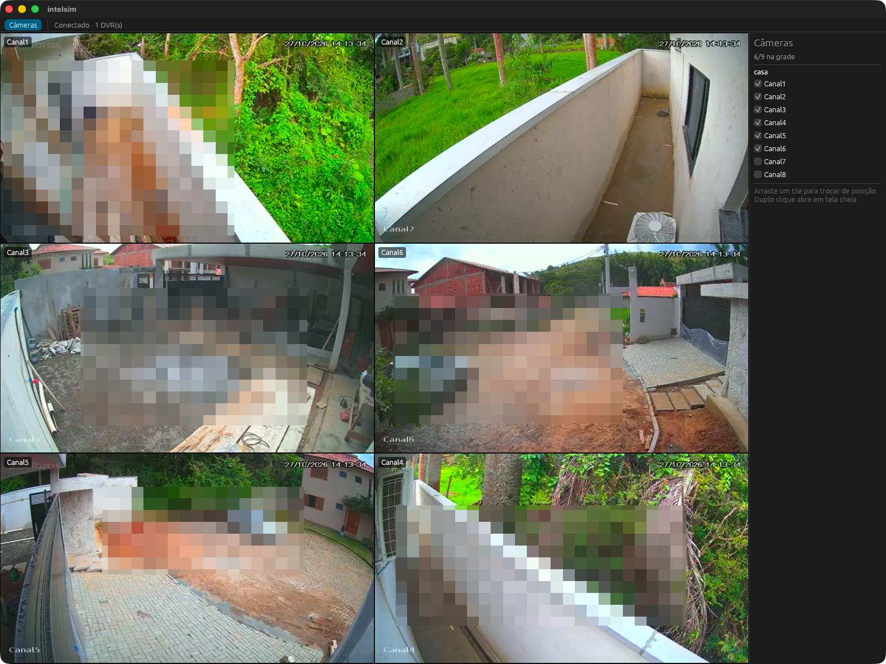
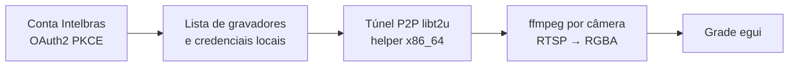

# Intel SIAM


Visualizador nativo de câmeras para gravadores Intelbras acessados pela nuvem, escrito em Rust. Substitui o SIMPlay
no dia a dia: abre direto nas câmeras que você escolheu, na ordem em que você as deixou.



## Funcionalidades

- **Grade de 1 a 12 câmeras.** Qualquer quantidade, não só quadrados: 6 câmeras ficam em 3×2 ou 2×3, de 10 a 12 em
  4×3 ou 3×4. A grade escolhe linhas e colunas pelo formato da janela.
- **Janela redimensionável.** Os tiles se rearranjam ao mudar o tamanho e mantêm a proporção 16:9.
- **Reordenar arrastando.** Arraste um tile sobre outro para trocar as posições.
- **Tela cheia por duplo clique.** Um duplo clique abre a câmera sozinha em alta resolução; outro volta à grade
  como estava.
- **Estado salvo.** As câmeras escolhidas, a ordem e a posição e o tamanho da janela voltam iguais na próxima
  abertura.
- **Login pela conta Intelbras.** O primeiro login é feito no navegador; depois o app renova a sessão sozinho. A lista
  de gravadores e câmeras vem da nuvem.
- **Leve na grade, nítido em tela cheia.** Os tiles usam o substream do gravador; a tela cheia usa o stream
  principal (1080p).
- **Reconexão automática.** Uma câmera que cai volta sozinha, sem afetar as outras. Senha recusada pelo gravador não
  gera novas tentativas, para não bloquear o usuário local.

## Como funciona



O túnel e cada câmera rodam como processos filhos supervisionados. Uma câmera com problema derruba só o próprio tile.
Detalhes em [docs/spec/viewer-architecture.md](docs/spec/viewer-architecture.md); requisitos em
[docs/spec/viewer.md](docs/spec/viewer.md); protocolo em [docs/protocol/](docs/protocol/).

## Requisitos

- macOS em Apple Silicon com Rosetta 2 (`softwareupdate --install-rosetta`). Linux vem a seguir; Windows depois.
- [Rust](https://rustup.rs) estável e as Command Line Tools do Xcode (para compilar o helper do túnel).
- `ffmpeg` (`brew install ffmpeg`).
- `libt2u.so`, a biblioteca de túnel do SIMPlay 1.4.1. Ela é da Intelbras e **não** vem neste repositório: copie-a da
  sua instalação do SIMPlay.

## Uso

O Intel SIAM não traz os segredos do SIMPlay. Copie `.env.example` para `.env`, preencha com os valores da sua
instalação do SIMPlay 1.4.1 e rode:

```sh
set -a; . ./.env; set +a
cargo run --release
```

Na primeira abertura, clique em **Entrar** e faça login com a sua conta Intelbras no navegador. Depois marque as
câmeras no painel **Câmeras**.

| Variável | Obrigatória | Conteúdo |
|---|---|---|
| `INTEL_SIAM_CLIENT_ID` | sim | `ClientId` OAuth do SIMPlay |
| `INTEL_SIAM_T2U_KEY` | sim | chave da nuvem P2P (`CLOUD_SERVER_KEY`) |
| `INTEL_SIAM_T2U_PASSWORD` | sim | senha da nuvem P2P (`CLOUD_SERVER_PWD`) |
| `INTEL_SIAM_LIBT2U` | não | caminho da `libt2u.so`; padrão `references/simplay-1.4.1/libt2u.so` no checkout |
| `INTEL_SIAM_FFMPEG` | não | caminho do `ffmpeg`; padrão `PATH`, depois `/opt/homebrew/bin/ffmpeg` |

Sem uma variável obrigatória, o app abre e mostra qual falta.

Token de sessão, layout e logs ficam em `~/Library/Application Support/intel-siam/`, fora do repositório.

### App para macOS

```sh
tools/package/macos.sh --install
install -m 600 .env ~/Library/Application\ Support/intel-siam/config.env
```

O script gera `Intel SIAM.app` com o ícone e o instala em `/Applications`. Aberto pelo Finder ou pelo Dock, o app
não recebe as variáveis do terminal; ele as lê de `config.env` na pasta de dados. Variáveis definidas no ambiente
têm prioridade.

## Roadmap

- Gravação contínua e por evento.
- Screenshots de uma câmera ou da grade.
- Envio de gravações e screenshots para o Google Drive.
- Análise com IA em tempo real.
- Reconhecimento facial.
- Áreas de detecção de carros com YOLO.
- Leitura de placas.
- Modo servidor por linha de comando, sem interface.
- Servidor MCP para consultar câmeras e eventos a partir de agentes de IA.
- Decodificação por hardware (VideoToolbox, VAAPI, D3D11VA).
- Empacotamento para macOS, depois Linux e Windows.

## Aviso

Projeto independente, sem relação com a Intelbras. Use apenas com gravadores e contas que são seus.

## Licença

[GPL-3.0](LICENSE).
