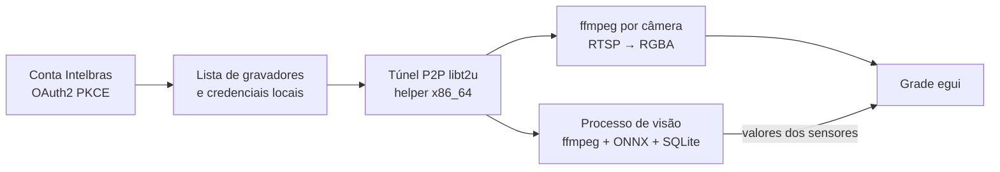

# Intel SIAM


Visualizador nativo de câmeras para gravadores Intelbras acessados pela nuvem, escrito em Rust. Substitui o SIMPlay
no dia a dia: abre direto nas câmeras que você escolheu, na ordem em que você as deixou.


## Funcionalidades

- **Grade de 1 a 12 câmeras.** Qualquer quantidade, não só quadrados: 6 câmeras ficam em 3×2 ou 2×3, de 10 a 12 em
  4×3 ou 3×4. A grade escolhe linhas e colunas pelo formato da janela.
- **Janela redimensionável.** Os tiles se rearranjam ao mudar o tamanho e mantêm a proporção 16:9.
- **Reordenar arrastando.** Arraste um tile sobre outro para trocar as posições.
- **Tela cheia por duplo clique.** Um duplo clique abre a câmera sozinha em alta resolução; outro volta à grade
  como estava.
- **Estado salvo.** As câmeras escolhidas, a ordem e a posição e o tamanho da janela voltam iguais na próxima
  abertura.
- **Login pela conta Intelbras.** O primeiro login é feito no navegador; depois o app renova a sessão sozinho. A lista
  de gravadores e câmeras vem da nuvem.
- **Leve na grade, nítido em tela cheia.** Os tiles usam o substream do gravador; a tela cheia usa o stream
  principal (1080p).
- **Reconexão automática.** Uma câmera que cai volta sozinha, sem afetar as outras. Senha recusada pelo gravador não
  gera novas tentativas, para não bloquear o usuário local.
- **Sensores de Estado.** No painel **Sensores**, crie um sensor de câmera do inventário ou URL RTSP/snapshot
  HTTP, desenhe um retângulo ou polígono e ensine até nove estados com botões ou teclas 1–9. O valor aparece
  no painel e no tile da câmera. Amostras podem ser corrigidas; a revisão e o histórico guardam as checagens.
  Inferência e armazenamento rodam num processo separado. O modelo é baixado após o primeiro ensino.
- **Sensores de Objetos e pessoas.** Escolha entre os 80 objetos do conjunto COCO (pessoa, carro, gato…) e o sensor
  diz, para cada um, se está presente e quantos há. Um objeto conta quando a base da caixa fica dentro da região.
  Ensine um rótulo próprio, como "Nosso carro", tocando na caixa dele ou desenhando-a; uma caixa errada é corrigida
  com um toque. Na dúvida entre o rótulo próprio e outro objeto da mesma classe, o sensor pergunta na revisão. Com
  o reconhecimento de rostos ligado, toque numa pessoa para dar nome ao rosto; a pessoa nomeada vale para todas as
  fontes, e um rosto de ninguém nomeado vira "pessoa desconhecida". O detector D-FINE S é baixado na criação do
  primeiro sensor de Objetos; as variantes N, M e L ficam nas configurações, e os modelos de rosto só baixam quando
  algum sensor reconhece rostos.
- **Sensores de Leitura.** Leia o medidor de água, gás ou energia, ou os minutos restantes da lavadora: desenhe uma
  caixa justa em volta do número e escolha o modo (contador que só sobe, valor qualquer ou tempo restante), o visor
  (automático, LED, LCD ou contador de rodas), a unidade e as casas decimais. O valor aparece com a unidade no tile
  e no painel, que mostra também a vazão de um contador. Um contador nunca desce nem pula: leitura abaixo do último
  valor ou acima do limite vai para a revisão, onde você confirma ou digita o valor certo; uma leitura um passo
  abaixo é a última roda girando e mantém o valor. O limite aprende com os dias de uso. Os leitores PP-OCRv6 e de
  rodas são baixados no primeiro uso.
- **Botões na cor primária.** Todo botão usa o verde do ícone: verde vivo quando ligado, verde escuro quando
  desligado. Valores e regras em [docs/design/visual.md](docs/design/visual.md).

## Como funciona



O túnel e cada câmera rodam como processos filhos supervisionados. Uma câmera com problema derruba só o próprio tile.
Os sensores rodam no processo `intel-siam-vision`, também supervisionado: ele abre os próprios decoders, um por fonte
com sensor, roda os modelos ONNX só na CPU e guarda sensores, amostras e histórico num SQLite próprio. Se ele cair, a
grade continua. Detalhes em [docs/spec/viewer-architecture.md](docs/spec/viewer-architecture.md) e
[docs/spec/sensors-architecture.md](docs/spec/sensors-architecture.md); requisitos em
[docs/spec/viewer.md](docs/spec/viewer.md); protocolo em [docs/protocol/](docs/protocol/).

## Requisitos

- macOS em Apple Silicon com Rosetta 2 (`softwareupdate --install-rosetta`). Linux vem a seguir; Windows depois.
- [Rust](https://rustup.rs) estável e as Command Line Tools do Xcode (para compilar o helper do túnel).
- `ffmpeg` (`brew install ffmpeg`).
- `libt2u.so`, a biblioteca de túnel do SIMPlay 1.4.1. Ela é da Intelbras e **não** vem neste repositório: copie-a da
  sua instalação do SIMPlay.
- Internet no primeiro uso de cada tipo de sensor, para baixar os modelos (conferidos por SHA-256). Depois, tudo roda
  local.

## Uso

O Intel SIAM não traz os segredos do SIMPlay. Copie `.env.example` para `.env`, preencha com os valores da sua
instalação do SIMPlay 1.4.1 e rode:

```sh
set -a; . ./.env; set +a
cargo build --release
cargo run --release
```

Na primeira abertura, clique em **Entrar** e faça login com a sua conta Intelbras no navegador. Depois marque as
câmeras no painel **Câmeras**.

Em **Sensores**, escolha **Novo sensor** e o tipo **Estado**, **Objetos** ou **Leitura**. A região nasce como o
quadro inteiro. Na aba **Ao vivo**, arraste um retângulo ou clique nos pontos de um polígono, feche-o e salve a
região. Num sensor de Estado, ensine quadros diferentes para pelo menos dois estados. Num sensor de Objetos, a prévia
mostra o último quadro checado com as caixas; em **Ensinar caixas**, toque numa caixa ou arraste em volta de algo que
o detector não achou e diga o que ela é. Num sensor de Leitura, que usa o stream Main por padrão, a caixa vai justa
em volta do número, e a aba mostra o que o leitor viu, a última leitura e a qualidade. As configurações do painel
controlam a retenção do histórico, o detector, o reconhecedor de rostos e o leitor de números; amostras e caixas
ensinadas não expiram.
Uma câmera usada só por sensores não precisa estar na grade. URL avulsa aparece apenas no painel.
As [evidências de verificação dos sensores](docs/spec/sensors-ui-verification.md) registram o smoke e seus limites.

| Variável | Obrigatória | Conteúdo |
|---|---|---|
| `INTEL_SIAM_CLIENT_ID` | sim | `ClientId` OAuth do SIMPlay |
| `INTEL_SIAM_T2U_KEY` | sim | chave da nuvem P2P (`CLOUD_SERVER_KEY`) |
| `INTEL_SIAM_T2U_PASSWORD` | sim | senha da nuvem P2P (`CLOUD_SERVER_PWD`) |
| `INTEL_SIAM_LIBT2U` | não | caminho da `libt2u.so`; padrão `references/simplay-1.4.1/libt2u.so` no checkout |
| `INTEL_SIAM_FFMPEG` | não | caminho do `ffmpeg`; padrão `PATH`, depois `/opt/homebrew/bin/ffmpeg` |

Sem uma variável obrigatória, o app abre e mostra qual falta.

Token de sessão, layout, logs, sensores e modelos baixados (`sensors/`) ficam em
`~/Library/Application Support/intel-siam/`, fora do repositório.

### App para macOS

```sh
tools/package/macos.sh --install
install -m 600 .env ~/Library/Application\ Support/intel-siam/config.env
```

O script gera `Intel SIAM.app` com o ícone e os dois executáveis (`intel-siam` e `intel-siam-vision`) e o instala em
`/Applications`. Aberto pelo Finder ou pelo Dock, o app
não recebe as variáveis do terminal; ele as lê de `config.env` na pasta de dados. Variáveis definidas no ambiente
têm prioridade.

## Roadmap

- Gravação contínua e por evento.
- Screenshots de uma câmera ou da grade.
- Envio de gravações e screenshots para o Google Drive.
- Leitura de placas e de texto livre.
- Publicação MQTT dos valores dos sensores.
- Modo servidor por linha de comando, sem interface.
- Servidor MCP para consultar câmeras e eventos a partir de agentes de IA.
- Decodificação por hardware (VideoToolbox, VAAPI, D3D11VA).
- Empacotamento para macOS, depois Linux e Windows.

## Aviso

Projeto independente, sem relação com a Intelbras. Use apenas com gravadores e contas que são seus.

## Licença

[GPL-3.0](LICENSE).
