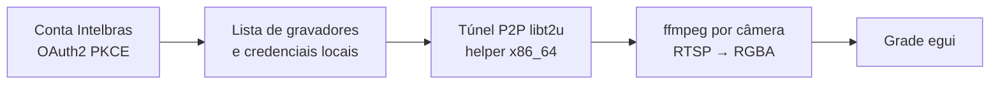

# Destilação: sensores do VisionState (estados, objetos e pessoas, leituras)

Destilação da funcionalidade "sensores" do VisionState para o Intel SIAM: os três tipos de sensor e cada
possibilidade que o README da origem descreve para eles. Os trechos foram copiados das linhas citadas; as menções
nas outras seções caem dentro deles.

## Origem

- **Sistema:** VisionState, app do Home Assistant que transforma câmeras em sensores com IA local
  (`oleost/VisionState`).
- **Onde está:** `references/VisionState`, pasta fora do git do projeto (o `.gitignore` do Intel SIAM ignora
  `/references/`).
- **Tipo:** repositório próprio. `git -C references/VisionState rev-parse --show-toplevel` devolve a própria pasta,
  e o índice do projeto não tem entrada `160000` para ela (não é submodule).
- **Versão:** commit `3815ef6d32846f966f9118d79fff6a32c6ead704` ("Merge pull request #56 from
  oleost/promote/0.11.0", 2026-10-27), app na versão `0.11.0` (`visionstate/config.yaml`). `git status` da pasta
  sem alterações: os ponteiros valem para esse commit.
- **Stack da origem:** Python 3.14, FastAPI, SQLite, asyncio, ONNX Runtime só em CPU, MQTT para o Home Assistant;
  frontend Svelte (ver `references/VisionState/docs/ARCHITECTURE.md:23-27`).

## Mapa da funcionalidade

Um sensor é uma linha do banco com câmera, região, intervalo e o tipo, escolhido na criação e nunca trocado
(`references/VisionState/visionstate/backend/visionstate/settings.py:31-40`). A cada passada o laço do sensor lê um retrato da linha (`references/VisionState/visionstate/backend/visionstate/engine/state.py:34-57`),
decide se é hora de checar, pega um frame, recorta a região, entrega ao tipo e publica. O fluxo resumido pela
própria origem está em `references/VisionState/docs/ARCHITECTURE.md:103-122`.

### Por onde o dado entra

| Seam | O que entra | Menção |
|---|---|---|
| Configuração | retrato da linha do sensor, com os JSON (`triggers`, `objects`, `reading`) preenchidos pelos padrões | `references/VisionState/visionstate/backend/visionstate/engine/state.py:34-57` |
| Fonte do frame | um JPEG/PNG por checagem: entidade de câmera do HA, URL de snapshot HTTP ou RTSP | `references/VisionState/visionstate/backend/visionstate/sources.py:20-24`, `references/VisionState/visionstate/backend/visionstate/sources.py:239-246` |
| Quando checar | intervalo regular, burst depois de gatilho, recheck de objeto sumido, sonda de mudança | `references/VisionState/visionstate/backend/visionstate/engine/logic.py:151-177`, `references/VisionState/visionstate/backend/visionstate/settings.py:388-408` |
| Gatilho por entidade | mudança de estado de uma entidade do HA (opcionalmente só para um estado) inicia um burst | `references/VisionState/visionstate/backend/visionstate/engine/runtime.py:215-231` |
| Detecção de mudança | miniatura cinza 48×48 da região comparada com a da última checagem; acima do limiar, checa e inicia burst | `references/VisionState/visionstate/backend/visionstate/engine/checks.py:165-203` |
| Comandos | botão "check now" e chave de pausa, vindos do HA por MQTT | `references/VisionState/visionstate/backend/visionstate/engine/publishing.py:125-149` |
| Luz | liga uma lâmpada/switch do HA antes do frame, descarta frames enquanto aquece | `references/VisionState/visionstate/backend/visionstate/engine/checks.py:85-105`, `references/VisionState/visionstate/backend/visionstate/engine/checks.py:107-129` |
| Ensino | amostras rotuladas (estados), caixas ensinadas (objetos), rostos nomeados (pessoas), respostas da revisão | `references/VisionState/visionstate/backend/visionstate/engine/training.py:202-221`, `references/VisionState/visionstate/backend/visionstate/teach.py:170-215`, `references/VisionState/visionstate/backend/visionstate/engine/faces.py:478-512` |

### Por onde o dado passa

| Seam | O que acontece | Menção |
|---|---|---|
| Laço por sensor | uma tarefa por sensor; exceção é registrada uma vez e o laço tenta de novo depois | `references/VisionState/visionstate/backend/visionstate/engine/checks.py:29-51`, `references/VisionState/visionstate/backend/visionstate/engine/checks.py:53-83` |
| Uma checagem | frame (com luz ou não), decodificação, câmera indisponível vira `offline`, despacho por tipo | `references/VisionState/visionstate/backend/visionstate/engine/checks.py:209-243`, `references/VisionState/visionstate/backend/visionstate/engine/checks.py:244-263` |
| Região | recorte retangular; polígono tem o lado de fora pintado com a cor neutra | `references/VisionState/visionstate/backend/visionstate/imaging.py:154-173` |
| Estados | embedding DINOv2 da região → classificador por sensor → limiar → debounce | `references/VisionState/visionstate/backend/visionstate/engine/checks.py:265-301`, `references/VisionState/visionstate/backend/visionstate/engine/checks.py:353-360`, `references/VisionState/visionstate/backend/visionstate/engine/state.py:144-161` |
| Treino de estados | amostra rotulada agenda um retreino; cliques próximos viram um só treino | `references/VisionState/visionstate/backend/visionstate/engine/training.py:46-70`, `references/VisionState/visionstate/backend/visionstate/classifier.py:180-196` |
| Objetos | detector COCO com margem → filtro por região e tamanho → caixas ensinadas → rostos → trilhas on/off | `references/VisionState/visionstate/backend/visionstate/engine/models.py:172-185`, `references/VisionState/visionstate/backend/visionstate/engine/logic.py:114-142`, `references/VisionState/visionstate/backend/visionstate/engine/objects.py:30-68`, `references/VisionState/visionstate/backend/visionstate/engine/logic.py:71-111` |
| Rótulos próprios | caixa comparada por similaridade de cosseno com as ensinadas; ganha rótulo, é filtrada ou vira pergunta | `references/VisionState/visionstate/backend/visionstate/teach.py:127-143`, `references/VisionState/visionstate/backend/visionstate/teach.py:170-215`, `references/VisionState/visionstate/backend/visionstate/teach.py:216-232` |
| Pessoas | rosto procurado nas caixas de pessoa, filtro de qualidade, comparação com os rostos de todos os sensores | `references/VisionState/visionstate/backend/visionstate/engine/faces.py:377-407`, `references/VisionState/visionstate/backend/visionstate/engine/faces.py:427-456`, `references/VisionState/visionstate/backend/visionstate/faces.py:380-406`, `references/VisionState/visionstate/backend/visionstate/faces.py:499-520` |
| Leituras | tamanho da imagem conferido → leitor (rodas ou OCR por tipo de display) → parse → limite do contador → veredito → debounce | `references/VisionState/visionstate/backend/visionstate/engine/reading.py:32-72`, `references/VisionState/visionstate/backend/visionstate/engine/reading.py:73-99`, `references/VisionState/visionstate/backend/visionstate/engine/models.py:152-170` |
| Plausibilidade | contador não desce nem sobe além do limite aprendido; leitura um passo abaixo é "assentando" | `references/VisionState/visionstate/backend/visionstate/engine/logic.py:217-242`, `references/VisionState/visionstate/backend/visionstate/readers.py:610-643`, `references/VisionState/visionstate/backend/visionstate/change_limit.py:73-90` |

### Por onde o dado sai

| Seam | O que sai | Menção |
|---|---|---|
| Tópicos MQTT | estado, atributos, confiança, imagem, disponibilidade, comandos; diagnósticos das leituras | `references/VisionState/visionstate/backend/visionstate/mqtt.py:37-64` |
| Entidades comuns | "Last frame", botão de checar agora e chave "Enabled", em todo sensor | `references/VisionState/visionstate/backend/visionstate/mqtt.py:78-123` |
| Entidades por tipo | estado `enum` + confiança; `occupancy` + contagem por classe; valor com unidade, classe e `total_increasing` | `references/VisionState/visionstate/backend/visionstate/mqtt.py:181-221`, `references/VisionState/visionstate/backend/visionstate/mqtt.py:224-231`, `references/VisionState/visionstate/backend/visionstate/mqtt.py:277-288`, `references/VisionState/visionstate/backend/visionstate/mqtt.py:291-319` |
| Pessoas | "<nome> seen by" e "<nome> last seen" no dispositivo VisionState | `references/VisionState/visionstate/backend/visionstate/mqtt.py:428-452`, `references/VisionState/visionstate/backend/visionstate/engine/faces.py:304-321` |
| Histórico e revisão | linha `Prediction` com o frame quando o valor muda ou o frame vai para a fila | `references/VisionState/visionstate/backend/visionstate/engine/checks.py:303-323`, `references/VisionState/visionstate/backend/visionstate/engine/objects.py:174-195`, `references/VisionState/visionstate/backend/visionstate/engine/reading.py:226-249` |

### Cada possibilidade do README

| README | Onde no código |
|---|---|
| Estados: porta aberta, fechada ou entreaberta; até 9 estados (`references/VisionState/README.md:34-38`) | `references/VisionState/visionstate/backend/visionstate/settings.py:451`, `references/VisionState/visionstate/backend/visionstate/engine/checks.py:265-301` |
| "Clique alguns exemplos de cada estado; aprende em cerca de um segundo" (`references/VisionState/README.md:38`) | `references/VisionState/visionstate/backend/visionstate/engine/training.py:202-221`, `references/VisionState/visionstate/backend/visionstate/settings.py:595-599`, `references/VisionState/visionstate/backend/visionstate/engine/training.py:46-70`, `references/VisionState/visionstate/backend/visionstate/classifier.py:180-196` |
| Estado com confiança, último frame, botão de checar agora, chave de pausa (`references/VisionState/README.md:92`) | `references/VisionState/visionstate/backend/visionstate/mqtt.py:78-123`, `references/VisionState/visionstate/backend/visionstate/mqtt.py:181-221` |
| 80 objetos sem treino (`references/VisionState/README.md:44`) | `references/VisionState/visionstate/backend/visionstate/detectors.json:1-21` (o conjunto `coco` tem 80 rótulos, contados no arquivo), `references/VisionState/visionstate/backend/visionstate/settings.py:42-64` |
| Vários objetos ao mesmo tempo, "um gato e uma bicicleta" (`references/VisionState/README.md:42`) | `references/VisionState/visionstate/backend/visionstate/engine/logic.py:71-111` |
| "Nosso carro" distinto de qualquer carro (`references/VisionState/README.md:42`, `references/VisionState/README.md:47-48`) | `references/VisionState/visionstate/backend/visionstate/engine/state.py:85-90`, `references/VisionState/visionstate/backend/visionstate/teach.py:170-215`, `references/VisionState/visionstate/backend/visionstate/settings.py:229-262` |
| "Tom está em casa": nomeia o rosto uma vez, toda câmera reconhece (`references/VisionState/README.md:42-44`) | `references/VisionState/visionstate/backend/visionstate/engine/state.py:131-141`, `references/VisionState/visionstate/backend/visionstate/engine/faces.py:478-512`, `references/VisionState/visionstate/backend/visionstate/faces.py:499-520` |
| Pessoa desconhecida na porta (`references/VisionState/README.md:42`) | `references/VisionState/visionstate/backend/visionstate/settings.py:375-378`, `references/VisionState/visionstate/backend/visionstate/engine/faces.py:478-512` |
| Rostos desligados até ligar por câmera (`references/VisionState/README.md:157-158`) | `references/VisionState/visionstate/backend/visionstate/settings.py:288-296` |
| Liga/desliga e contagem por objeto, pessoa e rótulo próprio (`references/VisionState/README.md:93`) | `references/VisionState/visionstate/backend/visionstate/mqtt.py:181-221`, `references/VisionState/visionstate/backend/visionstate/engine/objects.py:69-104` |
| Medidor de água, gás ou energia; minutos restantes da lavadora (`references/VisionState/README.md:58`) | `references/VisionState/visionstate/backend/visionstate/settings.py:66-88`, `references/VisionState/visionstate/backend/visionstate/readers.py:566-585` |
| Desenhar uma caixa em volta do número (`references/VisionState/README.md:60`, `references/VisionState/README.md:65`) | `references/VisionState/visionstate/backend/visionstate/engine/models.py:152-170` |
| Contador só sobe e cai no painel de Energia (`references/VisionState/README.md:60`, `references/VisionState/README.md:67-68`) | `references/VisionState/visionstate/backend/visionstate/readers.py:610-643`, `references/VisionState/visionstate/backend/visionstate/mqtt.py:291-319` |
| Rodas de medidor mecânico, inclusive roda entre dois dígitos (`references/VisionState/README.md:65-66`, `references/VisionState/README.md:72-73`) | `references/VisionState/visionstate/backend/visionstate/engine/models.py:152-170`, `references/VisionState/visionstate/backend/visionstate/readers.py:610-643`, `references/VisionState/visionstate/backend/visionstate/settings.py:66-88` |
| Dígitos de display LCD ou LED (`references/VisionState/README.md:66`) | `references/VisionState/visionstate/backend/visionstate/readers.py:222-242` |
| Cada valor conferido antes de publicar: não desce nem pula (`references/VisionState/README.md:66-67`) | `references/VisionState/visionstate/backend/visionstate/engine/logic.py:217-242`, `references/VisionState/visionstate/backend/visionstate/change_limit.py:1-13`, `references/VisionState/visionstate/backend/visionstate/change_limit.py:73-90` |
| Vazão opcional (m³/h, kW) (`references/VisionState/README.md:68`) | `references/VisionState/visionstate/backend/visionstate/settings.py:146-164`, `references/VisionState/visionstate/backend/visionstate/engine/reading.py:251-272`, `references/VisionState/visionstate/backend/visionstate/readers.py:663-677` |
| Liga uma luz em armário escuro (`references/VisionState/README.md:68-69`) | `references/VisionState/visionstate/backend/visionstate/engine/checks.py:85-105`, `references/VisionState/visionstate/backend/visionstate/engine/checks.py:107-129` |
| Câmera a bateria dispara a checagem quando tem foto nova (`references/VisionState/README.md:69`) | `references/VisionState/visionstate/backend/visionstate/settings.py:388-408`, `references/VisionState/visionstate/backend/visionstate/engine/runtime.py:215-231` |
| Só a região importa (`references/VisionState/README.md:81`) | `references/VisionState/visionstate/backend/visionstate/imaging.py:154-173`, `references/VisionState/visionstate/backend/visionstate/engine/logic.py:114-142` |
| Checa quando algo acontece: movimento, contato de porta, mudança na imagem (`references/VisionState/README.md:82`) | `references/VisionState/visionstate/backend/visionstate/engine/logic.py:151-177`, `references/VisionState/visionstate/backend/visionstate/engine/checks.py:165-203` |
| Melhora com o uso: fila de revisão, caixas corrigidas, rótulos suspeitos (`references/VisionState/README.md:83`) | `references/VisionState/visionstate/backend/visionstate/engine/logic.py:13-31`, `references/VisionState/visionstate/backend/visionstate/engine/objects.py:174-195`, `references/VisionState/visionstate/backend/visionstate/classifier.py:180-196` |
| Modelos: DINOv2, D-FINE, YuNet + SFace/AuraFace, PaddleOCR + leitor de rodas (`references/VisionState/README.md:140-149`) | `references/VisionState/visionstate/backend/visionstate/engine/checks.py:353-360`, `references/VisionState/visionstate/backend/visionstate/engine/models.py:152-170`, `references/VisionState/visionstate/backend/visionstate/engine/models.py:172-185` |

## Ponteiros verificáveis

### O README e o fluxo

`references/VisionState/README.md:32-49`

````markdown
## Three kinds of sensor

### 🚪 States

*Garage door open, closed or halfway*, the gate shut, the lights on in the shed.

Click a few examples of each state; it learns in about a second.

### 🧍 Objects & people

*Tom is home*, *our car is in the driveway*, a cat and a bicycle on it, an unknown person at the door.

Pick from 80 objects — no training. Name people by their face once; every camera knows them.

<p align="center">
  <br>
  <em>Tom recognised by his face, and our own car told apart from any other car.</em>
</p>
````

`references/VisionState/README.md:56-74`

````markdown
### 🔢 Readings

*The water, gas or power meter*, the minutes left on the washer.

Draw a box around the number. Counters only go up and land in the Energy dashboard.

## Read a water, gas or power meter with an ESP32-CAM

Put an ESP32-CAM (or any camera) above the meter, add it to Home Assistant with ESPHome or use its
snapshot URL, and draw a box around the digits. VisionState reads the rolling wheels of a
mechanical water or gas meter and the digits of an LCD or LED power meter, checks every value
before it is published (a counter never goes down or jumps), and the total lands in the Energy
dashboard — with a rate (m³/h, kW) if you want one. For a dark meter cabinet it switches a light
on for each reading; a battery camera can trigger a check when it has a new picture.

<p align="center">
  <br>
  <em>The rolling wheels of a real water meter, read right even while a wheel is half way between two digits.</em>
</p>
````

`references/VisionState/README.md:76-83`

````markdown
## Highlights

- 🧠 **100 % local on any CPU** — Intel, AMD, Raspberry Pi 4/5. No cloud, no GPU, no subscription, no telemetry.
- 🏠 **Native Home Assistant** — a sidebar app; every sensor is a normal device through MQTT discovery.
- 🎥 **Any camera** — every `camera.*` entity (an ESP32-CAM with ESPHome, Reolink, Frigate …), or an RTSP / HTTP snapshot URL.
- 🎯 **Watch only what matters** — draw a region around the door or the driveway; the rest is ignored.
- ⚡ **Checks when something happens** — on motion, a door contact or a change in the image, and can switch on a light for a camera in the dark.
- 🔁 **Gets better as you use it** — unsure frames go to a review queue, wrong boxes are fixed with a tap, and suspicious labels are flagged.
````

`references/VisionState/README.md:92-93`

````markdown
- **State sensor** — the state with its confidence, the last frame, a button to check now and a switch to pause it.
- **Object sensor** — an on/off sensor and a count for every object, person and own label.
````

`references/VisionState/README.md:128-149`

````markdown
## How it works

```
camera
 ▼  your region
 ▼  pretrained model (ONNX, CPU)
 ▼  small per-sensor model
 ▼  debounce
 ▼  MQTT
Home Assistant
```

- **States:** [DINOv2](https://github.com/facebookresearch/dinov2) turns the region into a feature
  vector; a tiny classifier per sensor, trained on *your* examples, picks the state.
- **Objects:** [D-FINE](https://github.com/Peterande/D-FINE) finds the COCO objects; boxes you
  corrected or gave an own label teach it your camera.
- **Faces:** [YuNet](https://github.com/opencv/opencv_zoo) finds a face on each person, and only a
  clear one is compared ([SFace](https://github.com/opencv/opencv_zoo), or
  [AuraFace](https://huggingface.co/fal/AuraFace-v1) on a fast PC) with the faces you named.
- **Readings:** [PaddleOCR](https://github.com/PaddlePaddle/PaddleOCR) reads digits; mechanical
  counters use a small wheel reader made for VisionState ([`tools/wheelreader`](tools/wheelreader)).
  Every value is checked before it is published.
````

`references/VisionState/README.md:157-158`

````markdown
- Face recognition is off until you turn it on for a camera; faces are kept in the app's own
  storage and exported only if you tick it (a backup holds them unless you untick it).
````

`references/VisionState/README.md:167-172`

````markdown
## Licence

[Apache-2.0](LICENSE). Bundled models: DINOv2 (Meta), D-FINE, PaddleOCR PP-OCRv6 and the
VisionState wheel reader, all Apache-2.0. Face models, downloaded only when a camera recognises
faces: YuNet (MIT), SFace or AuraFace (Apache-2.0). The screenshots use CC0 and public-domain
images.
````

`references/VisionState/docs/ARCHITECTURE.md:23-27`

````markdown
**Stack:** Python 3.14, FastAPI, uvicorn, SQLAlchemy (SQLite), asyncio; ONNX Runtime (CPU only),
NumPy, Pillow, PyAV (bundled FFmpeg); aiomqtt, websockets, httpx. Frontend: Svelte 5 +
Vite + TypeScript, plain CSS with design tokens, a hash router (Ingress-safe), bundled fonts. Docker
image `python:3.14-slim`, built by GitHub Actions and published on GHCR. Quality: pytest (with a fake
camera, Home Assistant and MQTT), ruff, pyright, svelte-check, Playwright, an image smoke test.
````

`references/VisionState/docs/ARCHITECTURE.md:103-122`

````markdown
## How one check flows

```
sensor loop (checks._sensor_loop)          woken by: its interval, a trigger entity (runtime),
  │                                        change detection (checks.probe), the UI, an MQTT command
  ├─ load_sensor → SensorConfig            a fresh snapshot of the row, every pass
  ├─ light on? (checks._light_before)      lights.py, frames thrown away while it warms up
  ├─ grab a frame (sources.FrameGrabber)   → LiveState.frames (the UI labels these)
  ├─ decode (imaging.decode)
  └─ by kind:
      state sensor   → checks._run_states  backbone embedding → head → probabilities
      object sensor  → objects._run_objects detector → taught boxes (teaching) → faces → tracks (logic)
      reading sensor → reading._run_reading reader → parse → plausibility (change_limit) → debounce
        │
        ├─ publish (publishing._send → mqtt.MqttBridge.publish)   state, attributes, image
        └─ history: a Prediction row + frame, when the value changed or the frame goes to review
```

A camera problem makes the sensor *unavailable* (its availability topic `offline`); any other
error is kept in `LiveState.error` and shown in the UI.
````


### Tipos, configuração e laço

`references/VisionState/visionstate/backend/visionstate/settings.py:19-29`

````python
SENSOR_DEFAULTS = {
    "interval_s": 10.0,  # seconds between classifications
    "threshold": 0.70,  # below this confidence the sensor reports UNKNOWN_STATE
    "debounce": 2,  # consecutive matching results required before the state changes
}
SENSOR_LIMITS = {
    "interval_s": (1.0, 3600.0),
    "threshold": (0.0, 1.0),
    "debounce": (1, 20),
}
UNKNOWN_STATE = "unknown"
````

`references/VisionState/visionstate/backend/visionstate/settings.py:31-40`

````python
# --- Sensor kinds ---------------------------------------------------------------------
#
# "single_state": learns the user's own states from labelled examples (one state at a time).
# "objects": finds common objects (people, cars, animals …) with a pretrained detector, no training.
# The kind is chosen when the sensor is created and never changes.

KIND_STATES = "single_state"
KIND_OBJECTS = "objects"
KIND_READING = "reading"  # a number read from a display or counter (OCR), no training
SENSOR_KINDS = (KIND_STATES, KIND_OBJECTS, KIND_READING)
````

`references/VisionState/visionstate/backend/visionstate/settings.py:451`

````python
MAX_STATES = 9  # keys 1-9 in the UI
````

`references/VisionState/visionstate/backend/visionstate/settings.py:595-599`

````python
RUNTIME = {
    "max_concurrent_inferences": 2,
    "inference_threads": 0,  # threads per model run (backbones.cpu_session); 0: one per physical core
    "frame_cache_size": 5,  # recent frames kept per sensor so a label hits the frame the user saw
    "retrain_delay_s": 1.0,  # coalesce rapid label clicks into one retrain
````

`references/VisionState/visionstate/backend/visionstate/engine/state.py:34-57`

````python
@dataclass
class SensorConfig:
    """Plain snapshot of a sensor row, safe to use outside a DB session."""

    id: int
    slug: str
    name: str
    source_type: str
    source: str
    roi: dict | None
    interval_s: float
    threshold: float
    debounce: int
    enabled: bool
    states: list[dict]
    triggers: dict = field(default_factory=lambda: merge_triggers(None))
    review: dict = field(default_factory=dict)  # sensor overrides only; see Runtime.review_rules
    kind: str = KIND_STATES
    objects: dict = field(default_factory=lambda: merge_objects(None))  # object sensors only
    reading: dict = field(default_factory=lambda: merge_reading(None))  # reading sensors only
    entity_prefix: bool = False  # see db.Sensor.entity_prefix
    publish: bool = True  # see db.Sensor.publish
    frame_size: list | None = None  # see db.Sensor.frame_size

````

`references/VisionState/visionstate/backend/visionstate/engine/state.py:85-90`

````python
    @property
    def object_keys(self) -> list[str]:
        """What an object sensor reports: its classes, then its own labels (and, recognising
        faces, the unknown person)."""
        unknown = [FACE_UNKNOWN_KEY] if self.faces_on else []
        return [*self.objects["classes"], *(label["key"] for label in self.custom_labels), *unknown]
````

`references/VisionState/visionstate/backend/visionstate/engine/checks.py:29-51`

````python
    async def _sensor_loop(self, sensor_id: int) -> None:
        event = self._wake[sensor_id]
        last_error = ""
        while True:
            try:
                timeout = await self._sensor_step(sensor_id)
            except asyncio.CancelledError:
                raise
            except Exception as err:  # noqa: BLE001 - e.g. the database is busy: keep the sensor alive
                error = redact(str(err)) or type(err).__name__
                if error != last_error:
                    log.exception("Sensor %s: check loop failed", sensor_id)
                last_error = error
                timeout = RUNTIME["loop_retry_s"]
            else:
                last_error = ""
            if timeout is False:
                return  # the sensor was deleted
            try:
                await asyncio.wait_for(event.wait(), timeout=timeout)
            except TimeoutError:
                pass
            event.clear()
````

`references/VisionState/visionstate/backend/visionstate/engine/checks.py:53-83`

````python
    async def _sensor_step(self, sensor_id: int) -> float | None | bool:
        """One pass of a sensor's loop: check when due. Returns how long to sleep (None: until
        woken), or False when the sensor no longer exists."""
        cfg = await asyncio.to_thread(self.load_sensor, sensor_id)
        if cfg is None:
            return False
        live = self.live_state(sensor_id)
        due_at, kind = next_check_at(cfg, live, time.time())
        if not cfg.enabled and not live.force_paused:
            live.force = False  # paused: no check after a retrain or a model change, only when asked
        if live.force or (cfg.enabled and due_at <= time.time()):
            forced, live.force, live.force_paused = live.force, False, False
            try:
                if forced or kind == "full":
                    await self.run_once(cfg)
                    await asyncio.to_thread(backbones.trim_memory)
                else:
                    await self.probe(cfg)
                live.failure = ""
            except asyncio.CancelledError:
                raise
            except Exception as err:  # noqa: BLE001
                live.error = redact(str(err)) or type(err).__name__
                if live.error != live.failure:
                    # Camera problems are handled in run_once: this is unexpected, keep the traceback
                    # (once, not for every check while it keeps failing).
                    log.exception("Sensor %s failed: %s", cfg.slug, live.error)
                live.failure = live.error
            due_at, _ = next_check_at(cfg, live, time.time())
        timeout = max(0.05, due_at - time.time()) if cfg.enabled else cfg.interval_s
        return None if math.isinf(timeout) else timeout  # no regular check: sleep until woken
````

`references/VisionState/visionstate/backend/visionstate/engine/checks.py:209-243`

````python
    async def run_once(
        self,
        cfg: SensorConfig,
        data: bytes | None = None,
        image: Image.Image | None = None,
        frame_id: str | None = None,
    ) -> None:
        """One check: take a frame (or use the one given), then hand it to the sensor's kind.

        A frame the camera could not deliver makes the sensor unavailable in Home Assistant.
        Without a light, the frame also becomes the baseline of change detection.
        """
        live = self.live_state(cfg.id)
        t = topics(cfg.slug)
        live.last_run = time.time()
        lit = False  # the frame was taken with the sensor's light on
        try:
            if data is None:
                wait = await self._light_before(cfg)
                try:
                    if wait is None:
                        frame_id, data = await self.grab(cfg)
                    else:
                        frame_id, data = await self._grab_in_light(cfg, wait)
                        lit = True
                finally:
                    self._light_after(cfg)
            if image is None:
                image = await asyncio.to_thread(imaging.decode, data)
        except (SourceError, OSError) as err:
            if live.available is not False:
                log.warning("Sensor %s: camera unavailable: %s", cfg.slug, err)
            live.available, live.error = False, redact(str(err))
            await self._send(cfg, t["availability"], "offline", retain=True)
            return
````

`references/VisionState/visionstate/backend/visionstate/engine/checks.py:244-263`

````python
        live.available, live.error = True, ""
        # Change detection compares frames without the light (probe), so a frame taken in the
        # light is no baseline for it: every probe would look like a change.
        if not lit:
            signature = await asyncio.to_thread(imaging.region_signature, image, cfg.roi)
            if live.signature is not None:
                live.change_score = imaging.change_score(live.signature, signature)
            live.signature = signature
        await self._send(cfg, t["availability"], "online", retain=True)
        if cfg.is_objects:
            live.analysed.append((frame_id, data))
            # The frame on screen changes together with its boxes, once they are found (the UI
            # draws the boxes of live.detections on live.frame_id).
            await self._run_objects(cfg, image, frame_id)
            return
        live.frame_id = frame_id
        if cfg.is_reading:
            await self._run_reading(cfg, image, lit)
            return
        await self._run_states(cfg, image)
````

`references/VisionState/visionstate/backend/visionstate/imaging.py:154-173`

````python
def crop(image: Image.Image, roi: dict | None) -> Image.Image:
    """The region of ``image`` (all of it without one); a polygon's outside is painted neutral."""
    roi = normalise_roi(roi)
    if roi is None:
        return image
    width, height = image.size
    box = (
        int(roi["x"] * width),
        int(roi["y"] * height),
        int((roi["x"] + roi["w"]) * width),
        int((roi["y"] + roi["h"]) * height),
    )
    cropped = image.crop(box)
    if not roi.get("points"):
        return cropped
    # Polygon: keep the inside, paint the rest of the bounding box neutral.
    polygon = [(p[0] * width - box[0], p[1] * height - box[1]) for p in roi["points"]]
    mask = Image.new("L", cropped.size, 0)
    ImageDraw.Draw(mask).polygon(polygon, fill=255)
    return Image.composite(cropped, Image.new("RGB", cropped.size, NEUTRAL_FILL), mask)
````

`references/VisionState/visionstate/backend/visionstate/sources.py:20-24`

````python
SOURCE_TYPES = {
    "ha_camera": "Home Assistant camera",
    "http": "HTTP snapshot URL",
    "rtsp": "RTSP stream",
}
````

`references/VisionState/visionstate/backend/visionstate/sources.py:239-246`

````python
    async def grab(self, source_type: str, source: str) -> bytes:
        check_source(source_type, source)
        try:
            if source_type == "ha_camera":
                return await self.ha.snapshot(source)
            if source_type == "http":
                return await self._get_limited(source)
            return await asyncio.get_running_loop().run_in_executor(self._rtsp, self._grab_stream, source)
````


### Gatilhos, sonda de mudança, luz e comandos

`references/VisionState/visionstate/backend/visionstate/settings.py:388-408`

````python
TRIGGER_DEFAULTS = {
    # The regular interval check. Off = the sensor only checks when triggered (an entity, a change
    # in the image, the "check now" button) and once after start-up.
    "regular": True,
    "entities": [],  # Home Assistant entity ids that trigger a check when their state changes
    # entity id -> the only new state that triggers (e.g. "Flow finished"); other entities
    # trigger on any state change. Compared without regard to case.
    "only_states": {},
    "burst_interval_s": 2.0,  # seconds between checks during a burst
    "burst_duration_s": 30.0,  # how long a burst lasts after the last trigger
    "change_detection": False,
    "change_interval_s": 2.0,  # how often the region is compared
    "change_threshold": 0.04,  # mean pixel difference (0-1) in the region that counts as a change
    # A light or switch that is turned on before a check takes its frame and off afterwards (a
    # lamp or flash next to the camera). Left alone when it is already on.
    "light_entity": "",
    # Wait between switching on and taking the frame. Frames are thrown away meanwhile (see
    # Checks._grab_in_light); an ESP32 camera at 1600x1200 takes about a second per frame, so 1 s
    # threw away only the stale one and the frame read was often dark.
    "light_delay_s": 2.0,
}
````

`references/VisionState/visionstate/backend/visionstate/engine/logic.py:151-177`

````python
def next_check_at(cfg: SensorConfig, live: LiveState, now: float) -> tuple[float, str]:
    """When the sensor loop should wake up next, and whether that is a full check or a cheap probe."""
    if live.last_run is None:
        return now, "full"
    pace = burst_pace(cfg, live, now)
    if pace is not None:
        full_at = live.last_run + pace
    elif cfg.triggers["regular"]:
        # Counted from the last check, whatever caused it: frequent triggers postpone it.
        full_at = live.last_run + cfg.interval_s
    else:
        full_at = math.inf  # only triggers
    if live.recheck_at and live.recheck_at < full_at:
        full_at = live.recheck_at  # an object went missing: look again soon (DETECTION["recheck_s"])
    if cfg.triggers["change_detection"]:
        probe_at = max(live.last_run, live.last_probe) + cfg.triggers["change_interval_s"]
        if probe_at < full_at:
            return probe_at, "probe"
    return full_at, "full"


def burst_pace(cfg: SensorConfig, live: LiveState, now: float) -> float | None:
    """Seconds between checks while a burst runs (a trigger's, or looking for a face), or None."""
    paces = [cfg.triggers["burst_interval_s"]] if now < live.burst_until else []
    if now < live.face_burst.until:
        paces.append(FACES["burst_interval_s"])
    return min(paces) if paces else None
````

`references/VisionState/visionstate/backend/visionstate/engine/runtime.py:215-231`

````python
    def start_burst(self, cfg: SensorConfig, source: str, detail: str) -> None:
        """Check now, then keep checking at the burst pace for the configured duration (on the loop)."""
        if not cfg.enabled:
            return
        live = self.live_state(cfg.id)
        now = time.time()
        live.burst_until = now + cfg.triggers["burst_duration_s"]
        live.last_trigger = {"source": source, "detail": detail, "at": now}
        self.wake(cfg.id, force=True)

    async def _on_ha_state(self, entity_id: str, old: str | None, new: str | None) -> None:
        for sensor_id in self._entity_index.get(entity_id, set()):
            cfg = await asyncio.to_thread(self.load_sensor, sensor_id)
            if cfg is None or not entity_triggers(cfg.triggers, entity_id, new):
                continue
            log.debug("Sensor %s triggered by %s: %s -> %s", sensor_id, entity_id, old, new)
            self.start_burst(cfg, "entity", f"{entity_id}: {old} → {new}")
````

`references/VisionState/visionstate/backend/visionstate/engine/checks.py:165-203`

````python
    async def probe(self, cfg: SensorConfig) -> None:
        """Cheap check: compare the region with the last classified frame; classify only if it changed."""
        live = self.live_state(cfg.id)
        live.last_probe = time.time()
        entity = cfg.triggers["light_entity"]
        if entity and self.lights.wait_s(entity, 0.0) is not None:
            # The light is on (a burst of checks, or someone looking): a frame now is lit and the
            # baseline is not, so every comparison would look like a change. Compare later.
            return
        try:
            frame_id, data = await self.grab(cfg)
            # Only for the signature: decoded small (a check that follows decodes it whole).
            small = await asyncio.to_thread(imaging.decode_for_signature, data, cfg.roi)
        except (SourceError, OSError) as err:
            live.available, live.error = False, redact(str(err))
            return
        # With a light, the probe frame (taken without it) is only for comparing: the check
        # itself takes a new frame in the light.
        lit = bool(cfg.triggers["light_entity"])
        if live.signature is None:
            # No baseline (first run or the region changed). With a light this frame is the
            # baseline (checks in the light never set one); without, check it, which sets one.
            if lit:
                live.signature = await asyncio.to_thread(imaging.region_signature, small, cfg.roi)
            else:
                await self.run_once(cfg, data=data, frame_id=frame_id)
            return
        signature = await asyncio.to_thread(imaging.region_signature, small, cfg.roi)
        score = imaging.change_score(live.signature, signature)
        live.change_score = score
        if score >= cfg.triggers["change_threshold"]:
            now = time.time()
            live.burst_until = now + cfg.triggers["burst_duration_s"]
            live.last_trigger = {"source": "change", "detail": f"{score:.1%} of the region changed", "at": now}
            if lit:
                live.signature = signature
                await self.run_once(cfg)
            else:
                await self.run_once(cfg, data=data, frame_id=frame_id)
````

`references/VisionState/visionstate/backend/visionstate/engine/checks.py:85-105`

````python
    async def _light_before(self, cfg: SensorConfig) -> float | None:
        """Hold the sensor's light on for a check (see lights.py).

        Returns the seconds until it is bright, or None without a light (or when it could not be
        switched on: the check goes on without it).
        """
        entity = cfg.triggers["light_entity"]
        live = self.live_state(cfg.id)
        if not entity:
            return None
        if live.light_off_task:
            live.light_off_task.cancel()  # still held from the previous check of a burst
            live.light_off_task = None
        light = await self.lights.hold(entity, f"check:{cfg.id}")
        if light.error:  # the check goes on without the light
            if light.error != live.light_error:
                log.warning("Sensor %s: could not switch on %s: %s", cfg.slug, entity, light.error)
            live.light_error = light.error
            return None
        live.light_error = ""
        return self.lights.wait_s(entity, cfg.triggers["light_delay_s"]) or 0.0
````

`references/VisionState/visionstate/backend/visionstate/engine/checks.py:107-129`

````python
    async def _grab_in_light(self, cfg: SensorConfig, wait: float) -> tuple[str, bytes]:
        """A frame taken in the light, ``wait`` seconds after it came on.

        Many cameras hand out a picture they took before (an ESP32 camera keeps one ready, taken
        right after the previous one was fetched — up to 10 s earlier by default), and only
        adjust their exposure between pictures. So while the light warms up, frames are fetched
        and thrown away: the stale one goes, and the camera adjusts to the light. The frame after
        that is the one checked. An RTSP stream is live already: it just waits.
        """
        if cfg.source_type == "rtsp":
            if wait:
                await asyncio.sleep(wait)
            return await self.grab(cfg)
        deadline = time.time() + wait
        while True:
            await self.grabber.grab(cfg.source_type, cfg.source)  # thrown away
            remaining = deadline - time.time()
            if remaining <= 0:
                break
            await asyncio.sleep(min(RUNTIME["light_warmup_interval_s"], remaining))
            if deadline - time.time() <= 0:
                break
        return await self.grab(cfg)
````

`references/VisionState/visionstate/backend/visionstate/engine/publishing.py:125-149`

````python
    def _apply_command(self, slug: str, command: str, payload: str) -> int | None:
        """The sensor a command is for (None: no such sensor); stores "enabled"."""
        with self.db.session() as s:
            row = s.scalar(select(Sensor).where(Sensor.slug == slug))
            if row is None:
                return None
            if command == "enabled":
                value = payload.strip().upper()
                if value not in ("ON", "OFF"):  # anything else is not from Home Assistant's switch
                    log.warning("Sensor %s: ignored %r on its pause switch (expected ON or OFF)", slug, payload[:20])
                    return None
                row.enabled = value == "ON"
            return row.id

    async def _on_command(self, slug: str, command: str, payload: str) -> None:
        sensor_id = await asyncio.to_thread(self._apply_command, slug, command, payload)
        if sensor_id is None:
            return
        if command == "classify":
            self.wake(sensor_id, force=True, paused_too=True)
        elif command == "enabled":
            cfg = await asyncio.to_thread(self.load_sensor, sensor_id)
            if cfg:
                await self.publish_discovery(cfg)
            self.wake(sensor_id)
````


### Estados

`references/VisionState/visionstate/backend/visionstate/engine/checks.py:265-301`

````python
    async def _run_states(self, cfg: SensorConfig, image: Image.Image) -> None:
        """One check of a state sensor: classify the region, debounce, publish, keep history."""
        live = self.live_state(cfg.id)
        t = topics(cfg.slug)
        if cfg.id not in self.heads and cfg.id in self.training:
            # Its first model is being trained, or a head of an older format retrained after an
            # update: "unknown" until then would be wrong. The training checks again when done.
            return
        probs = await self.classify_image(cfg, image)
        if probs:
            top, confidence = max(probs.items(), key=lambda kv: kv[1])
        else:
            top, confidence = UNKNOWN_STATE, 0.0
        live.probs, live.top, live.confidence = probs, top, confidence
        value = top if probs and confidence >= cfg.threshold else UNKNOWN_STATE
        changed = live.debouncer.update(value, cfg.debounce)
        now = time.time()
        if changed:
            live.changes.append(now)

        crop = imaging.crop(image, cfg.roi)
        await self._send(cfg, t["state"], live.debouncer.published or UNKNOWN_STATE, retain=True)
        await self._send(cfg, t["confidence"], percent(confidence), retain=True)
        await self._send(
            cfg,
            t["attributes"],
            {
                # Whole percent, like the confidence: a value that changes at every check makes Home
                # Assistant store the state again each time.
                "probabilities": {k: round(v, 2) for k, v in probs.items()},
                "top_state": top,
                "trained": bool(probs),
                "last_trigger": live.last_trigger,
            },
            retain=True,
        )
        await self._send_on_change(cfg, t["image"], live.debouncer.published, lambda: imaging.encode_jpeg(crop, 80))
````

`references/VisionState/visionstate/backend/visionstate/engine/checks.py:303-323`

````python
        reason = None
        if probs:
            rules = self.review_rules(cfg)
            recent = sum(1 for ts in live.changes if now - ts <= rules["flip_window_s"])
            reason = review_reason(rules, confidence, cfg.threshold, recent, now - live.last_flag, random.random())
            if reason:
                live.last_flag = now
        if changed or reason:
            await asyncio.to_thread(
                self._record_prediction,
                cfg.id,
                image,
                top,
                live.debouncer.published,
                confidence,
                probs,
                changed,
                reason,
            )
            if reason:
                await self.publish_review_count()
````

`references/VisionState/visionstate/backend/visionstate/engine/checks.py:353-360`

````python
    async def classify_image(self, cfg: SensorConfig, image: Image.Image) -> dict[str, float]:
        head = self.heads.get(cfg.id)
        if head is None or self.embedder is None or head.backbone != self.embedder.spec.id:
            return {}
        crop = imaging.crop(image, cfg.roi)
        async with self._sem:
            vector = await asyncio.to_thread(self.embedder.embed, [crop])
        return head.predict(vector, cfg.state_keys)[0]
````

`references/VisionState/visionstate/backend/visionstate/engine/state.py:144-161`

````python
class Debouncer:
    """Only changes the published value after ``required`` consecutive equal results."""

    def __init__(self) -> None:
        self.published: str | None = None
        self.candidate: str | None = None
        self.count = 0

    def update(self, value: str, required: int) -> bool:
        if value == self.candidate:
            self.count += 1
        else:
            self.candidate, self.count = value, 1
        if self.published is None or (self.count >= required and value != self.published):
            changed = value != self.published
            self.published = value
            return changed
        return False
````

`references/VisionState/visionstate/backend/visionstate/engine/logic.py:13-31`

````python
def review_reason(
    rules: dict,
    confidence: float,
    threshold: float,
    recent_changes: int,
    seconds_since_flag: float,
    roll: float,
) -> str | None:
    """Decide whether a frame should go to the review queue, and why (rules: see merge_review)."""
    if not rules["enabled"] or seconds_since_flag < rules["cooldown_s"]:
        return None
    # Frames below the reporting threshold (reported as unknown) always qualify.
    if confidence < max(rules["below"], threshold):
        return "low_confidence"
    if recent_changes >= rules["flip_limit"]:
        return "flip"
    if roll < rules["spot_rate"]:
        return "spot_check"
    return None
````

`references/VisionState/visionstate/backend/visionstate/engine/training.py:46-70`

````python
    def schedule_retrain(self, sensor_id: int, delay: float | None = None) -> None:
        """Retrain soon; repeated calls within the delay are coalesced into one run."""
        if self._on_loop(self.schedule_retrain, sensor_id, delay):
            self.training.add(sensor_id)  # show "training" right away
            return
        loop = asyncio.get_running_loop()
        handle = self._retrain_handles.pop(sensor_id, None)
        if handle:
            handle.cancel()
        wait = RUNTIME["retrain_delay_s"] if delay is None else delay
        self.training.add(sensor_id)
        self._retrain_handles[sensor_id] = loop.call_later(wait, lambda: self._spawn(self.retrain(sensor_id)))

    async def retrain(self, sensor_id: int) -> None:
        self._retrain_handles.pop(sensor_id, None)
        self.training.add(sensor_id)
        try:
            async with self._sem:
                await asyncio.to_thread(self._retrain_sync, sensor_id)
        except Exception:  # noqa: BLE001
            log.exception("Training sensor %s failed", sensor_id)
        finally:
            if sensor_id not in self._retrain_handles:
                self.training.discard(sensor_id)
        self.wake(sensor_id, force=True)
````

`references/VisionState/visionstate/backend/visionstate/engine/training.py:202-221`

````python
    def add_sample(
        self, sensor_id: int, image: Image.Image, origin: str, state_id: int | None, use_roi: bool = True
    ) -> int:
        """Store a training image of a state sensor, labelled when ``state_id`` is given; returns its id."""
        filename = self.storage.save_sample(sensor_id, image)
        with self.db.session() as s:
            sample = Sample(
                sensor_id=sensor_id,
                filename=filename,
                origin=origin,
                use_roi=use_roi,
                is_night=imaging.is_night(image),
                width=image.width,
                height=image.height,
            )
            if state_id is not None:
                sample.labels.append(SampleLabel(state_id=state_id))
            s.add(sample)
            s.flush()
            return sample.id
````

`references/VisionState/visionstate/backend/visionstate/classifier.py:180-196`

````python
def train(vectors: np.ndarray, labels: list[str], backbone: str, version: int, state_keys: list[str]) -> TrainResult:
    """Train a head on the labelled samples (one embedding and one state key each).

    Needs two states with samples; with fewer, ``head`` is None (the sensor is untrained).
    With enough samples per state the quality is measured too: accuracy and confusion from
    cross-validation, and "suspects" — samples a model that never saw them disagrees with,
    likely labelled wrong (shown on the Quality tab).
    """
    started = time.perf_counter()
    counts = {k: labels.count(k) for k in state_keys}
    classes = sorted({k for k in labels})
    if len(classes) < 2:
        return TrainResult(head=None, n_samples=len(labels), counts=counts)

    y = np.array(labels)
    keys, coef, intercept = fit(vectors, y)
    head = Head(backbone=backbone, keys=keys, coef=coef, intercept=intercept, version=version)
````


### Objetos e rótulos próprios

`references/VisionState/visionstate/backend/visionstate/settings.py:42-64`

````python
# Object sensors reuse threshold ("minimum confidence") and debounce ("detections in a row
# before on"), with their own defaults. Limits are the same as in SENSOR_LIMITS.
OBJECT_SENSOR_DEFAULTS = {
    "interval_s": 10.0,
    "threshold": 0.60,  # weak false detections cluster around 0.5-0.55
    "debounce": 1,
}
OBJECT_DEFAULTS = {
    "classes": ["person"],
    "min_size": 0.0,  # smallest box, as a share of the region's area (0 = any size)
    "clear_after_s": 30.0,  # an object stays "detected" this long after it was last seen
    "use_taught": True,  # compare boxes with what the user taught (see TEACH); off = the detector alone
    # The user's own labels, each a kind of one of the classes: [{"key", "name", "parent"}], e.g.
    # "Our car" under "car". Each gets the same two entities as a class. Made by teaching a box.
    "custom": [],
    "teach": {},  # this sensor's own values of the tunable teaching limits (TEACH_TUNABLE); missing = global
    "faces": {},  # recognising people by their face: see FACE_DEFAULTS (missing = default)
}
OBJECT_LIMITS = {
    "min_size": (0.0, 0.5),
    "clear_after_s": (0.0, 3600.0),
}
OBJECT_MAX_CLASSES = 20  # two Home Assistant entities per class
````

`references/VisionState/visionstate/backend/visionstate/settings.py:215-227`

````python
DETECTION = {
    "nms_iou": 0.7,  # boxes of one class overlapping more than this are the same object
    "max_detections": 100,
    "preview_threshold": 0.5,  # used by the wizard preview before a threshold is chosen
    # The detector also sees this share of the region's size on each side, so objects at the
    # edge are seen whole (their bottom centre then decides whether they are inside).
    "context_margin": 0.25,
    # An object that was there and is missing is looked for again soon, and only switches off once
    # it was missing this many checks in a row (and for clear_after_s): one missed check, a box
    # taken for something else, a person behind a post, does not switch it off.
    "clear_misses": 2,
    "recheck_s": 5.0,
}
````

`references/VisionState/visionstate/backend/visionstate/settings.py:229-262`

````python
# Teaching an object sensor. The user marks a box as wrong ("none"), as another of the sensor's
# objects, as one of their own labels ("Our car"), or draws a box around something the detector
# missed. Later boxes of those classes are compared with the taught ones (DINOv2 embeddings of
# the box, cosine similarity) and take the label of the closest taught box when they are clearly
# that one; otherwise the detector's answer stands. Measured on real photos: the same object in
# other light or framing scores 0.87-0.97, other objects of the same kind mostly below 0.7.
TEACH = {
    "match_similarity": 0.88,
    "margin": 0.03,  # the closest label must beat the next one by this much, else the detector decides
    # An object that stays where it was (a parked car) keeps the answer it got in the last check
    # while it is still this close to that taught box: light and the detector's box move the
    # similarity by a few hundredths between checks, which would flip it at match_similarity.
    "keep_similarity": 0.8,
    "keep_iou": 0.6,  # "where it was": its box overlaps the box of the last check this much
    # Between this and match_similarity a box of an own label's class is unsure: it neither
    # switches the label on nor off, and the sensor asks in the review queue ("Is this Our car?";
    # the answer is taught). At most one question per label per review cooldown (review rules).
    "ask_similarity": 0.75,
    "rescue_similarity": 0.9,  # a box the detector was unsure about counts only when this close to a taught one
    "rescue_floor": 0.25,  # weakest boxes looked at again, once a box the detector missed was taught
    "max_checked": 6,  # boxes compared per check (most certain first), to bound the extra work
    "max_rescue": 4,  # unsure boxes compared per check
    "rescue_overlap_iou": 0.5,  # an unsure box overlapping a counted one this much is that same object
    "crop_margin": 0.1,  # share of a box's size added on each side of what is compared
    "min_box": 0.01,  # smallest taught box side, as a share of the frame
    # A drawn box counts as "seen faintly" when one of the detector's boxes this weak overlaps it.
    "seen_floor": 0.05,
    "seen_iou": 0.3,
    "filtered_record_cooldown_s": 600,  # a class filtered away again soon is not stored in the history again
    "frames_kept": 6,  # analysed frames kept per object sensor, so a box can still be taught a while later
    "max_examples": 500,  # taught boxes per sensor
    "max_labels": 10,  # own labels per sensor (two entities each)
    "list_limit": 50,  # filtered-away boxes listed on the Quality tab
}
````

`references/VisionState/visionstate/backend/visionstate/detectors.json:1-21`

````json
{
  "default": "dfine-s-coco",
  "label_sets": {
    "coco": {
      "popular": [
        "person",
        "car",
        "cat",
        "dog",
        "bicycle",
        "truck",
        "motorcycle",
        "bird"
      ],
      "labels": [
        {
          "key": "person",
          "name": "Person",
          "group": "People",
          "icon": "mdi:account"
        },
````

`references/VisionState/visionstate/backend/visionstate/engine/models.py:172-185`

````python
    async def detect_objects(
        self, image: Image.Image, roi: dict | None, objects: dict, threshold: float, all_classes: bool = False
    ) -> list[dict]:
        """Objects in the region of ``image`` (boxes normalised to the whole frame).

        The detector sees a margin around the region, so an object at the edge is seen whole and
        its box (and bottom centre) is not cut off by the crop.
        """
        detector = await self.ensure_detector()
        analysed = imaging.region_box(roi, DETECTION["context_margin"])
        region = imaging.crop_box(image, analysed)
        async with self._sem:
            found = await asyncio.to_thread(detector.detect, region, threshold)
        return filter_detections(found, analysed, roi, objects, all_classes)
````

`references/VisionState/visionstate/backend/visionstate/engine/logic.py:114-142`

````python
def filter_detections(
    found: list[detectors.Detection],
    analysed: imaging.Box,
    roi: dict | None,
    objects: dict,
    all_classes: bool = False,
) -> list[dict]:
    """Map detections from the analysed box to the whole frame and keep the ones that count.

    An object counts when its bottom centre (where a person or car stands) lies inside the
    region, it is big enough (share of the region's area) and its class is selected.
    """
    x1, y1, x2, y2 = analysed
    aw, ah = x2 - x1, y2 - y1
    rx1, ry1, rx2, ry2 = imaging.region_box(roi)
    region_area = (rx2 - rx1) * (ry2 - ry1)
    classes = set(objects["classes"])
    result = []
    for det in found:
        if not all_classes and det.key not in classes:
            continue
        bx1, by1, bx2, by2 = det.box
        box = (x1 + bx1 * aw, y1 + by1 * ah, x1 + bx2 * aw, y1 + by2 * ah)
        if (box[2] - box[0]) * (box[3] - box[1]) < objects["min_size"] * region_area:
            continue
        if not imaging.in_region((box[0] + box[2]) / 2, box[3], roi):
            continue
        result.append({"key": det.key, "score": round(det.score, 4), "box": [round(v, 4) for v in box]})
    return result
````

`references/VisionState/visionstate/backend/visionstate/engine/objects.py:30-68`

````python
    async def _run_objects(self, cfg: SensorConfig, image: Image.Image, frame_id: str | None) -> None:
        """One check of an object sensor: detect, compare with what was taught, update and publish.
        ``frame_id`` (the frame analysed) is announced together with what was found in it."""
        live = self.live_state(cfg.id)
        classes = cfg.objects["classes"]
        index = await self.taught_index(cfg)
        rescue = bool(index and index.rescue)
        # Once a box the detector missed was taught, its unsure boxes are looked at too.
        floor = min(cfg.threshold, self.teach_limits(cfg)["rescue_floor"]) if rescue else cfg.threshold
        try:
            found = await self.detect_objects(image, cfg.roi, cfg.objects, floor, all_classes=rescue)
        except Exception as err:  # noqa: BLE001 - detector missing or failed to load
            live.error = f"Object detector unavailable: {redact(str(err))}"
            live.frame_id, live.detections = frame_id, []
            return
        candidates: list[dict] = []
        if rescue:
            candidates = [d for d in found if d["score"] < cfg.threshold]
            found = [d for d in found if d["score"] >= cfg.threshold and d["key"] in classes]
        if index is not None:
            found = await self.apply_taught(cfg, image, index, found, candidates, live.detections)
        if cfg.faces_on:
            found = await self.apply_faces(cfg, image, found, live.detections)
        counted = [d for d in found if not d.get("filtered")]
        now = time.time()
        live.frame_id, live.detections = frame_id, found  # together: the boxes belong to that frame
        best = max(counted, key=lambda d: d["score"], default=None)
        live.top, live.confidence = (best.get("label") or best["key"], best["score"]) if best else (None, 0.0)
        keys = cfg.object_keys
        changed = update_tracks(live.tracks, found, keys, cfg.debounce, cfg.objects["clear_after_s"], now)
        live.changes.extend([now] * len(changed))
        # Something that was there is missing: look again soon instead of at the next interval.
        missing = any(t.on and 0 < t.misses < DETECTION["clear_misses"] for t in live.tracks.values())
        live.recheck_at = now + DETECTION["recheck_s"] if missing else 0.0
        if cfg.faces_on:
            await self.update_people(cfg)  # each person's own entity: where they are seen
            if steer_face_burst(live.face_burst, found, now) == "start":
                live.last_trigger = {"source": "person", "detail": "looking for a face", "at": now}

````

`references/VisionState/visionstate/backend/visionstate/engine/objects.py:69-104`

````python
        for key in keys:
            track = live.tracks[key]
            ot = object_topics(cfg.slug, key)
            attributes = {
                "confidence": round(track.score, 2),
                "boxes": [d["box"] for d in found if teach.counts_for(d, key)],
                "last_seen": datetime.fromtimestamp(track.last_seen, UTC).isoformat() if track.last_seen else None,
                "last_trigger": live.last_trigger,
            }
            if index is not None:
                attributes["filtered"] = sum(1 for d in found if d.get("filtered") and d["key"] == key)
            await self._send(cfg, ot["state"], "ON" if track.on else "OFF", retain=True)
            await self._send(cfg, ot["count"], str(track.count), retain=True)
            shows = (track.on, track.count, live.last_trigger, attributes.get("filtered"))
            await self._send_on_change(cfg, ot["attributes"], shows, lambda attributes=attributes: attributes)
        names = {key: label.name for key, label in detectors.LABELS.by_key.items()}
        names.update({c["key"]: c["name"] for c in cfg.custom_labels})
        names[FACE_UNKNOWN_KEY] = "Unknown person"
        drawn = [{**d, "key": d.get("label") or d["key"]} for d in counted]

        def picture() -> bytes:
            box = imaging.region_box(cfg.roi)
            return imaging.encode_jpeg(
                imaging.crop_box(imaging.draw_detections(image, drawn, names, OBJECT_BOX_COLOR), box), 80
            )

        shows = tuple((key, live.tracks[key].on, live.tracks[key].count) for key in keys)
        await self._send_on_change(cfg, topics(cfg.slug)["image"], shows, picture)
        for key in changed:
            track = live.tracks[key]
            published = "on" if track.on else "off"
            await asyncio.to_thread(self._record_detection, cfg.id, image, key, published, track.score, found)
        await self._record_filtered(cfg, image, found, now)
        if cfg.faces_on:
            await self._record_face(cfg, image, found, now)
        await self._ask_unsure(cfg, image, found, now)
````

`references/VisionState/visionstate/backend/visionstate/engine/logic.py:71-111`

````python
def update_tracks(
    tracks: dict[str, ObjectTrack],
    detections: list[dict],
    classes: list[str],
    required: int,
    clear_after_s: float,
    now: float,
) -> list[str]:
    """Advance each class after one check; returns the classes that switched on or off.

    An object switches on after ``required`` checks in a row with it present, and off once it
    has been missing for ``DETECTION["clear_misses"]`` checks in a row and ``clear_after_s``
    seconds, so a person turning around or one missed check does not make it flicker. A box that
    may be an own label (``ask``, see teach.apply) counts neither way for that label: unsure, it
    keeps what was published. ``classes`` may hold own labels too; filtered boxes count for nothing.
    """
    changed = []
    for key in classes:
        track = tracks.setdefault(key, ObjectTrack())
        found = [d for d in detections if teach.counts_for(d, key)]
        track.score = max((d["score"] for d in found), default=0.0)
        if found:
            track.streak += 1
            track.misses = 0
            track.last_seen = now
            if track.on or track.streak >= required:
                if not track.on:
                    changed.append(key)
                track.on, track.count = True, len(found)
        elif any(teach.unsure_for(d, key) for d in detections):
            track.streak = 0  # neither here nor gone: keep what was published
        else:
            track.streak = 0
            track.misses += 1
            gone = now - track.last_seen >= clear_after_s and track.misses >= DETECTION["clear_misses"]
            if track.on and gone:
                track.on, track.count = False, 0
                changed.append(key)
    for key in [k for k in tracks if k not in classes]:
        del tracks[key]
    return changed
````

`references/VisionState/visionstate/backend/visionstate/engine/state.py:164-173`

````python
@dataclass
class ObjectTrack:
    """Published state of one object class of an object sensor."""

    on: bool = False
    count: int = 0  # published count; kept while "on" until the object has cleared
    streak: int = 0  # checks in a row with the object present
    misses: int = 0  # checks in a row without it (see DETECTION["clear_misses"])
    last_seen: float = 0.0
    score: float = 0.0  # best confidence in the last check
````

`references/VisionState/visionstate/backend/visionstate/teach.py:127-143`

````python
def nearest(index: TaughtIndex, vector: np.ndarray, min_similarity: float) -> Match | None:
    """The taught label this box clearly is, or None (too far from all, or between two labels)."""
    if not index.ids:
        return None
    sims = index.vectors @ vector
    best: dict[str, tuple[float, int]] = {}
    for i, sim in enumerate(sims):
        label = index.labels[i]
        if label not in best or sim > best[label][0]:
            best[label] = (float(sim), index.ids[i])
    ranked = sorted(best.items(), key=lambda kv: -kv[1][0])
    label, (similarity, example_id) = ranked[0]
    if similarity < min_similarity:
        return None
    if len(ranked) > 1 and similarity - ranked[1][1][0] < TEACH["margin"]:
        return None
    return Match(label, similarity, example_id)
````

`references/VisionState/visionstate/backend/visionstate/teach.py:170-215`

````python
def apply(
    found: list[dict],
    checked: list[int],
    checked_vectors: np.ndarray,
    rescue: list[dict],
    rescue_vectors: np.ndarray,
    index: TaughtIndex,
    classes: list[str],
    parents: dict[str, str],
    previous: list[dict] | None = None,
    limits: dict | None = None,
) -> list[dict]:
    """The boxes of a check after comparing them with the taught ones.

    A box that matches gets ``match`` ({id, label, similarity} of the taught box) and either
    ``filtered`` (not counted), another ``key`` (the detector's class kept in ``was``) or an own
    ``label``. Unsure boxes that match a taught box closely are added with ``rescued``.
    ``previous`` (the boxes of the last check) lets an object that stayed where it was keep its
    answer at a lower similarity (``kept``, see TEACH["keep_similarity"]). A box that may be an
    own label, but not clearly, gets ``ask`` ({id, label, similarity}; see TEACH["ask_similarity"]).
    ``limits``: the sensor's teaching limits (settings.merge_teach); TEACH when not given.
    """
    limits = limits or TEACH
    result = [dict(d) for d in found]
    for i, vector in zip(checked, checked_vectors, strict=True):
        match = nearest(index, vector, limits["match_similarity"])
        if match is None:
            match = _kept(index, vector, result[i]["box"], previous or [], limits["keep_similarity"])
            if match is not None:
                result[i]["kept"] = True
        if match is None:
            if ask := _unsure(index, vector, result[i]["key"], parents, limits["ask_similarity"]):
                result[i]["ask"] = ask
            continue
        det = result[i]
        key, label = resolve(match.label, parents)
        if key == det["key"] and label is None:
            continue  # taught as right: nothing changes
        det["match"] = {"id": match.example_id, "label": match.label, "similarity": round(match.similarity, 3)}
        if key is None or key not in classes:
            det["filtered"] = True
            continue
        if key != det["key"]:
            det["was"], det["key"] = det["key"], key
        if label:
            det["label"] = label
````

`references/VisionState/visionstate/backend/visionstate/teach.py:216-232`

````python
    for cand, vector in zip(rescue, rescue_vectors, strict=True):
        match = nearest(index, vector, limits["rescue_similarity"])
        if match is None:
            continue
        key, label = resolve(match.label, parents)
        if key is None or key not in classes:
            continue
        if any(box_iou(cand["box"], d["box"]) >= TEACH["rescue_overlap_iou"] for d in result if not d.get("filtered")):
            continue  # already counted (another unsure box of the same object was rescued)
        det = {**cand, "key": key, "rescued": True}
        det["match"] = {"id": match.example_id, "label": match.label, "similarity": round(match.similarity, 3)}
        if key != cand["key"]:
            det["was"] = cand["key"]
        if label:
            det["label"] = label
        result.append(det)
    return result
````

`references/VisionState/visionstate/backend/visionstate/engine/objects.py:174-195`

````python
    async def _ask_unsure(self, cfg: SensorConfig, image: Image.Image, found: list[dict], now: float) -> None:
        """Put a box that may be an own label, but not clearly, in the review queue ("Is this Our
        car?"); the answer is taught. One question per label per review cooldown (about a face: up
        to FACES["ask_burst"], FACES["ask_gap_s"] apart), and none while the review rules are off."""
        live = self.live_state(cfg.id)
        rules = self.review_rules(cfg)
        unsure = [d for d in found if d.get("ask") and not d.get("filtered")]
        if not rules["enabled"] or not unsure:
            return
        asked = False
        for label in sorted({d["ask"]["label"] for d in unsure}):
            box = max((d for d in unsure if d["ask"]["label"] == label), key=lambda d: d["ask"]["similarity"])
            burst = FACES["ask_burst"] if box["ask"].get("face") else 1
            times = [t for t in live.asked.get(label, []) if now - t < rules["cooldown_s"]]
            if len(times) >= burst or (times and now - times[-1] < FACES["ask_gap_s"]):
                live.asked[label] = times
                continue
            recorded = await asyncio.to_thread(self._record_question, cfg.id, image, box, found, burst)
            live.asked[label] = [*times, now] if recorded else times
            asked = asked or recorded
        if asked:
            await self.publish_review_count()
````


### Pessoas

`references/VisionState/visionstate/backend/visionstate/settings.py:288-296`

````python
FACE_DEFAULTS = {
    "enabled": False,
    # Smallest usable face: the width of the face in the camera's frame, in pixels (not the
    # distance between the eyes, which shrinks as a head turns). On a 480x640 living room camera
    # and the test photos scaled down, SFace still told the person (0.53-0.60) from a stranger
    # (<=0.31) at a face 28-31 px wide (about 13 px between the eyes); at 21 px it fell to 0.45.
    "min_face_px": 30.0,
    "ask_unknown": False,  # put faces nobody was taught for in the review queue ("Who is this?")
}
````

`references/VisionState/visionstate/backend/visionstate/settings.py:308-341`

````python
FACES = {
    "stats_window": 40,  # "a usable face in 9 of the last 40 person boxes looked at"
    "max_faces": 4,  # person boxes searched for a face per check (most certain first): one detector run
    # A person box that keeps a sure name is searched again only every this many checks.
    "recheck_every": 3,
    # The upper part of a person box where the face is looked for: its height, in box widths
    # (a standing person is about 3 widths tall), and a margin on every side, in box widths.
    "region_height": 1.3,
    "region_margin": 0.1,
    "detect_score": 0.6,  # a face the face detector finds at all
    "nms_iou": 0.3,
    # Quality gate. The face detector's score, how far the face is turned sideways (see faces.turn:
    # 0 straight, ~0.35 about 30 degrees, ~0.6 about 45) and the sharpness of the aligned face
    # (variance of the Laplacian at 112 px: sharp faces 32+ down to 13 px between the eyes, the
    # same faces blurred by 2 px at most 19). A profile has its eyes close together for its width:
    # 0.41-0.50 of it looking at the camera, a profile 0.08; below turned_eye_share it is turned.
    "min_score": 0.75,
    "max_turn": 0.55,
    "min_sharpness": 25.0,
    "turned_eye_share": 0.3,
    # A face that matched nobody counts towards Unknown person only when it is clearly seen: this
    # many times the smallest face, turned at most this far, and found with at least this detector
    # score. A smaller or more turned face can be named (a person's own face still looks like them
    # a bit turned, 0.66-0.78 at 0.26-0.35), but not matching anyone may only mean the angle: "not
    # sure who", never a stranger. On a phone camera real faces scored 0.86-0.94 and things taken
    # for a face (a wall, a second face on a profile with the eyes in the wrong place) 0.60-0.79.
    "unknown_size": 1.5,
    "unknown_max_turn": 0.35,
    "unknown_min_score": 0.85,
    "top_k": 3,  # a person's score: the mean similarity to their this many closest taught faces
    "margin": 0.05,  # a match must beat the next person by this much
    # Unknown person: a person box whose usable face matched nobody in this many checks in a row
    # (the same box: it overlaps the last check's by keep_iou in TEACH) and that never had a name.
    "unknown_after": 2,
````

`references/VisionState/visionstate/backend/visionstate/settings.py:357-368`

````python
    # Looking for a face while a person is there: someone walking up to a doorbell shows a usable
    # face for a few seconds only, often between two regular checks. A check that finds a person
    # nobody is named for checks again every burst_interval_s (or the sensor's burst pace if
    # faster), until everyone in view is named, nobody was seen in burst_absent_checks checks in a
    # row, burst_idle_checks checks in a row brought neither a usable face nor a person coming
    # closer (a box or face burst_progress times larger than before), or after burst_max_s. Then not
    # again until the person has gone: someone sitting on the steps gets one burst, not one an hour.
    "burst_interval_s": 1.0,
    "burst_max_s": 30.0,
    "burst_idle_checks": 6,
    "burst_absent_checks": 2,
    "burst_progress": 1.1,
````

`references/VisionState/visionstate/backend/visionstate/settings.py:375-378`

````python
FACE_UNKNOWN_KEY = "unknown_person"  # the key (and entity) of a face nobody was taught for
# A person's own entity (sensor.visionstate_<key>) says on which sensor they are seen: its slug,
# the one that saw them last when several do, or this when none sees them now.
PERSON_NOT_SEEN = "not_seen"
````

`references/VisionState/visionstate/backend/visionstate/engine/state.py:131-141`

````python
def with_people(objects: dict, session: Session | None) -> dict:
    """An object sensor's settings with the people (shared by every sensor, db.Person) among its
    own labels while it recognises faces: {key, name, parent "person", face True}. Each one is an
    entity of the sensor and a name its faces can get."""
    if session is None or not faces_on(objects):
        return objects
    people = [
        {"key": p.key, "name": p.name, "parent": "person", "face": True}
        for p in session.scalars(select(Person).order_by(Person.created_at))
    ]
    return {**objects, "custom": [*(c for c in objects["custom"] if not c.get("face")), *people]}
````

`references/VisionState/visionstate/backend/visionstate/engine/faces.py:377-407`

````python
    async def apply_faces(
        self, cfg: SensorConfig, image: Image.Image, found: list[dict], previous: list[dict]
    ) -> list[dict]:
        """Look for faces in the person boxes of a check and tell who they are.

        Each searched person box gets ``face`` ({box (normalised), problem, label, similarity,
        state, sure, unknown, age}); a recognised person becomes the box's own ``label`` (it
        counts for that person), a maybe ``ask``, and a clearly seen face that matched nobody for
        FACES["unknown_after"] checks ``label`` = FACE_UNKNOWN_KEY. A box that stays where it was
        keeps its name while no usable face is seen (and while the face stays close enough).
        """
        model = self.wanted_faces()
        if model is None:
            return found
        live = self.live_state(cfg.id)
        index = await self.face_index_for(model)
        limits = self.face_limits(cfg)
        settings = cfg.objects["faces"]
        result = [dict(d) for d in found]
        searched: list[int] = []
        waiting: list[tuple[int, dict]] = []  # person boxes to search, with what they were last check
        for i, d in enumerate(result):
            if d["key"] != "person" or d.get("filtered"):
                continue
            face_before = (same_box(previous, d["box"]) or {}).get("face") or {}
            if face_before.get("sure") and face_before.get("age", 0) + 1 < FACES["recheck_every"]:
                # A sure name: carried over for a few checks without looking again (saves CPU).
                result[i]["face"] = {**face_before, "age": face_before.get("age", 0) + 1}
                result[i]["label"] = face_before["label"]
                continue
            waiting.append((i, face_before))
````

`references/VisionState/visionstate/backend/visionstate/engine/faces.py:427-456`

````python
        for i, (face, aligned) in zip(searched, seen, strict=True):
            problem = "none"
            if face is not None and aligned is not None:
                if any(_iou(face.box, other) > 0.5 for other in taken):
                    face, problem = None, "none"
                else:
                    taken.append(face.box)
                    min_px = limits["min_face_px"]
                    problem = faces.problem(face, aligned, min_px, (image.width, image.height)) or ""
            entry: dict = {"problem": problem or None}
            if face is not None:
                w, h = image.width, image.height
                x1, y1, x2, y2 = face.box
                entry["box"] = [round(x1 / w, 4), round(y1 / h, 4), round(x2 / w, 4), round(y2 / h, 4)]
                entry["face_px"] = round(face.width)
            result[i]["face"] = entry
            live.face_stats.append(problem or "ok")
            if not problem and face is not None and aligned is not None:
                usable.append((i, face, aligned))
        vectors = np.zeros((0, 0), dtype=np.float32)
        if usable and index.ids:
            async with self._sem:
                vectors = await asyncio.to_thread(model.recogniser.embed, [a for _, _, a in usable])
        for n, (i, face, _aligned) in enumerate(usable):
            clear = faces.clearly_seen(face, limits["min_face_px"])
            self._name_face(result[i], previous, index, vectors[n] if index.ids else None, limits, settings, clear)
        for i in searched:
            if result[i]["face"].get("problem"):
                self._keep_name(result[i], previous)  # no usable face now: keep what the box was
        return result
````

`references/VisionState/visionstate/backend/visionstate/engine/faces.py:478-512`

````python
        decision = faces.decide(identity, limits, named_before)
        named = bool(face_before.get("named")) or named_before is not None
        face.update({"similarity": identity.similarity, "candidate": identity.label, "age": 0, "named": named})
        if decision == "match" and identity.label is not None:
            agreed = named_before == identity.label or face_before.get("candidate") == identity.label
            if identity.similarity >= limits["sure_similarity"] or agreed:
                sure = identity.similarity >= limits["sure_similarity"]
                face.update({"label": identity.label, "state": "match", "sure": sure, "named": True})
                det["label"] = identity.label
                det["match"] = {"id": identity.example_id, "label": identity.label, "similarity": identity.similarity}
            else:
                face["state"] = "pending"  # a second check must agree first
            return
        if decision == "ask" and identity.label is not None:
            face["state"] = "ask"
            det["ask"] = {
                "id": identity.example_id,
                "label": identity.label,
                "similarity": identity.similarity,
                "face": True,
            }
            return
        if not clear:  # small or turned: not looking like anyone may only be the angle
            face.update({"state": "unclear", "unknown": face_before.get("unknown", 0)})
            if face["unknown"] >= FACES["unknown_after"] and not named and not det.get("label"):
                det["label"] = FACE_UNKNOWN_KEY  # a stranger seen clearly before stays one
            return
        face["state"] = "unknown"
        if not index.ids:
            return  # nobody was taught: there is no "unknown" yet
        face["unknown"] = face_before.get("unknown", 0) + 1
        if not named and face["unknown"] >= FACES["unknown_after"] and not det.get("label"):
            det["label"] = FACE_UNKNOWN_KEY
        if settings["ask_unknown"]:
            det["ask"] = {"id": None, "label": FACE_UNKNOWN_KEY, "similarity": identity.similarity, "face": True}
````

`references/VisionState/visionstate/backend/visionstate/faces.py:380-406`

````python
def problem(face: Face, aligned: Image.Image, min_face_px: float, frame: tuple[int, int]) -> str | None:
    """Why a face cannot be used ("cut", "small", "turned", "blurry", "unsure"), or None.

    ``face`` in the pixels of the frame of size ``frame``; ``min_face_px`` is the sensor's
    smallest face (its width)."""
    if cut_off(face, frame):
        return "cut"
    if face.width < min_face_px:
        return "small"
    if face.score < FACES["min_score"]:
        return "unsure"
    if turn(face) > FACES["max_turn"] or face.eye_distance < face.width * FACES["turned_eye_share"]:
        return "turned"
    if sharpness(aligned) < FACES["min_sharpness"]:
        return "blurry"
    return None


def clearly_seen(face: Face, min_face_px: float) -> bool:
    """Whether a usable face is seen well enough that matching nobody makes it a stranger: big
    enough, nearly straight at the camera (a turned face may just not look like its photos) and
    surely a face."""
    return (
        face.width >= min_face_px * FACES["unknown_size"]
        and turn(face) <= FACES["unknown_max_turn"]
        and face.score >= FACES["unknown_min_score"]
    )
````

`references/VisionState/visionstate/backend/visionstate/faces.py:499-520`

````python
def identify(index: FaceIndex, vector: np.ndarray) -> Identity:
    ranked = scores(index, vector)
    if not ranked:
        return Identity(None, 0.0, 0.0, None)
    label, score, example = ranked[0]
    margin = score - ranked[1][1] if len(ranked) > 1 else 1.0
    return Identity(label, round(score, 3), round(margin, 3), example)


def decide(identity: Identity, limits: dict[str, float], kept: str | None = None) -> str:
    """What a usable face is: "match" (it is ``identity.label``), "ask" (maybe, not sure) or
    "unknown" (nobody taught). ``kept``: the name this person box had in the last check; it keeps
    it while the face stays close enough (``keep_similarity``)."""
    if identity.label is None:
        return "unknown"
    if kept is not None and identity.label == kept and identity.similarity >= limits["keep_similarity"]:
        return "match"
    if identity.similarity >= limits["match_similarity"] and identity.margin >= FACES["margin"]:
        return "match"
    if identity.similarity >= limits["ask_similarity"]:
        return "ask"
    return "unknown"
````

`references/VisionState/visionstate/backend/visionstate/engine/logic.py:180-207`

````python
def steer_face_burst(burst: FaceBurst, found: list[dict], now: float) -> str | None:
    """After a check of a sensor that recognises faces: start or end looking for a face more
    often while a person is there (FACES["burst_*"]). Returns "start" or "stop" when that changes."""
    people = [d for d in found if d["key"] == "person" and not d.get("filtered")]
    if not people:
        burst.absent += 1
        if burst.absent >= FACES["burst_absent_checks"]:
            burst.spent = False  # gone: the next visit gets a burst of its own
            return _end_face_burst(burst, spent=False)
        return None
    burst.absent = 0
    unnamed = [d for d in people if (d.get("face") or {}).get("state") != "match"]
    height = max(d["box"][3] - d["box"][1] for d in people)
    width = max(float((d.get("face") or {}).get("face_px") or 0) for d in people)
    if burst.until == 0.0:
        if burst.spent or not unnamed:
            return None
        burst.until, burst.idle, burst.best_height, burst.best_face = now + FACES["burst_max_s"], 0, height, width
        return "start"
    if not unnamed or now >= burst.until:
        return _end_face_burst(burst, spent=True)  # everyone named, or the time is up
    usable = any((d.get("face") or {}).get("box") and not (d.get("face") or {}).get("problem") for d in unnamed)
    closer = height > burst.best_height * FACES["burst_progress"] or width > burst.best_face * FACES["burst_progress"]
    burst.idle = 0 if usable or closer else burst.idle + 1
    burst.best_height, burst.best_face = max(burst.best_height, height), max(burst.best_face, width)
    if burst.idle >= FACES["burst_idle_checks"]:
        return _end_face_burst(burst, spent=True)  # standing turned away, or no face to be had
    return None
````

`references/VisionState/visionstate/backend/visionstate/engine/faces.py:304-321`

````python
    async def update_people(self, cfg: SensorConfig) -> None:
        """After a check of a sensor that recognises faces: where each person is now. A person
        seen on several sensors is where they were seen last."""
        live = self.live_state(cfg.id)
        keys = [c["key"] for c in cfg.custom_labels if c.get("face")]
        for key in keys:
            track = live.tracks.get(key)
            if track is not None and track.on and track.last_seen:
                last = self._person_last.get(key)
                if last is None or track.last_seen >= last[0]:
                    self._person_last[key] = (track.last_seen, cfg.id)
        for key in keys:
            where = PERSON_NOT_SEEN
            _at, sensor_id = self._person_last.get(key, (0.0, 0))
            track = self.live_state(sensor_id).tracks.get(key) if sensor_id else None
            if track is not None and track.on:
                where = cfg.slug if sensor_id == cfg.id else await self._sensor_slug(sensor_id) or PERSON_NOT_SEEN
            await self._publish_person(key, where)
````


### Leituras

`references/VisionState/visionstate/backend/visionstate/settings.py:66-88`

````python
# Reading sensors reuse threshold (minimum OCR confidence) and debounce (equal readings in a row
# before a new value is published).
READING_SENSOR_DEFAULTS = {
    "interval_s": 30.0,
    "threshold": 0.70,  # clean LCDs read at ~0.99, LED displays at ~0.8
    "debounce": 1,  # a counter in use changes every reading: 2 held it back until the water stopped
}
# counter: only goes up (energy/water/gas meters); value: any number (prices);
# time_left: "h:mm" or minutes on an appliance display, reported in minutes.
READING_MODES = ("counter", "value", "time_left")
# How the reader treats the region: "auto" reads it as it is and falls back to removing faint
# unlit segments when unsure; "led" (light digits on dark) and "lcd" (dark digits on light)
# always remove unlit segments, for displays where they show clearly; "counter" is a mechanical
# counter with rolling digit wheels: the region is split into ``digits`` equal cells and only the
# middle of each cell is read, so the dividers between the wheels are never read as digits.
READING_DISPLAYS = ("auto", "led", "lcd", "counter")
# What reads a "counter" display: "wheels" gives each wheel's position (readers.WheelReader, a wheel
# half way between two digits is read as such); "ocr" reads the wheels as text with the number reader.
COUNTER_READERS = ("wheels", "ocr")
# Home Assistant device classes offered for readings ("" = none).
READING_DEVICE_CLASSES = ("", "energy", "water", "gas", "volume", "monetary", "duration", "power", "temperature")
# Counters: what limits how fast the value may go up (see READING_DEFAULTS["change_limit"]).
READING_CHANGE_LIMITS = ("auto", "fixed", "step", "off")
````

`references/VisionState/visionstate/backend/visionstate/settings.py:89-115`

````python
READING_DEFAULTS = {
    "mode": "counter",
    "decimals": 0,  # digits after the decimal point; the reader's own dots and commas are ignored
    "unit": "",
    "device_class": "",
    "display": "auto",
    "digits": 6,  # "counter" display only: wheels inside the region; other digit counts are rejected
    "counter_reader": "wheels",  # "counter" display only: see COUNTER_READERS
    # The wheel reader (an id in readers.json) a counter read by "wheels" uses. A new sensor
    # stores the registry's default, so a later default never changes it; "" = that default.
    "wheel_reader": "",
    # Values and times left: the largest plausible change between two readings (0 = no limit).
    # Counters use change_limit instead (see COUNTER_LIMIT).
    "max_step": 0.0,
    # Counters: how fast the counter may go up. "auto" learns it from the counter's own readings
    # (max_rate until then; 0: COUNTER_LIMIT["standard_steps_per_min"]), "fixed" takes max_rate
    # (per hour, in the counter's unit; 0: no limit), "step" takes max_step for every reading,
    # however long since the last one (0: no limit), "off" sets no limit.
    "change_limit": "auto",
    "max_rate": 0.0,
    # Share of accepted readings that is also sent to the review queue, to find misreads that
    # passed every check. Rejected readings always go there.
    "spot_rate": 0.0,
    # Counters: the rate entity (off by default in Home Assistant) is the change over about this
    # many minutes — long enough not to jump with every step of the counter, short enough to see a leak.
    "rate_window_min": 15.0,
}
````

`references/VisionState/visionstate/backend/visionstate/settings.py:124-145`

````python
# The limit on how fast a counter may go up (change_limit.py). The time since the last accepted
# reading allows more change, but only time the counter was not seen: down, or read unsure.
# Readings that were read with confidence but went over the limit hold that time still, so a
# misread that repeats can never wait its way through.
COUNTER_LIMIT = {
    # "auto": the largest rise over this window per day, and the day's total rise, of the last
    # learn_days days; the second largest of them (one misread that slipped through does not
    # count). Learned after min_days days with readings: a whole week, wash day and weekend.
    "window_s": 600,
    "learn_days": 14,
    "min_days": 7,
    "safety": 2.0,  # "auto": the learned rate and day times this
    # "auto" until it learned, and what the UI fills in for "fixed" and "step": this many steps of
    # the counter's last digit a minute (0.04 m³ a minute for a water meter with three decimals).
    "standard_steps_per_min": 40,
    "margin_steps": 2,  # always allowed: this many steps of the last digit (a wheel half way)
    # A gap between two readings longer than gap_checks intervals (at least gap_min_s) is time the
    # counter was not seen (the app was down, the camera away).
    "gap_checks": 3,
    "gap_min_s": 300.0,
    "relearn_s": 3600.0,  # how often the learned limit is worked out again
}
````

`references/VisionState/visionstate/backend/visionstate/settings.py:146-164`

````python
# Diagnostic entities of a reading sensor (off by default in Home Assistant). "problem" is "ok" or
# why the last reading was rejected, as a lower-case key.
READING_PROBLEMS = (
    "ok",
    "nothing_read",
    "unsure",
    "wrong_digit_count",
    "went_down",
    "changed_too_much",
    "camera_changed",
)
# Unit of a counter -> (unit of its rate, Home Assistant device class, factor from "per hour").
# Other units get "<unit>/h" without a device class.
READING_RATE_UNITS = {
    "kWh": ("kW", "power", 1.0),
    "Wh": ("W", "power", 1.0),
    "m³": ("m³/h", "volume_flow_rate", 1.0),
    "L": ("L/min", "volume_flow_rate", 1 / 60),
}
````

`references/VisionState/visionstate/backend/visionstate/settings.py:177-178`

````python
READING = {
    "chars": "0123456789.,:-",  # the reader may only output these characters
````

`references/VisionState/visionstate/backend/visionstate/engine/reading.py:32-72`

````python
    async def _run_reading(self, cfg: SensorConfig, image: Image.Image, lit: bool = False) -> None:
        """One check of a reading sensor: read the number, check it and publish it.

        A value is published after ``debounce`` equal readings in a row. Unsure, empty and
        implausible readings (a counter going down or up faster than its limit, change_limit.py;
        another value changing more than ``max_step``; a mechanical counter read with another
        number of digits than it has wheels) are rejected: the last value stays and the rejected
        reading is kept in the history and sent to the review queue — once while the same one waits
        there (same reason and value: _repeat_rejected). A
        counter's readings over its limit are accepted after all when enough of them agree.
        Every reading is counted per day (Quality tab).
        ``lit``: the frame was taken with the sensor's light switched on (kept with the reading).
        """
        live = self.live_state(cfg.id)
        settings = cfg.reading
        counter = settings["mode"] == "counter"
        if not live.reading_restored:
            live.reading_restored = True
            restored = await asyncio.to_thread(self._restore_reading, cfg.id, live.watch)
            if live.debouncer.published is None:
                live.debouncer.published = restored
        if await self._camera_changed(cfg, image, lit):
            return
        try:
            text, used = await self.read_number(image, cfg.roi, settings)
        except Exception as err:  # noqa: BLE001 - reader missing or failed to load
            live.error = f"Number reader unavailable: {redact(str(err))}"
            return
        now = time.time()
        value = readers.parse(text.text, settings)
        last = float(live.debouncer.published) if live.debouncer.published is not None else None
        watch = live.watch
        limit = None
        if counter:
            change_limit.advance(watch, now, cfg.interval_s)
            await asyncio.to_thread(self._learn_limit, cfg.id, watch, now)
            limit = change_limit.limit(settings, watch.learned, watch.budget_s)
        reason, settling = reading_verdict(text, value, last, cfg.threshold, settings, limit)
        # Over the limit stays rejected, however many readings agree: only an answer in Review moves it on.
        if counter and reason in change_limit.IMPLAUSIBLE and value is not None and last is not None:
            change_limit.hold(watch)
````

`references/VisionState/visionstate/backend/visionstate/engine/reading.py:73-99`

````python
        shown = readers.format_value(value, settings)
        live.reading = {
            "text": text.text,
            "score": round(text.score, 4),
            "value": shown,
            "reason": reason,
            "settling": settling,
            "at": now,
        }
        live.reading_image = reader_jpeg = await asyncio.to_thread(imaging.encode_jpeg, used, 85)
        live.top, live.confidence = shown, text.score

        changed = False
        if reason is None and not settling and shown is not None:  # never let a lower reading through
            changed = live.debouncer.update(shown, cfg.debounce)
        if changed:
            live.changes.append(now)
        # The limit starts again when a reading confirms the published value — not with one that
        # still waits for its debounce: until then the published value is the older one.
        learned = None
        published = live.debouncer.published
        if counter and reason is None and value is not None:
            if published is not None and (changed or settling or shown == published):
                change_limit.accept(watch, now)
            learned = change_limit.observe(watch, now, value, cfg.interval_s)
        await self._publish_reading(cfg, image, reader_jpeg, text, shown, reason, now)
        await self._keep_reading(cfg, image, text, shown, reason, changed, lit, learned)
````

`references/VisionState/visionstate/backend/visionstate/engine/reading.py:113-142`

````python
        live = self.live_state(cfg.id)
        size = list(image.size)
        known = cfg.frame_size
        if known is None:
            await asyncio.to_thread(self._set_frame_size, cfg.id, size)
        if known is None or known == size or cfg.roi is None:  # the whole picture: nothing moves
            if live.camera_changed is not None:
                log.info("%s: reading again, with the camera's picture at %dx%d", cfg.name, *size)
                live.camera_changed = None
                await self.camera_notice(cfg, None)
            return False
        now = time.time()
        held = live.camera_changed
        if held is None or held["to"] != size:
            log.warning(
                "%s: the camera's picture changed from %dx%d to %dx%d: readings are held until the region is checked",
                cfg.name,
                *known,
                *size,
            )
            live.camera_changed = held = {"from": known, "to": size, "since": now}
            details = {"text": "", "value": None, "reason": CAMERA_CHANGED, "roi": cfg.roi, "app": VERSION, "lamp": lit}
            await asyncio.to_thread(self._record_reading, cfg.id, image, None, 0.0, details, False)
            await self.camera_notice(cfg, held)
        live.reading = {"text": "", "score": 0.0, "value": None, "reason": CAMERA_CHANGED, "settling": False, "at": now}
        crop = imaging.crop_box(image, imaging.region_box(cfg.roi))
        live.reading_image = await asyncio.to_thread(imaging.encode_jpeg, crop, 85)
        await asyncio.to_thread(self._count_reading, cfg.id, CAMERA_CHANGED)
        await self._publish_reading(cfg, image, live.reading_image, readers.Text("", 0.0), None, CAMERA_CHANGED, now)
        return True
````

`references/VisionState/visionstate/backend/visionstate/engine/models.py:152-170`

````python
    async def read_number(
        self, image: Image.Image, roi: dict | None, reading: dict
    ) -> tuple[readers.Text, Image.Image]:
        """Read the region of ``image``; returns the text and the image the reader used.

        The text's ``details`` name the reader that read it (``reader``)."""
        if uses_wheels(reading):
            wheels = await self.ensure_wheel_reader(wheel_reader_of(reading))
            box = imaging.pixel_box(image, imaging.region_box(roi))
            async with self._sem:
                text, used = await asyncio.to_thread(wheels.read_counter, image, int(reading["digits"]), box)
            return replace(text, details={"reader": wheels.spec.id, **(text.details or {})}), used
        region = imaging.crop_box(image, imaging.region_box(roi))
        reader = await self.ensure_reader()
        async with self._sem:
            text, used = await asyncio.to_thread(
                reader.read_display, region, reading["display"], int(reading["digits"])
            )
        return replace(text, details={"reader": reader.spec.id, **(text.details or {})}), used
````

`references/VisionState/visionstate/backend/visionstate/readers.py:222-242`

````python
    def read_display(self, image: Image.Image, display: str, digits: int = 0) -> tuple[Text, Image.Image]:
        """Read a region for a display type (settings.READING_DISPLAYS); returns the read and the image used.

        "auto" reads the image as it is (best for most displays and signs when the region is
        tight) and only when that is unsure also tries the digits' own segments, keeping the
        more confident read: removing faint unlit segments rescues some displays but can drop
        thin digits on others, so it is a fallback. "led" / "lcd" always remove unlit segments
        (light digits on dark / dark digits on light). "counter" reads ``digits`` rolling wheels.
        """
        if display == "counter":
            return self.read_counter(image, digits)
        if display in ("led", "lcd"):
            cleaned = segments(image, light_digits=display == "led")
            return self.read(cleaned), cleaned
        first = plain(image)
        result = self.read(first)
        if result.text and result.score >= READING["segments_fallback_below"]:
            return result, first
        cleaned = segments(image, light_digits=is_light_on_dark(image))
        second = self.read(cleaned)
        return (second, cleaned) if second.score > result.score else (result, first)
````

`references/VisionState/visionstate/backend/visionstate/readers.py:566-585`

````python
def parse(text: str, settings: dict) -> float | None:
    """The number a reading stands for, or None when there is none.

    Only digits count: dots and commas read on the display are ignored and the configured
    number of decimals decides where the decimal point is (a stray dot is a common misread).
    ``time_left`` reads "h:mm" (or plain minutes) and returns minutes.
    """
    if settings["mode"] == "time_left":
        if ":" in text:
            hours, _, minutes = text.rpartition(":")
            h, m = re.sub(r"\D", "", hours), re.sub(r"\D", "", minutes)
            if not m or len(m) > 2 or int(m) > 59:
                return None
            return float(int(h or 0) * 60 + int(m))
        digits = re.sub(r"\D", "", text)
        return float(int(digits)) if digits else None
    digits = re.sub(r"\D", "", text)
    if not digits:
        return None
    return int(digits) / 10 ** int(settings["decimals"])
````

`references/VisionState/visionstate/backend/visionstate/readers.py:610-643`

````python
def wrong_digit_count(text: str, settings: dict) -> bool:
    """A mechanical counter always shows all its wheels: any other number of digits is a misread."""
    return settings["display"] == "counter" and digit_count(text) != int(settings["digits"])


def implausible(value: float, last: float | None, settings: dict, limit: float | None = None) -> str | None:
    """Why a new value can not be right compared with the last accepted one, or None.

    A counter may go up by ``limit`` at most (change_limit.limit; None: no limit), any other
    value change by ``max_step`` either way (0: no limit)."""
    if last is None:
        return None
    if settings["mode"] == "counter":
        if value < last:
            return "went down"
        step = limit or 0.0
    else:
        step = float(settings["max_step"])
    if step and abs(value - last) > step:
        return "changed too much"
    return None


def settling(value: float | None, last: float | None, settings: dict) -> bool:
    """Whether a counter read exactly one step of its last digit below its value: the last wheel turning.

    A wheel between two digits is read as the one or the other; once the higher one was published,
    every right reading until the counter gets there is one step lower. Such a reading keeps the
    value without counting as rejected, so it neither floods the review queue nor the statistics.
    """
    if settings["mode"] != "counter" or value is None or last is None:
        return False
    step = 10 ** -int(settings["decimals"])
    return abs((last - value) - step) < step / 1000
````

`references/VisionState/visionstate/backend/visionstate/readers.py:663-677`

````python
def counter_rate(samples: deque[tuple[float, float]], now: float, window_s: float, min_span_s: float) -> float | None:
    """How fast a counter goes up, per hour, over about the last window.

    ``samples`` (a deque of (time, accepted value)) is trimmed to the samples inside the window
    plus the last one before it, which anchors the start: with readings far apart (a sensor that
    only checks when triggered) that gives the average since the previous reading.
    """
    while len(samples) > 1 and samples[1][0] <= now - window_s:
        samples.popleft()
    if len(samples) < 2:
        return None
    (t0, v0), (t1, v1) = samples[0], samples[-1]
    if t1 - t0 < min_span_s:
        return None
    return max(0.0, (v1 - v0) * 3600 / (t1 - t0))
````

`references/VisionState/visionstate/backend/visionstate/engine/logic.py:217-242`

````python
def reading_verdict(
    text: readers.Text,
    value: float | None,
    last: float | None,
    threshold: float,
    settings: dict,
    limit: float | None = None,
) -> tuple[str | None, bool]:
    """Whether a reading is rejected, and why (None: accepted), and whether it is "settling".

    Rejected: nothing read, another number of digits than the counter has wheels, too unsure,
    or implausible next to the ``last`` published value (see readers.implausible; ``limit``: how
    much a counter may go up, change_limit.limit). Settling: one
    step below the last value, the last wheel of a counter turning; the value stays, but that is
    no rejection.
    """
    if value is None:
        return "nothing read", False
    if readers.wrong_digit_count(text.text, settings):
        return "wrong digit count", False
    if text.score < threshold:
        return "unsure", False
    reason = readers.implausible(value, last, settings, limit)
    if reason == "went down" and readers.settling(value, last, settings):
        return None, True
    return reason, False
````

`references/VisionState/visionstate/backend/visionstate/change_limit.py:1-13`

````python
"""How much a counter may go up since its last accepted reading (settings.COUNTER_LIMIT).

The limit grows with the time the counter was not seen: the app down, the camera away, or the
readings unsure. Time in which the counter was read with confidence but went over the limit does
not count, so a wheel misread over and over never waits its way through. Such readings are never
accepted by themselves, however many agree: they wait for an answer in Review.

"auto" learns the limit from the counter's own accepted readings: the largest rise over a few
minutes per day and the rise per day (db.ReadingStat ``peak`` and ``total``), only over stretches
in which it was read all the time; until then a rate (set, or the standard one) applies. "step"
is the older limit: the same change for every reading, however long since the last one. Pure logic, no I/O:
the engine (engine/reading.py) keeps a ``Watch`` per sensor and stores it (db.ReadingWatch).
"""
````

`references/VisionState/visionstate/backend/visionstate/change_limit.py:73-90`

````python
def limit(settings: dict, learned: Learned | None, seconds: float) -> float | None:
    """The largest rise allowed after ``seconds`` of counting time, or None (no limit)."""
    hours = max(0.0, seconds) / 3600
    mode = settings["change_limit"]
    if mode == "step":  # the same for every reading, as counters had before the rate
        step = float(settings["max_step"])
        return step if step > 0 else None
    if mode == "fixed":
        rate = float(settings["max_rate"])
        return margin(settings) + rate * hours if rate > 0 else None
    if mode == "auto" and learned is not None:
        days = max(1, math.ceil(seconds / 86_400))
        rise = min(learned.per_hour * hours, learned.per_day * days)
        return margin(settings) + COUNTER_LIMIT["safety"] * rise
    if mode == "auto":  # still learning: the rate set, or the standard one
        rate = float(settings["max_rate"]) or standard_rate(settings)
        return margin(settings) + rate * hours
    return None
````

`references/VisionState/visionstate/backend/visionstate/change_limit.py:105-118`

````python
def advance(watch: Watch, now: float, interval_s: float) -> None:
    """Before a reading is checked: the time since the last one counts towards the limit.

    Once the counter was read with confidence over the limit, only the part of a pause longer
    than a normal one counts (the app was down)."""
    if watch.seen_at is not None:
        passed = max(0.0, now - watch.seen_at)
        watch.budget_s += max(0.0, passed - gap(interval_s)) if watch.held else passed
    watch.seen_at = now


def accept(watch: Watch, now: float) -> None:
    """A reading confirmed the published value (or made it): the limit starts again."""
    watch.accepted_at, watch.budget_s, watch.held = now, 0.0, False
````

`references/VisionState/visionstate/backend/visionstate/change_limit.py:150-153`

````python
def hold(watch: Watch) -> None:
    """A reading read with confidence but over the limit: from now on, normal pauses no longer
    count towards the limit (see advance), so it does not grow until the counter was away."""
    watch.held = True
````

`references/VisionState/visionstate/backend/visionstate/engine/reading.py:226-249`

````python
        live = self.live_state(cfg.id)
        watch = live.watch if cfg.reading["mode"] == "counter" else None
        await asyncio.to_thread(self._count_reading, cfg.id, reason, learned, watch, live.debouncer.published)
        spot = reason is None and not changed and random.random() < float(cfg.reading["spot_rate"])
        if changed or reason is not None or spot:
            published = live.debouncer.published if reason is None else None
            # The region it was read in: the frame is whole, and the region may be moved later.
            details = {
                "text": text.text,
                "value": shown,
                "reason": reason,
                "roi": cfg.roi,
                **(text.details or {}),
                "app": VERSION,
                "lamp": lit,
            }
            review = "rejected" if reason is not None else "spot_check" if spot else None
            if reason is not None and await asyncio.to_thread(self._repeat_rejected, cfg.id, reason, shown):
                return
            await asyncio.to_thread(
                self._record_reading, cfg.id, image, published, text.score, details, changed, review
            )
            if review:
                await self.publish_review_count()
````

`references/VisionState/visionstate/backend/visionstate/engine/reading.py:251-272`

````python
    async def _send_reading_diagnostics(
        self, cfg: SensorConfig, text: str, shown: str | None, reason: str | None, now: float
    ) -> None:
        """The diagnostic entities of a reading sensor: raw reading, problem, accepted share, rate."""
        live = self.live_state(cfg.id)
        settings = cfg.reading
        t = topics(cfg.slug)
        await self._send(cfg, t["raw"], shown or text or "-", retain=True)
        await self._send(cfg, t["problem"], readers.problem_key(reason), retain=True)
        live.reads.append((now, reason is None))
        share = readers.accepted_share(live.reads, now, READING["accepted_window_s"])
        if share is not None:
            await self._send(cfg, t["accepted"], f"{share:g}", retain=True)
        if settings["mode"] != "counter":
            return
        if reason is None and live.debouncer.published is not None:
            live.rate_samples.append((now, float(live.debouncer.published)))
        window = float(settings["rate_window_min"]) * 60
        per_hour = readers.counter_rate(live.rate_samples, now, window, READING["rate_min_span_s"])
        if per_hour is not None:
            _, _, factor = rate_unit(settings)
            await self._send(cfg, t["rate"], f"{per_hour * factor:.4g}", retain=True)
````


### Saída para o Home Assistant

`references/VisionState/visionstate/backend/visionstate/mqtt.py:37-64`

````python
def topics(slug: str) -> dict[str, str]:
    """The MQTT topics of a sensor's values and commands (object classes: ``object_topics``).

    Never rename one once released: Home Assistant's entities are bound to them.
    """
    base = f"{APP_SLUG}/{slug}"
    return {
        "state": f"{base}/state",
        "attributes": f"{base}/attributes",
        "confidence": f"{base}/confidence",
        "image": f"{base}/image",
        "availability": f"{base}/availability",
        "classify": f"{base}/classify/set",
        "enabled_set": f"{base}/enabled/set",
        "enabled": f"{base}/enabled",
        # reading sensors: diagnostic entities (off by default in Home Assistant)
        "raw": f"{base}/raw",
        "problem": f"{base}/problem",
        "accepted": f"{base}/accepted",
        "rate": f"{base}/rate",
        "reader_image": f"{base}/reader_image",
    }


def object_topics(slug: str, key: str) -> dict[str, str]:
    """Topics of one object class of an object sensor."""
    base = f"{APP_SLUG}/{slug}/objects/{key}"
    return {"state": f"{base}/state", "count": f"{base}/count", "attributes": f"{base}/attributes"}
````

`references/VisionState/visionstate/backend/visionstate/mqtt.py:78-123`

````python
def discovery_messages(prefix: str, sensor: SensorDescriptor) -> list[tuple[str, dict]]:
    """Home Assistant MQTT discovery configs for one sensor: one device, its entities.

    The entities of its kind (``_state_entities``, ``_object_entities``, ``_reading_entities``),
    then those every sensor has: the last frame, "check now" and the pause switch. Unique IDs
    and topics are never changed once released: Home Assistant's entities are bound to them.
    """
    d = _Discovery(prefix, sensor)
    if sensor.kind == KIND_READING:
        kind_specific = _reading_entities(d)
    elif sensor.kind == KIND_OBJECTS:
        kind_specific = _object_entities(d)
    else:
        kind_specific = _state_entities(d)
    check_now = {KIND_OBJECTS: "Detect now", KIND_READING: "Read now"}.get(sensor.kind, "Classify now")
    frame = {
        "name": "Last frame",
        **d.suggest("image", "frame"),
        "image_topic": d.t["image"],
        "content_type": "image/jpeg",
        **d.with_camera,
    }
    button = {
        "name": check_now,
        **d.suggest("button", "classify"),
        "command_topic": d.t["classify"],
        "payload_press": "PRESS",
        "icon": "mdi:camera-iris",
        **d.bridge_only,
    }
    pause = {
        "name": "Enabled",
        **d.suggest("switch", "enabled"),
        "command_topic": d.t["enabled_set"],
        "state_topic": d.t["enabled"],
        "payload_on": "ON",
        "payload_off": "OFF",
        "entity_category": "config",
        **d.bridge_only,
    }
    return [
        *kind_specific,
        d.config("image", "frame", frame),
        d.config("button", "classify", button),
        d.config("switch", "enabled", pause),
    ]
````

`references/VisionState/visionstate/backend/visionstate/mqtt.py:181-221`

````python
def _state_entities(d: _Discovery) -> list[tuple[str, dict]]:
    """A state sensor: its state (one of its keys, or unknown) and the confidence."""
    state = {
        "name": None,
        **d.suggest("sensor"),
        "state_topic": d.t["state"],
        "json_attributes_topic": d.t["attributes"],
        "device_class": "enum",
        "options": [*d.sensor.state_keys, UNKNOWN_STATE],
        "icon": "mdi:eye-check-outline",
        **d.with_camera,
    }
    return [d.config("sensor", "state", state), d.confidence()]


def _object_entities(d: _Discovery) -> list[tuple[str, dict]]:
    """An object sensor: per class and own label, whether it is there (on/off) and how many."""
    entities = []
    for key, name, icon in d.sensor.objects:
        ot = object_topics(d.sensor.slug, key)
        present = {
            "name": name,
            **d.suggest("binary_sensor", key),
            "state_topic": ot["state"],
            "json_attributes_topic": ot["attributes"],
            "payload_on": "ON",
            "payload_off": "OFF",
            "device_class": "occupancy",
            "icon": icon,  # the object itself instead of occupancy's house
            **d.with_camera,
        }
        count = {
            "name": f"{name} count",
            **d.suggest("sensor", f"{key}_count"),
            "state_topic": ot["count"],
            "state_class": "measurement",
            "icon": "mdi:counter",
            **d.with_camera,
        }
        entities += [d.config("binary_sensor", key, present), d.config("sensor", f"{key}_count", count)]
    return entities
````

`references/VisionState/visionstate/backend/visionstate/mqtt.py:224-231`

````python
def _reading_entities(d: _Discovery) -> list[tuple[str, dict]]:
    """A reading sensor: its value and the confidence, and diagnostics that are off by default
    (raw reading, problem, accepted share, reader image) for those who want them, e.g. for leak
    detection. A counter also gets its rate."""
    reading, t = d.sensor.reading or {}, d.t
    # Diagnostic entities, off until the user switches them on in Home Assistant.
    hidden = {"entity_category": "diagnostic", "enabled_by_default": False}
    value = {"name": None, **d.suggest("sensor"), **reading_entity(reading, t), **d.with_camera}
````

`references/VisionState/visionstate/backend/visionstate/mqtt.py:277-288`

````python
    entities = [
        d.config("sensor", "state", value),
        d.confidence(),
        d.config("sensor", "raw", raw),
        d.config("sensor", "problem", problem),
        d.config("sensor", "accepted", accepted),
        d.config("image", "reader_image", reader_image),
    ]
    if reading.get("mode") == "counter":
        rate = {**d.suggest("sensor", "rate"), **rate_entity(reading, t), **d.with_camera}
        entities.append(d.config("sensor", "rate", rate))
    return entities
````

`references/VisionState/visionstate/backend/visionstate/mqtt.py:291-319`

````python
def reading_entity(reading: dict, t: dict[str, str]) -> dict:
    """Discovery fields of a reading sensor's value: unit, device class and state class.

    Counters are ``total_increasing`` so they work in the Energy dashboard; a money value may
    not have a measurement state class in Home Assistant, so it gets none.
    """
    mode = reading.get("mode", "value")
    if mode == "time_left":
        unit, device_class = "min", "duration"
    else:
        unit, device_class = ha_unit(reading.get("unit") or "", reading.get("device_class") or "")
    unit, device_class = unit or None, device_class or None
    if mode == "counter":
        state_class = "total_increasing"
    elif device_class == "monetary":
        state_class = None
    else:
        state_class = "measurement"
    payload = {
        "state_topic": t["state"],
        "json_attributes_topic": t["attributes"],
        "icon": "mdi:counter" if mode == "counter" else "mdi:timer-outline" if mode == "time_left" else "mdi:numeric",
        "unit_of_measurement": unit,
        "device_class": device_class,
        "state_class": state_class,
    }
    if mode != "time_left":
        payload["suggested_display_precision"] = int(reading.get("decimals", 0))
    return {k: v for k, v in payload.items() if v is not None}
````

`references/VisionState/visionstate/backend/visionstate/mqtt.py:428-452`

````python
def person_discovery_messages(prefix: str, people: list[tuple[str, str]]) -> list[tuple[str, dict]]:
    """Each person's own entities on the "VisionState" device: "<name> seen by"
    (sensor.visionstate_<key>_seen_by), the slug of the sensor that sees them or not_seen, and
    "<name> last seen" (sensor.visionstate_<key>_last_seen), a timestamp, so Home Assistant shows
    "3 minutes ago" also when the user confirmed a frame afterwards. (The names say what the value
    is; a person's own name alone was easily taken for Home Assistant's person.<name>. Beta
    installs keep the entity ID they had.)"""
    messages = []
    for key, name in people:
        t = person_topics(key)
        messages.append(
            (
                f"{prefix}/sensor/{APP_SLUG}/person_{key}/config",
                {
                    "unique_id": f"{APP_SLUG}_person_{key}",
                    "default_entity_id": f"sensor.{APP_SLUG}_{key}_seen_by",
                    "name": f"{name} seen by",
                    "state_topic": t["state"],
                    "json_attributes_topic": t["attributes"],
                    "icon": "mdi:account-eye",
                    "availability": [{"topic": BRIDGE_AVAILABILITY}],
                    "device": _hub_device(),
                },
            )
        )
````


## Tradução para a stack

### A stack lida

O Intel SIAM é um único crate Rust (edição 2024) com UI em egui/eframe, cliente HTTP `ureq`, servidor HTTP
`tiny_http` (callback do OAuth), `serde`/`serde_json` e `sha2`/`base64`. Não há runtime assíncrono, banco de dados,
cliente MQTT nem runtime de inferência entre as dependências diretas.

`Cargo.toml:1-19`

````toml
[package]
name = "intel-siam"
version = "0.1.0"
edition = "2024"
publish = false

[dependencies]
base64 = "0.22"
bytemuck = "1"
eframe = { version = "0.37", features = ["persistence"] }
egui = { version = "0.37", features = ["bytemuck"] }
getrandom = "0.3"
open = "5"
serde = { version = "1", features = ["derive"] }
serde_json = "1"
sha2 = "0.10"
tiny_http = "0.12"
ureq = "3"

````


O vídeo chega por um `ffmpeg` filho por stream, que escreve RGBA de tamanho fixo num pipe; o supervisor reinicia
filhos com backoff e uma câmera com problema derruba só o próprio tile.

`README.md:27-37`

````markdown
## Como funciona



O túnel e cada câmera rodam como processos filhos supervisionados. Uma câmera com problema derruba só o próprio tile.
````

`docs/spec/viewer-architecture.md:26-32`

````markdown
B vence porque o processo filho já é obrigatório para o túnel, e estender o mesmo supervisor aos decoders dá
isolamento de falha e cancelamento por `kill` sem um segundo modelo de concorrência. O custo de cópia fica medido no
primeiro uso real, antes de qualquer otimização.

O trait `VideoSource` da spec vira um **contrato de processo**: um filho que escreve exatamente `w*h*4` bytes RGBA
por frame no stdout, com `w×h` conhecido antes de iniciar. Trocar FFmpeg por GStreamer ou ligar HW decode muda o
argv, não a UI.
````

`docs/spec/viewer-architecture.md:36-55`

````markdown
Um pacote Cargo único na raiz, sem workspace: há um só consumidor, e os módulos puros são testáveis dentro do crate.

| Módulo | Responsabilidade |
|---|---|
| `src/main.rs` | bootstrap do eframe |
| `src/app.rs` | `ViewerApp`: laço por frame, dono de todo o estado, único escritor do layout |
| `src/model.rs` | `DvrSerial`, `ChannelIndex`, `CameraId`, `Layout`, `ViewMode`, `Intent`, `reduce` |
| `src/layout.rs` | geometria pura: `grid_dims`, `tile_rects` (16:9, linhas/colunas equilibradas) |
| `src/cloud.rs` | OAuth PKCE + refresh, sessão, parse de `/video-devices`, `secrets.json`, worker |
| `src/plan.rs` | puro: estado → conjunto desejado de filhos; URL RTSP; argv do ffmpeg |
| `src/procs.rs` | `Supervisor`: spawn, `reconcile`, backoff, stall, kill no `Drop` |
| `src/frames.rs` | tamanhos por `StreamKind`, `FrameSlot`, leitura do rawvideo |
| `src/status.rs` | puro: `tile_status`, `classify_exit` |
| `src/ui.rs` | egui: grade, overlays de status, arrastar, duplo-clique, seletor de câmeras |
| `helper/t2u_tunnel.c` | helper x86_64, compilado pelo `build.rs` e embutido no binário |

O fluxo por frame: `account.poll()` → `procs.poll()` → `ui::draw` devolve `Intent`s → `reduce` →
`plan::desired_children` → `procs.reconcile(desired)`. O `reconcile` é idempotente: mata o que não é desejado ou
mudou de spec, inicia o que falta fora do backoff. Uma porta nova do túnel muda o argv dos decoders, e eles são
reiniciados por desigualdade de spec, sem caso especial.
````

`src/app.rs:45-70`

````rust
impl eframe::App for ViewerApp {
    fn ui(&mut self, ui: &mut egui::Ui, _frame: &mut eframe::Frame) {
        let now = Instant::now();
        self.account.poll();
        self.procs.poll(now);
        let scene = Scene {
            layout: &self.layout,
            view: &self.view,
            account: &self.account,
            tools: &self.tools,
            procs: &self.procs,
            now,
        };
        let actions = ui::draw(ui, &scene, &mut self.ui);
        for intent in actions.intents {
            reduce(&mut self.layout, &mut self.view, intent);
        }
        match actions.account {
            Some(AccountAction::SignIn) => self.account.sign_in(),
            Some(AccountAction::Retry) => self.account.retry(),
            None => {}
        }
        let desired =
            plan::desired_children(&self.layout, &self.view, self.account.devices(), &self.procs.tunnel_ports(), &self.tools);
        self.procs.reconcile(desired, now);
    }
````

`src/procs.rs:18-22`

````rust
#[derive(Clone, Debug, PartialEq, Eq, Hash, Ord, PartialOrd)]
pub enum ChildKey {
    Tunnel(DvrSerial),
    Decoder(StreamKey),
}
````

`src/procs.rs:48-52`

````rust
#[derive(Clone, Copy, Debug, PartialEq, Eq)]
pub enum ChildIo {
    TunnelLines,
    Frames(StreamKind),
}
````

`src/procs.rs:84-90`

````rust
const BACKOFF_CAP: Duration = Duration::from_secs(30);
const HEALTHY_AFTER: Duration = Duration::from_secs(10);
const STDERR_TAIL: u64 = 4096;

fn backoff(attempt: u32) -> Duration {
    Duration::from_secs(1u64 << attempt.saturating_sub(1).min(5)).min(BACKOFF_CAP)
}
````

`src/frames.rs:23-30`

````rust
    /// Fixed output size per kind. ffmpeg scales to it, so the byte framing is known before
    /// spawn and a resolution change on the DVR can never desync the pipe.
    pub const fn size(self) -> [usize; 2] {
        match self {
            Self::Sub => [640, 360],
            Self::Main => [1920, 1080],
        }
    }
````

`src/frames.rs:46-67`

````rust
/// One writer (the reader thread) and one reader (the UI). Latest frame wins; older ones are dropped
/// whole, never partially.
#[derive(Default)]
pub struct FrameSlot {
    latest: Mutex<Option<Arc<ColorImage>>>,
    frames: AtomicU64,
}

impl FrameSlot {
    pub fn take(&self) -> Option<Arc<ColorImage>> {
        self.latest.lock().unwrap().take()
    }

    pub fn frames(&self) -> u64 {
        self.frames.load(Ordering::Relaxed)
    }

    fn publish(&self, image: Arc<ColorImage>) {
        *self.latest.lock().unwrap() = Some(image);
        self.frames.fetch_add(1, Ordering::Relaxed);
    }
}
````

`src/procs.rs:369-371`

````rust
    pub fn take_frame(&self, key: &StreamKey) -> Option<Arc<egui::ColorImage>> {
        self.running.get(&ChildKey::Decoder(key.clone()))?.slot.as_ref()?.take()
    }
````

`src/plan.rs:39-47`

````rust
/// Contains the DVR password; `Debug` redacts it.
#[derive(Clone, PartialEq, Eq)]
pub struct RtspUrl(String);

impl fmt::Debug for RtspUrl {
    fn fmt(&self, f: &mut fmt::Formatter<'_>) -> fmt::Result {
        f.write_str("RtspUrl(***)")
    }
}
````

`src/plan.rs:60-77`

````rust
pub fn ffmpeg_args(url: &RtspUrl, kind: StreamKind) -> Vec<OsString> {
    let [w, h] = kind.size();
    // A plain stretch, not scale+pad: the 704x480 substream is anamorphic 16:9 with no SAR flag, so
    // keeping its pixel aspect would squeeze the picture into 4:3.
    let vf = format!("scale={w}:{h},format=rgba");
    [
        "-nostdin", "-hide_banner", "-nostats", "-loglevel", "info",
        // The tunnel forwards one TCP port, so RTP has to be interleaved on the RTSP connection.
        "-rtsp_transport", "tcp", "-timeout", "5000000",
        "-fflags", "nobuffer", "-flags", "low_delay",
        "-i", &url.0,
        "-an", "-vf", &vf, "-fps_mode", "passthrough",
        "-f", "rawvideo", "-pix_fmt", "rgba", "pipe:1",
    ]
    .into_iter()
    .map(OsString::from)
    .collect()
}
````

`src/plan.rs:97-131`

````rust
pub fn desired_children(
    layout: &Layout,
    view: &ViewMode,
    devices: Option<&BTreeMap<DvrSerial, Dvr>>,
    ports: &BTreeMap<DvrSerial, LocalPort>,
    tools: &Tools,
) -> BTreeMap<ChildKey, ChildSpec> {
    let mut out = BTreeMap::new();
    let Some(devices) = devices else { return out };
    let solo = match view {
        ViewMode::Solo(cam) => Some(cam),
        ViewMode::Grid => None,
    };
    for cam in layout.tiles() {
        let Some(dvr) = devices.get(&cam.dvr) else { continue };
        if let Some(spec) = tunnel_spec(&tools.tunnel, &dvr.serial, tools) {
            out.insert(ChildKey::Tunnel(dvr.serial.clone()), spec);
        }
        let (Some(ffmpeg), Some(&port)) = (&tools.ffmpeg, ports.get(&cam.dvr)) else { continue };
        let kinds: &[StreamKind] = if solo == Some(cam) { &[StreamKind::Sub, StreamKind::Main] } else { &[StreamKind::Sub] };
        for &kind in kinds {
            let url = rtsp_url(port, &dvr.creds, cam, kind);
            out.insert(
                ChildKey::Decoder(StreamKey { camera: cam.clone(), kind }),
                ChildSpec {
                    program: ffmpeg.clone(),
                    args: ffmpeg_args(&url, kind),
                    io: ChildIo::Frames(kind),
                    stall_after: DECODER_STALL,
                },
            );
        }
    }
    out
}
````

`src/model.rs:33-37`

````rust
#[derive(Clone, Debug, PartialEq, Eq, Hash, Ord, PartialOrd, Serialize, Deserialize)]
pub struct CameraId {
    pub dvr: DvrSerial,
    pub channel: ChannelIndex,
}
````

`src/model.rs:75-87`

````rust
pub const LAYOUT_KEY: &str = "intel-siam.layout";

#[derive(Debug, Serialize, Deserialize)]
pub struct SavedLayout {
    pub version: u32,
    pub tiles: Vec<CameraId>,
}

impl From<&Layout> for SavedLayout {
    fn from(layout: &Layout) -> Self {
        Self { version: 1, tiles: layout.tiles.clone() }
    }
}
````

`src/model.rs:97-131`

````rust
#[derive(Clone, Debug, PartialEq, Eq)]
pub enum Intent {
    Swap(usize, usize),
    ToggleSolo(CameraId),
    AddCamera(CameraId),
    RemoveCamera(CameraId),
}

pub fn reduce(layout: &mut Layout, view: &mut ViewMode, intent: Intent) {
    match intent {
        Intent::Swap(a, b) => {
            if a < layout.tiles.len() && b < layout.tiles.len() {
                layout.tiles.swap(a, b);
            }
        }
        Intent::ToggleSolo(cam) => {
            *view = match view {
                ViewMode::Solo(current) if *current == cam => ViewMode::Grid,
                _ if layout.contains(&cam) => ViewMode::Solo(cam),
                _ => view.clone(),
            };
        }
        Intent::AddCamera(cam) => {
            if !layout.is_full() && !layout.contains(&cam) {
                layout.tiles.push(cam);
            }
        }
        Intent::RemoveCamera(cam) => {
            layout.tiles.retain(|t| *t != cam);
            if *view == ViewMode::Solo(cam) {
                *view = ViewMode::Grid;
            }
        }
    }
}
````

`src/status.rs:56-71`

````rust
/// What one tile tells the user. Derived every frame, never stored.
#[derive(Clone, Debug, PartialEq, Eq)]
pub enum TileStatus {
    SignedOut,
    LoadingAccount,
    AccountFailed,
    CameraMissing,
    TunnelUnavailable(Unavailable),
    FfmpegMissing,
    TunnelStarting,
    /// `retry_in` is `None` when the failure is terminal.
    TunnelDown { reason: ExitReason, retry_in: Option<Duration> },
    StreamStarting,
    StreamDown { reason: ExitReason, retry_in: Option<Duration> },
    Live,
}
````


O roadmap já cita análise com IA, reconhecimento facial, detecção de carros com YOLO, leitura de placas, modo
servidor sem interface e servidor MCP; a licença é GPL-3.0. O escopo atual deixa alarmes de fora.

`README.md:85-97`

````markdown
## Roadmap

- Gravação contínua e por evento.
- Screenshots de uma câmera ou da grade.
- Envio de gravações e screenshots para o Google Drive.
- Análise com IA em tempo real.
- Reconhecimento facial.
- Áreas de detecção de carros com YOLO.
- Leitura de placas.
- Modo servidor por linha de comando, sem interface.
- Servidor MCP para consultar câmeras e eventos a partir de agentes de IA.
- Decodificação por hardware (VideoToolbox, VAAPI, D3D11VA).
- Empacotamento para macOS, depois Linux e Windows.
````

`README.md:103-105`

````markdown
## Licença

[GPL-3.0](LICENSE).
````

`docs/spec/viewer.md:25-30`

````markdown
- `NFR-001` — macOS em primeiro lugar (ambiente de desenvolvimento atual); concluído o macOS, a prioridade passa a ser
  Linux, e Windows vem depois, sem reescrever a UI.
- `NFR-002` — leve: binário único quando possível, poucas dependências de runtime, inicialização rápida.
- `NFR-003` — decode por hardware desejável (VAAPI no Linux, D3D11VA no Windows, VideoToolbox no macOS), mas atrás
  de uma fronteira para não travar o esqueleto. Primeiro decode por software em substream; HW depois.
- `NFR-004` — segredos fora do git: tokens e credenciais do DVR em arquivo local ignorado, nunca no código.
````

`docs/spec/viewer.md:59-64`

````markdown
## Fora de escopo por ora

- Gravação/playback de vídeo gravado no DVR.
- PTZ, áudio, alarmes, múltiplos DVRs ao mesmo tempo.
- Reimplementar o protocolo P2P em Rust (continua via `libt2u` sob Rosetta).
- HW decode (previsto pela fronteira, não no primeiro esqueleto).
````


**Rules.** Não há `.claude/rules/` no projeto, e isso é intencional; a stack acima foi lida do código e dos
manifestos.

`CLAUDE.md:11`

````markdown
- Não exija `.claude/rules/` e não sugira `/anvil-boot`. A ausência do diretório é intencional.
````


**Divergência entre documento e código.** A spec manda pôr o FFmpeg atrás de um trait `VideoSource`
(`docs/spec/viewer.md:54-57`); o código não tem trait e usa um contrato de processo, `ChildIo::Frames`
(`src/procs.rs:48-52`), decisão registrada na arquitetura (`docs/spec/viewer-architecture.md:26-32`). Vale o código:
um sensor que consuma frames entra nesse contrato, não num trait.

`docs/spec/viewer.md:54-57`

````markdown
Recomendação: **egui/eframe para a UI, FFmpeg atrás do trait `VideoSource`**. As interações (grade dinâmica, drag,
solo, persistência) são o coração do produto, e o modo imediato do egui as torna baratas e iguais nos três sistemas.
Começar com substream em software adia a peça cross-platform mais difícil (HW decode) sem travar a UX
(**Laziness Protocol**, **Outcome-Oriented Execution**). O trait mantém a porta aberta para GStreamer/VAAPI no Linux.
````


### Conceito a conceito

#### Entrada

- **Erro do sensor sem a senha da câmera** (`references/VisionState/visionstate/backend/visionstate/engine/checks.py:29-51`, que passa o erro por `redact`) —
  *equivalente direto*. `RtspUrl` esconde a senha no `Debug` (`src/plan.rs:39-47`).
- **Identidade da câmera de um sensor** (`source_type` + `source`, `references/VisionState/visionstate/backend/visionstate/engine/state.py:34-57`) — *equivalente com
  adaptação*: `CameraId` (`src/model.rs:33-37`). Difere porque no Intel SIAM toda câmera é um canal de DVR atrás
  do túnel; o sensor ainda precisa escolher o `StreamKind` (`src/frames.rs:23-30`).
- **Fonte RTSP, um frame por checagem** (`references/VisionState/visionstate/backend/visionstate/sources.py:239-246`) — *equivalente com adaptação*: o decoder
  `ffmpeg` filho (`src/plan.rs:60-77`) publica o último frame num `FrameSlot` (`src/frames.rs:46-67`). Três
  diferenças: a origem busca um JPEG quando quer, o projeto tem um stream contínuo já decodificado; o
  `FrameSlot::take` consome o frame e tem um só leitor, a UI (`src/procs.rs:369-371`); e só existe decoder para
  câmeras que estão na grade (`src/plan.rs:97-131`).
- **Fontes `ha_camera` e `http`** (`references/VisionState/visionstate/backend/visionstate/sources.py:20-24`) — `ha_camera` é *não portar*; `http` (o snapshot do
  ESP32-CAM dos medidores, `references/VisionState/README.md:64-65`) é *sem equivalente*.
- **Câmera indisponível vira `offline`** (`references/VisionState/visionstate/backend/visionstate/engine/checks.py:209-243`) — *equivalente com adaptação*:
  `TileStatus` (`src/status.rs:56-71`) já distingue túnel caído, stream caído e ao vivo. Difere porque é derivado a
  cada frame para um tile, não publicado por sensor.
- **Laço por sensor com nova tentativa** (`references/VisionState/visionstate/backend/visionstate/engine/checks.py:29-51`, `references/VisionState/visionstate/backend/visionstate/engine/checks.py:53-83`) — *equivalente
  com adaptação*: o laço por frame do `ViewerApp` (`src/app.rs:45-70`) com o `reconcile` idempotente e o backoff
  (`src/procs.rs:84-90`). Difere porque a origem é asyncio com uma tarefa por sensor; no projeto não há runtime
  assíncrono e a inferência não pode rodar na thread da UI.
- **Quando checar: intervalo, burst, recheck, sonda** (`references/VisionState/visionstate/backend/visionstate/engine/logic.py:151-177`) — *sem equivalente*. É lógica
  pura, portável como função.
- **Detecção de mudança** (`references/VisionState/visionstate/backend/visionstate/engine/checks.py:165-203`) — *sem equivalente*. Com stream contínuo, a assinatura
  da região sai do frame já decodificado e a distinção "sonda barata × checagem cheia" perde o motivo de buscar
  JPEG; o limiar de 4 % (`references/VisionState/visionstate/backend/visionstate/settings.py:388-408`) continua aplicável.
- **Gatilho por entidade do HA e "só neste estado"** (`references/VisionState/visionstate/backend/visionstate/engine/runtime.py:215-231`, `references/VisionState/visionstate/backend/visionstate/settings.py:388-408`) —
  *não portar*.
- **Luz antes do frame** (`references/VisionState/visionstate/backend/visionstate/engine/checks.py:85-105`, `references/VisionState/visionstate/backend/visionstate/engine/checks.py:107-129`) — *não portar*.
- **Botão "checar agora" e chave de pausa** (`references/VisionState/visionstate/backend/visionstate/engine/publishing.py:125-149`) — *equivalente com adaptação*:
  viram `Intent`s tratados por `reduce` (`src/model.rs:97-131`), vindos da UI em vez de um tópico MQTT.
- **Região retangular ou polígono, fora pintado neutro** (`references/VisionState/visionstate/backend/visionstate/imaging.py:154-173`) — *sem equivalente*. O
  `layout.rs` do projeto é geometria de tiles, não de região dentro do frame.

#### Configuração e estado

- **Sensor persistido com padrões preenchidos na leitura** (`references/VisionState/visionstate/backend/visionstate/engine/state.py:34-57`, `references/VisionState/visionstate/backend/visionstate/settings.py:19-29`) —
  *equivalente com adaptação*: `SavedLayout` versionado com `serde` no storage do eframe (`src/model.rs:75-87`).
  Difere porque a origem guarda sensores, amostras, caixas ensinadas, rostos, histórico e estatísticas diárias em
  SQLite com imagens em disco; o storage do eframe guarda só valores pequenos.
- **Frames recentes por sensor** (`frame_cache_size`, `references/VisionState/visionstate/backend/visionstate/settings.py:595-599`) — *sem equivalente*: o
  `FrameSlot` guarda só o último (`src/frames.rs:46-67`).

#### Estados

- **Embedding DINOv2 da região e classificador por sensor** (`references/VisionState/visionstate/backend/visionstate/engine/checks.py:353-360`) — *sem equivalente*.
  Exige um runtime ONNX, que o projeto não tem (`Cargo.toml:1-19`).
- **Limiar → `unknown`, debounce, confiança** (`references/VisionState/visionstate/backend/visionstate/engine/checks.py:265-301`, `references/VisionState/visionstate/backend/visionstate/engine/state.py:144-161`) —
  *sem equivalente*. Lógica pura.
- **Amostras rotuladas e retreino agrupado em 1 s** (`references/VisionState/visionstate/backend/visionstate/engine/training.py:202-221`,
  `references/VisionState/visionstate/backend/visionstate/engine/training.py:46-70`, `references/VisionState/visionstate/backend/visionstate/classifier.py:180-196`) — *sem equivalente*. A regressão logística é treinada
  com L-BFGS em NumPy na origem; no projeto não há álgebra linear nem armazenamento de amostras.
- **Fila de revisão de estados** (`references/VisionState/visionstate/backend/visionstate/engine/logic.py:13-31`, `references/VisionState/visionstate/backend/visionstate/engine/checks.py:303-323`) — *sem equivalente*.

#### Objetos e pessoas

- **Detector COCO de 80 classes** (`references/VisionState/visionstate/backend/visionstate/engine/models.py:172-185`, `references/VisionState/visionstate/backend/visionstate/detectors.json:1-21`) — *sem equivalente*.
  O roadmap fala em YOLO (`README.md:85-97`); a origem usa D-FINE.
- **Filtro: pé da caixa dentro da região, tamanho mínimo, margem de contexto** (`references/VisionState/visionstate/backend/visionstate/engine/logic.py:114-142`,
  `references/VisionState/visionstate/backend/visionstate/settings.py:215-227`) — *sem equivalente*. Lógica pura.
- **Trilhas on/off e contagem com `clear_misses` e `clear_after_s`** (`references/VisionState/visionstate/backend/visionstate/engine/logic.py:71-111`,
  `references/VisionState/visionstate/backend/visionstate/engine/state.py:164-173`) — *sem equivalente*. Lógica pura.
- **Rótulos próprios por caixas ensinadas** (`references/VisionState/visionstate/backend/visionstate/teach.py:127-143`, `references/VisionState/visionstate/backend/visionstate/teach.py:170-215`,
  `references/VisionState/visionstate/backend/visionstate/teach.py:216-232`, `references/VisionState/visionstate/backend/visionstate/settings.py:229-262`) — *sem equivalente*. Usa o mesmo embedding dos estados.
- **Pergunta na revisão ("é o Nosso carro?")** (`references/VisionState/visionstate/backend/visionstate/engine/objects.py:174-195`) — *sem equivalente*.
- **Rostos: YuNet, filtro de qualidade, SFace/AuraFace, decisão match/ask/unknown** (`references/VisionState/visionstate/backend/visionstate/engine/faces.py:377-407`,
  `references/VisionState/visionstate/backend/visionstate/engine/faces.py:427-456`, `references/VisionState/visionstate/backend/visionstate/faces.py:380-406`, `references/VisionState/visionstate/backend/visionstate/faces.py:499-520`) — *sem equivalente*. O roadmap lista
  reconhecimento facial (`README.md:85-97`).
- **Pessoas compartilhadas por todos os sensores** (`references/VisionState/visionstate/backend/visionstate/engine/state.py:131-141`) e **pessoa desconhecida**
  (`references/VisionState/visionstate/backend/visionstate/engine/faces.py:478-512`, `references/VisionState/visionstate/backend/visionstate/settings.py:375-378`) — *sem equivalente*.
- **Burst à procura de rosto** (`references/VisionState/visionstate/backend/visionstate/engine/logic.py:180-207`, `references/VisionState/visionstate/backend/visionstate/settings.py:357-368`) — *sem equivalente*.
  Lógica pura; com stream contínuo o "checar a cada 1 s" vira amostrar o frame mais novo.
- **Rostos desligados por padrão, por câmera** (`references/VisionState/visionstate/backend/visionstate/settings.py:288-296`) — *sem equivalente*.
- **Onde cada pessoa está e quando foi vista** (`references/VisionState/visionstate/backend/visionstate/engine/faces.py:304-321`) — *sem equivalente*.

#### Leituras

- **Modos `counter`, `value`, `time_left` e displays `auto`, `led`, `lcd`, `counter`** (`references/VisionState/visionstate/backend/visionstate/settings.py:66-88`,
  `references/VisionState/visionstate/backend/visionstate/readers.py:222-242`, `references/VisionState/visionstate/backend/visionstate/readers.py:566-585`) — *sem equivalente*. O leitor só emite
  `0123456789.,:-` (`references/VisionState/visionstate/backend/visionstate/settings.py:177-178`), então não serve como está para a leitura de placas do roadmap
  (`README.md:85-97`).
- **Leitor de rodas para medidor mecânico** (`references/VisionState/visionstate/backend/visionstate/engine/models.py:152-170`) — *sem equivalente*.
- **Veredito e limite do contador (`auto`, `fixed`, `step`, `off`)** (`references/VisionState/visionstate/backend/visionstate/engine/logic.py:217-242`,
  `references/VisionState/visionstate/backend/visionstate/readers.py:610-643`, `references/VisionState/visionstate/backend/visionstate/change_limit.py:1-13`, `references/VisionState/visionstate/backend/visionstate/change_limit.py:73-90`, `references/VisionState/visionstate/backend/visionstate/change_limit.py:105-118`,
  `references/VisionState/visionstate/backend/visionstate/change_limit.py:150-153`, `references/VisionState/visionstate/backend/visionstate/settings.py:124-145`) — *sem equivalente*. Lógica pura, mas o modo `auto`
  aprende de estatísticas diárias persistidas.
- **Leituras retidas quando o tamanho da imagem muda** (`references/VisionState/visionstate/backend/visionstate/engine/reading.py:113-142`) — *equivalente com
  adaptação*: o decoder escala sempre para um tamanho fixo (`src/frames.rs:23-30`), então o frame do sensor nunca
  muda de tamanho. Difere porque uma troca de resolução ou proporção no DVR passa calada, esticada pelo `scale`
  (`src/plan.rs:60-77`); a região passaria a mostrar outra coisa sem aviso.
- **Diagnósticos: leitura crua, problema, % aceito, vazão** (`references/VisionState/visionstate/backend/visionstate/engine/reading.py:251-272`,
  `references/VisionState/visionstate/backend/visionstate/readers.py:663-677`, `references/VisionState/visionstate/backend/visionstate/settings.py:146-164`) — *sem equivalente*.
- **Histórico e revisão de leituras rejeitadas** (`references/VisionState/visionstate/backend/visionstate/engine/reading.py:226-249`) — *sem equivalente*.

#### Saída

- **Tópicos MQTT, discovery e entidades do HA** (`references/VisionState/visionstate/backend/visionstate/mqtt.py:37-64`, `references/VisionState/visionstate/backend/visionstate/mqtt.py:78-123`, `references/VisionState/visionstate/backend/visionstate/mqtt.py:181-221`,
  `references/VisionState/visionstate/backend/visionstate/mqtt.py:224-231`, `references/VisionState/visionstate/backend/visionstate/mqtt.py:277-288`, `references/VisionState/visionstate/backend/visionstate/mqtt.py:291-319`, `references/VisionState/visionstate/backend/visionstate/mqtt.py:428-452`) — *sem equivalente*. O
  projeto não fala com o Home Assistant; o roadmap prevê um servidor MCP (`README.md:85-97`).
- **Notificação persistente no HA quando a câmera muda** (`references/VisionState/visionstate/backend/visionstate/engine/reading.py:113-142`) — *não portar*.

## O que não portar

- **Gatilho por entidade do Home Assistant** (`references/VisionState/visionstate/backend/visionstate/engine/runtime.py:215-231`) — depende do stream de eventos do
  HA por WebSocket. O equivalente no DVR seriam alarmes e detecção de movimento, fora de escopo hoje
  (`docs/spec/viewer.md:59-64`).
- **Luz como entidade do HA** (`references/VisionState/visionstate/backend/visionstate/engine/checks.py:85-105`, `references/VisionState/visionstate/backend/visionstate/engine/checks.py:107-129`) — liga
  `light`/`switch` do HA. Além disso, o descarte de frames enquanto a luz aquece existe porque um ESP32-CAM entrega
  uma foto velha; um stream RTSP contínuo não tem esse problema.
- **Fonte `ha_camera`** (`references/VisionState/visionstate/backend/visionstate/sources.py:20-24`) — snapshot de uma entidade `camera.*` do HA.
- **Busca de um JPEG por checagem, com RTSP mantido aberto por um tempo** (`references/VisionState/visionstate/backend/visionstate/sources.py:239-246`) — resolve o
  custo de conectar ao RTSP a cada checagem; o projeto já mantém decoders vivos (`src/plan.rs:97-131`).
- **Notificação persistente do HA** (`references/VisionState/visionstate/backend/visionstate/engine/reading.py:113-142`) — canal de aviso do HA.
- **Laço em asyncio com `to_thread` e semáforo de inferências** (`references/VisionState/visionstate/backend/visionstate/engine/checks.py:29-51`,
  `references/VisionState/visionstate/backend/visionstate/settings.py:595-599`) — é a forma do Python de não bloquear o event loop; o projeto supervisiona processos e
  threads (`src/procs.rs:84-90`).
- **Fora do recorte desta destilação**, citados só pelo fluxo: Ingress, add-on do Supervisor, API REST FastAPI,
  frontend Svelte, backup e exportação (`references/VisionState/docs/ARCHITECTURE.md:23-27`).

## Perguntas abertas

1. **Para onde vão os valores dos sensores?** A origem existe para publicar no Home Assistant por MQTT discovery
   (`references/VisionState/visionstate/backend/visionstate/mqtt.py:78-123`), e várias possibilidades do README só fazem sentido lá: painel de Energia com
   `total_increasing` (`references/VisionState/visionstate/backend/visionstate/mqtt.py:291-319`), automações sobre `sensor.garage_door`. Opções: só na UI do Intel SIAM
   (sobreposição no tile), servidor MCP do roadmap (`README.md:85-97`), MQTT para o HA, ou combinação.
2. **Onde roda a inferência?** Crate de ONNX Runtime dentro do processo, ou um processo filho supervisionado como
   os decoders (`src/procs.rs:18-22`, `src/procs.rs:48-52`), seguindo o contrato de processo
   (`docs/spec/viewer-architecture.md:26-32`)? O filho isola falha e pode ser outro binário ou até Python; dentro
   do processo pesa contra o `NFR-002` — binário leve e poucas dependências de runtime — (`docs/spec/viewer.md:25-30`).
3. **De qual stream o sensor lê, e quando?** O Sub sai em 640×360 (`src/frames.rs:23-30`), pequeno para rostos de
   30 px de largura (`references/VisionState/visionstate/backend/visionstate/settings.py:288-296`) e dígitos de medidor; o Main em 1080p só existe no solo. Um sensor
   roda para câmera fora da grade, com o app fechado (modo servidor do roadmap), ou só enquanto o tile está
   visível (`src/plan.rs:97-131`)? Isso decide se o sensor ganha decoder próprio e um segundo leitor do frame
   (`src/procs.rs:369-371`).
4. **Quais dos três tipos entram, e em que ordem?** Objetos e pessoas casam com o roadmap (carros, reconhecimento
   facial); estados e leituras não aparecem nele. Entram junto o ensino (amostras, caixas ensinadas,
   `references/VisionState/visionstate/backend/visionstate/teach.py:170-215`) e a fila de revisão (`references/VisionState/visionstate/backend/visionstate/engine/logic.py:13-31`), ou primeiro só o detector pronto?
5. **Qual detector de objetos?** D-FINE, Apache-2.0, como na origem (`references/VisionState/visionstate/backend/visionstate/detectors.json:1-21`, `references/VisionState/README.md:169-170`), ou YOLO, como diz o roadmap (`README.md:85-97`)? A licença do modelo precisa ser
   conferida contra a GPL-3.0 do projeto (`README.md:103-105`).
6. **Onde persistir amostras, caixas, rostos, histórico e estatísticas diárias?** SQLite (dependência nova) ou
   arquivos no diretório do app, ao lado do `SavedLayout` (`src/model.rs:75-87`)? Rostos são dado biométrico: o
   padrão "desligado até ligar por câmera" da origem (`references/VisionState/visionstate/backend/visionstate/settings.py:288-296`) vale aqui?
7. **Câmeras fora do DVR entram?** As leituras do README supõem um ESP32-CAM por snapshot HTTP
   (`references/VisionState/README.md:64-65`); o Intel SIAM só conhece canais de DVR (`src/model.rs:33-37`).
8. **O que substitui o gatilho por entidade e a luz?** Só intervalo e detecção de mudança, ou eventos do DVR
   (alarmes estão fora de escopo, `docs/spec/viewer.md:59-64`)?
9. **A lógica pura entra como está?** `Debouncer`, `update_tracks`, `next_check_at`, `reading_verdict` e
   `change_limit` (`references/VisionState/visionstate/backend/visionstate/engine/state.py:144-161`, `references/VisionState/visionstate/backend/visionstate/engine/logic.py:71-111`, `references/VisionState/visionstate/backend/visionstate/engine/logic.py:151-177`,
   `references/VisionState/visionstate/backend/visionstate/engine/logic.py:217-242`, `references/VisionState/visionstate/backend/visionstate/change_limit.py:73-90`) portam como módulos Rust puros e testáveis, como
   `status.rs`. Os limiares calibrados na origem (`references/VisionState/visionstate/backend/visionstate/settings.py:215-227`, `references/VisionState/visionstate/backend/visionstate/settings.py:229-262`,
   `references/VisionState/visionstate/backend/visionstate/settings.py:308-341`, `references/VisionState/visionstate/backend/visionstate/settings.py:124-145`) são copiados como constantes ou recalibrados para as câmeras
   Intelbras?
10. **A troca de resolução no DVR precisa ser detectada?** Com escala fixa (`src/plan.rs:60-77`), a proteção da
    origem (`references/VisionState/visionstate/backend/visionstate/engine/reading.py:113-142`) não dispara; detectar exigiria ler o tamanho de entrada do stream.
11. **Onde e como se desenha a região?** A origem aceita retângulo ou polígono, com o lado de fora pintado na cor
    neutra (`references/VisionState/visionstate/backend/visionstate/imaging.py:154-173`), e objetos contam pelo pé da caixa dentro dela (`references/VisionState/visionstate/backend/visionstate/engine/logic.py:114-142`).
    No Intel SIAM isso seria um editor sobre o tile em egui; basta retângulo no começo, ou o polígono entra junto?
