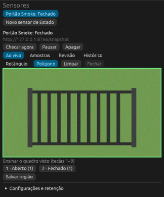
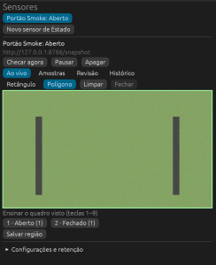
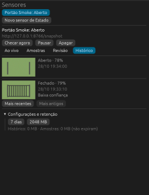
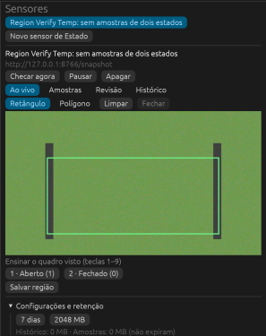
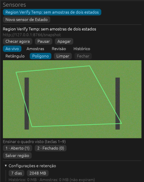
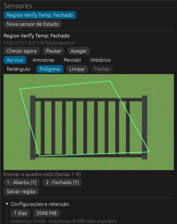
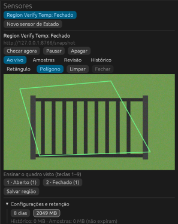
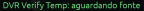
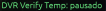

# Verificação dos sensores de Estado

## Compilação, testes e pacote

Os comandos abaixo terminaram com sucesso, sem warnings de Rust ou clippy.

- `cargo build --all-targets --release`.
- `cargo test`. Foram aprovados 94 testes.
- `cargo clippy --all-targets`.
- `tools/package/macos.sh`. O pacote inclui `intel-siam` e `intel-siam-vision` em `Contents/MacOS`.

O `otool -L` do executável de visão empacotado lista apenas bibliotecas de sistema e frameworks do macOS.
Não há dylib ONNX externa nesta build. O script copia as dylibs de `target/release`, se existirem.

`src/sensors/client_tests.rs` usa o processo de visão real para criar um sensor, conservar `wanted_feeds`
enquanto o filho reinicia e restaurar o foco em Amostras após reenviar `Desired`. O teste também fornece
uma URL RTSP local e observa `SourceDown`, em vez de `WaitingSource`, nas duas instâncias. Um segundo teste
usa um processo de protocolo com `Hello` versão 999 e observa `ExitReason::Incompatible` sem nova tentativa.

## Smoke na interface real

O app foi iniciado com `set -a; . ./.env; set +a; cargo run --release`.
O servidor de snapshots usou as imagens `open_*.png` e `closed_*.png` de `/tmp/smoke` na porta 8766.
As ações semânticas de acessibilidade do `orca computer` abriram o painel e criaram **Portão Smoke** com
fonte `http://127.0.0.1:8766/snapshot`. Os estados foram **Aberto** e **Fechado**.

Os botões de ensino gravaram uma amostra de cada situação. A interface passou de **sem amostras de dois
estados** para **Fechado**. Depois de alternar o servidor para a imagem aberta, o valor passou para
**Aberto** sem novo ensino. A aba Amostras mostrou as duas imagens e seus rótulos. A aba Histórico mostrou
as checagens e as respectivas miniaturas.
Ao terminar, **Apagar** e **Confirmar exclusão** removeram o sensor de smoke da lista. A interface voltou
a mostrar a lista vazia, sem deixar um sensor tentando acessar o servidor temporário.

As imagens abaixo são recortes das capturas reais do painel. A grade foi excluída do recorte para não
publicar novas imagens das câmeras do usuário.







## Complemento de verificação da interface

A rodada complementar usou o executável release existente, com `.env`, e o mesmo servidor HTTP.
Ela não repetiu a classificação, as abas e os testes automatizados já aprovados acima.
Não houve alteração de código nesta rodada.

### Entrada nativa do macOS

O guia retornado por `orca skills get computer-use --json` distingue entrega de entrada e efeito observado.
`synthetic_input` significa entrada enviada sem comprovação automática, não um erro do editor.
Para `window_not_focused`, o guia recomenda uma tentativa com `--restore-window` e depois foco nativo.
As coordenadas do Orca são locais à janela e precisam considerar `screenshot.scale`.

A janela iniciou em outro monitor, com posição `{-5996, 6}`. O arrasto pelo Orca não mudou a região.
AppleScript, selecionando o processo pelo PID, trouxe a janela para `{50, 60}`, com tamanho `{1400, 850}`.
Mesmo nessa posição, o arrasto pelo Orca não produziu o retângulo esperado.

O caminho alternativo usou eventos reais de mouse do CoreGraphics, publicados em `.cghidEventTap`.
O arrasto enviou `mouseMoved`, `leftMouseDown`, vinte eventos `leftMouseDragged` e `leftMouseUp`.
Os cliques do polígono enviaram `leftMouseDown` e `leftMouseUp`.
AppleScript com `System Events` enviou as teclas. Capturas e releitura do banco comprovaram os efeitos.
O driver Swift temporário foi removido ao final.

### Regiões e atalhos

O sensor temporário **Region Verify Temp** usou a fonte URL do smoke.
O arrasto de tela `{1080, 350}` até `{1370, 510}` produziu o retângulo verde dentro da prévia.
Após **Salvar região**, uma consulta somente leitura em `sensors.db` retornou a região persistida:

```json
{"Rect":{"min":[0.16397229,0.3248332],"max":[0.83371824,0.8519374]}}
```



No modo **Polígono**, os cliques de tela `{1050, 340}`, `{1280, 320}`, `{1380, 500}` e `{1100, 510}`
habilitaram **Fechar**. O botão fechou o contorno verde e voltou a ficar desabilitado.
Após **Salvar região**, a consulta retornou quatro vértices, sem substituir o polígono pelo quadro inteiro:

```json
{"Polygon":[[0.09468822,0.1539646],[0.62586606,0.07185014],[0.85681295,0.8108802],[0.21016166,0.8519374]]}
```



A tecla `1`, sem clicar no botão de ensino, mudou **Aberto (0)** para **Aberto (1)**.
Após alternar o servidor para a imagem fechada, a tecla `2` mudou **Fechado (0)** para **Fechado (1)**.
A captura registra uma amostra de cada estado e o valor **Fechado**.
As teclas de `3` a `9` não foram exercitadas, pois o sensor tinha dois estados.



### Retenção

A ação de acessibilidade `increment` no controle de dias não mudou o valor observado.
O duplo clique nativo abriu o editor numérico. `Cmd+A`, digitação e `Return` alteraram ambos os limites.
A interface mostrou **8 dias** e **2049 MB**. A tabela `setting` confirmou
`max_age.secs = 691200` e `max_bytes = 2148532224`.
Os limites foram aumentados para evitar expiração de dados durante a prova.



Os mesmos controles restauraram **7 dias** e **2048 MB**.
A consulta final confirmou `max_age.secs = 604800` e `max_bytes = 2147483648`.

### Selo no tile de DVR

Havia câmeras reais disponíveis na grade. O sensor temporário **DVR Verify Temp**, vinculado ao **Canal1**,
mostrou **DVR Verify Temp: aguardando fonte** sobre o tile correspondente.
Depois de **Pausar**, tanto o painel quanto o selo passaram para **DVR Verify Temp: pausado**.
As imagens abaixo contêm somente os rótulos, sem publicar o vídeo da câmera.





Essa prova cobre o selo e a atualização do status no tile, não a mudança de um valor classificado nesse tile.
A classificação com duas situações continua comprovada pelo smoke da fonte URL.
A correção de uma revisão pendente não foi exercitada nesta rodada.

### Limpeza e alcance

Os dois sensores temporários foram removidos pelos botões **Apagar** e **Confirmar exclusão**.
A lista voltou a ficar vazia. A consulta final retornou zero linhas em `sensor`, `sample` e `history`.
Nenhum sensor do usuário foi removido. A retenção original foi restaurada e os dois processos de smoke foram encerrados.
As capturas de regiões, atalhos e retenção foram recortadas para excluir a grade de câmeras.

Não foi encontrado defeito do aplicativo nos caminhos exercitados.
Build, testes e clippy não foram repetidos, pois esta rodada alterou somente o relatório e as evidências.
As aprovações da primeira seção pertencem à rodada anterior, não validam alterações concorrentes posteriores.

# Verificação dos sensores de Objetos

## Compilação e testes

`cargo build --all-targets --release`, `cargo test` (138 testes aprovados) e `cargo clippy --all-targets`
terminaram sem avisos. Os testes novos cobrem o parse da saída do D-FINE (sigmoide, centro/tamanho para cantos, NMS
por classe, forma errada recusada), os filtros (margem de contexto, base da caixa na região, tamanho mínimo,
classe), as trilhas (liga após `debounce`, só desliga após duas faltas e `clear_after`, contagem publicada,
recheck após uma falta), o rótulo próprio (acerta, filtra, mantém o objeto parado, pergunta, resgata caixa
incerta), e no engine o fluxo de ensinar, indexar, perguntar, responder e esquecer o rótulo.

## Smoke do processo de visão com modelo real

Um driver Python falou o protocolo real com `target/release/intel-siam-vision`, com dados em `/tmp`, e serviu por
HTTP o `driveway.jpg` da origem e o `cat.jpg` redimensionado para 640×421, o mesmo tamanho. Saída da última rodada:

```text
[   5.8s] D-FINE S file 41535197 bytes, sha256 cd8a49a945feda6d28c6304ae8ae85c2759ba1d78a5a83a22c5ce8db82ef7238 matches
[   8.6s] driveway counts {'person': 1, 'car': 4}
[  38.7s] cat counts {'cat': 1}
[  41.7s] teaching [7.288158e-05, 0.123342015, 0.16987748, 0.34896597] score 0.941 as Nosso carro on frame 33
[  45.1s] Sensor status=Live value=[person=1, car=4, cat=1, Nosso carro=1] taught=1 indexing=False review=1 found: car:0.94:Taught(label=4242, sim=0.992, how=Clear) car:0.93:Unsure(sim=0.862) person:0.84:Detector car:0.83:Detector car:0.65:Detector
[  48.2s] review item 6 {"Ask": {"label": 4242, "detected": "car", ...}}
[  49.6s] after the corrections car:0.94:Taught(label=4242, sim=0.992, how=Clear) car:0.93:Detector person:0.84:Filtered car:0.83:Detector car:0.65:Detector
[  79.6s] value without the person {'car': 4, 'Nosso carro': 1}
[  79.7s] history 7 [{"Filtered": "person"}]
[  79.7s] history 5 [{"On": {"Own": 4242}}]
[  79.7s] exit code 0
```

O D-FINE S foi baixado de verdade e conferido por SHA-256. A garagem deu 4 carros e 1 pessoa (o teste da origem
pede pelo menos 3 carros e 1 pessoa). Com o gato, carros e pessoa saíram depois de `clear_after` (30 s). O carro
ensinado como **Nosso carro** voltou com similaridade 0,992. O segundo carro ficou a 0,862 e virou a pergunta "É
Nosso carro?". A resposta "é outro carro" o deixou como carro comum. Um toque marcando a "pessoa" como **Não é
isso** a filtrou na checagem seguinte, e o histórico registrou cada evento. A primeira rodada achou o defeito do
ambiente ONNX duplicado, corrigido antes desta.

## Smoke na interface real: não feito

O app subiu com `.env` e o executável release, mas a janela não pôde ser observada nem operada. O
`orca computer get-app-state` falhou com `permission_denied` ("AX reads stayed blocked"), mesmo com as permissões de
acessibilidade e captura concedidas. O `screencapture` da janela saiu em branco, embora o `sample` do processo
mostrasse o laço do egui pintando texturas. A suspeita é a janela num Space que não está à mostra. Movê-la pediria
acessibilidade ou alterar o estado salvo da janela do usuário. Não há capturas da interface de Objetos nesta rodada.
O painel (criar com escolha de classes, prévia com caixas, ensinar tocando ou desenhando, revisão, histórico, selo
com contagem) compila e foi exercitado só pelo protocolo acima.

Nenhum sensor do usuário foi criado ou removido. O banco do usuário foi migrado para a versão 2 ao abrir o app,
sem sensores. Os dados do smoke ficaram só em `/tmp/smoke-objects`.

# Verificação de Pessoas nos sensores de Objetos

## Compilação e testes

`cargo build --all-targets --release` terminou sem erro, `cargo test` passou com 154 testes e
`cargo clippy --all-targets` terminou sem avisos, em 2026-10-28. Os testes novos cobrem a decisão
match/ask/unknown e a média dos rostos mais próximos (`faces.rs`), o filtro de qualidade com cortado, pequeno,
inseguro, virado e desfocado, o desconhecido só com rosto visto com clareza, o nome que precisa de duas checagens
ou de similaridade segura, o burst à procura de rosto (portado de `test_triggers.py`), as perguntas sobre rostos,
a pessoa nomeada num sensor e reconhecida e vista por outro (`engine_tests.rs`) e apagar a pessoa com os rostos,
embeddings e arquivos (`store.rs`).

## Smoke do processo de visão com modelos reais

`/tmp/smoke-people/driver.py` fala o protocolo 4 com `target/release/intel-siam-vision`, com um servidor de
snapshot HTTP em loopback que serve as fotos da origem. A de 2018 (480×640) foi reduzida para 450×600 e completada
com preto até 480×600, como as outras, para não cair em `GeometryChanged`. Saída (`run3.log`, sem as linhas de
progresso):

```text
[   0.0s] Hello {'Hello': {'protocol': 4}}
[   6.3s] faces off: models dir ['cd8a49a9…7238'] keys {'person': 1}
[  10.8s] YuNet 232589 bytes, sha256 8f2383e4…2fa4 matches
[  10.8s] SFace 38696353 bytes, sha256 0ba9fbfa…4e79 matches
[  10.8s] naming Williams on frame 16 box [0.0325, 0.1914, 0.9187, 0.9921]
[  12.0s] server now serves face_williams_2018.jpg
[  18.0s] 2018: person face=yes problem=None state={"Match": {"person": 5150, "sure": true, "kept": false}} sim=0.634 age=0 {'person': 1, 'Williams': 1}
[  18.0s] server now serves an empty 480x600 scene
[  26.0s] empty: {}
[  26.0s] server now serves face_wilmore.jpg
[  31.1s] wilmore: person face=yes problem=None state="Unknown" sim=0.016 unknown=2 age=0 {'person': 1, 'Pessoa desconhecida': 1}
[  31.1s] Williams off: True
[  31.1s] face files left []
[  31.1s] exit code 0
```

- Com rostos desligados, três checagens contaram a pessoa e a pasta de modelos só tinha o D-FINE S, copiado do
  smoke de Objetos. YuNet e SFace foram baixados só depois do `Configure` que ligou os rostos, com o SHA-256
  conferido acima.
- Williams foi nomeada no quadro de 2006 e reconhecida na foto de 2018 com similaridade 0,634 (o limiar de match do
  SFace é 0,5; o de "certo", 0,6). Wilmore teve 0,016 com Williams e virou "pessoa desconhecida" na segunda
  checagem.
- A cena vazia entre Williams e Wilmore é necessária: sem ela, a caixa de Wilmore ficava no mesmo lugar da de
  Williams e herdava `named`, e uma caixa que já teve nome nunca vira desconhecida (regra da origem). No primeiro
  smoke isso aconteceu: 87 checagens "Unknown" sem publicar a pessoa desconhecida.
- A aba Pessoas devolveu o rosto ensinado com o sensor de origem; `ForgetPerson` apagou a pessoa e o arquivo do
  rosto, e o processo terminou com código 0 ao fechar o stdin.

## Smoke na interface real: não feito

A tela do Mac estava bloqueada (`CGSSessionScreenIsLocked` = true no `ioreg`), e não tentei desbloquear. A chave
de rostos no sensor, a seção Pessoas (lista, renomear, apagar, mover e excluir rostos, onde e quando foi vista),
nomear tocando numa pessoa em Ensinar caixas, as perguntas "É <pessoa>?"/"Quem é?" na revisão e o selo com os nomes
compilam e foram exercitados só pelo protocolo acima. Nenhum sensor ou pessoa do usuário foi criado; os dados do
smoke ficaram só em `/tmp/smoke-people`.
