# Verificação dos sensores de Estado

## Compilação, testes e pacote

Os comandos abaixo terminaram com sucesso, sem warnings de Rust ou clippy.

- `cargo build --all-targets --release`.
- `cargo test`. Foram aprovados 94 testes.
- `cargo clippy --all-targets`.
- `tools/package/macos.sh`. O pacote inclui `intel-siam` e `intel-siam-vision` em `Contents/MacOS`.

O `otool -L` do executável de visão empacotado lista apenas bibliotecas de sistema e frameworks do macOS.
Não há dylib ONNX externa nesta build. O script copia as dylibs de `target/release`, se existirem.

`src/sensors/client_tests.rs` usa o processo de visão real para criar um sensor, conservar `wanted_feeds`
enquanto o filho reinicia e restaurar o foco em Amostras após reenviar `Desired`. O teste também fornece
uma URL RTSP local e observa `SourceDown`, em vez de `WaitingSource`, nas duas instâncias. Um segundo teste
usa um processo de protocolo com `Hello` versão 999 e observa `ExitReason::Incompatible` sem nova tentativa.

## Smoke na interface real

O app foi iniciado com `set -a; . ./.env; set +a; cargo run --release`.
O servidor de snapshots usou as imagens `open_*.png` e `closed_*.png` de `/tmp/smoke` na porta 8766.
As ações semânticas de acessibilidade do `orca computer` abriram o painel e criaram **Portão Smoke** com
fonte `http://127.0.0.1:8766/snapshot`. Os estados foram **Aberto** e **Fechado**.

Os botões de ensino gravaram uma amostra de cada situação. A interface passou de **sem amostras de dois
estados** para **Fechado**. Depois de alternar o servidor para a imagem aberta, o valor passou para
**Aberto** sem novo ensino. A aba Amostras mostrou as duas imagens e seus rótulos. A aba Histórico mostrou
as checagens e as respectivas miniaturas.
Ao terminar, **Apagar** e **Confirmar exclusão** removeram o sensor de smoke da lista. A interface voltou
a mostrar a lista vazia, sem deixar um sensor tentando acessar o servidor temporário.

As imagens abaixo são recortes das capturas reais do painel. A grade foi excluída do recorte para não
publicar novas imagens das câmeras do usuário.


## Complemento de verificação da interface

A rodada complementar usou o executável release existente, com `.env`, e o mesmo servidor HTTP.
Ela não repetiu a classificação, as abas e os testes automatizados já aprovados acima.
Não houve alteração de código nesta rodada.

### Entrada nativa do macOS

O guia retornado por `orca skills get computer-use --json` distingue entrega de entrada e efeito observado.
`synthetic_input` significa entrada enviada sem comprovação automática, não um erro do editor.
Para `window_not_focused`, o guia recomenda uma tentativa com `--restore-window` e depois foco nativo.
As coordenadas do Orca são locais à janela e precisam considerar `screenshot.scale`.

A janela iniciou em outro monitor, com posição `{-5996, 6}`. O arrasto pelo Orca não mudou a região.
AppleScript, selecionando o processo pelo PID, trouxe a janela para `{50, 60}`, com tamanho `{1400, 850}`.
Mesmo nessa posição, o arrasto pelo Orca não produziu o retângulo esperado.

O caminho alternativo usou eventos reais de mouse do CoreGraphics, publicados em `.cghidEventTap`.
O arrasto enviou `mouseMoved`, `leftMouseDown`, vinte eventos `leftMouseDragged` e `leftMouseUp`.
Os cliques do polígono enviaram `leftMouseDown` e `leftMouseUp`.
AppleScript com `System Events` enviou as teclas. Capturas e releitura do banco comprovaram os efeitos.
O driver Swift temporário foi removido ao final.

### Regiões e atalhos

O sensor temporário **Region Verify Temp** usou a fonte URL do smoke.
O arrasto de tela `{1080, 350}` até `{1370, 510}` produziu o retângulo verde dentro da prévia.
Após **Salvar região**, uma consulta somente leitura em `sensors.db` retornou a região persistida:

```json
{"Rect":{"min":[0.16397229,0.3248332],"max":[0.83371824,0.8519374]}}
```


No modo **Polígono**, os cliques de tela `{1050, 340}`, `{1280, 320}`, `{1380, 500}` e `{1100, 510}`
habilitaram **Fechar**. O botão fechou o contorno verde e voltou a ficar desabilitado.
Após **Salvar região**, a consulta retornou quatro vértices, sem substituir o polígono pelo quadro inteiro:

```json
{"Polygon":[[0.09468822,0.1539646],[0.62586606,0.07185014],[0.85681295,0.8108802],[0.21016166,0.8519374]]}
```


A tecla `1`, sem clicar no botão de ensino, mudou **Aberto (0)** para **Aberto (1)**.
Após alternar o servidor para a imagem fechada, a tecla `2` mudou **Fechado (0)** para **Fechado (1)**.
A captura registra uma amostra de cada estado e o valor **Fechado**.
As teclas de `3` a `9` não foram exercitadas, pois o sensor tinha dois estados.


### Retenção

A ação de acessibilidade `increment` no controle de dias não mudou o valor observado.
O duplo clique nativo abriu o editor numérico. `Cmd+A`, digitação e `Return` alteraram ambos os limites.
A interface mostrou **8 dias** e **2049 MB**. A tabela `setting` confirmou
`max_age.secs = 691200` e `max_bytes = 2148532224`.
Os limites foram aumentados para evitar expiração de dados durante a prova.


Os mesmos controles restauraram **7 dias** e **2048 MB**.
A consulta final confirmou `max_age.secs = 604800` e `max_bytes = 2147483648`.

### Selo no tile de DVR

Havia câmeras reais disponíveis na grade. O sensor temporário **DVR Verify Temp**, vinculado ao **Canal1**,
mostrou **DVR Verify Temp: aguardando fonte** sobre o tile correspondente.
Depois de **Pausar**, tanto o painel quanto o selo passaram para **DVR Verify Temp: pausado**.
As imagens abaixo contêm somente os rótulos, sem publicar o vídeo da câmera.


Essa prova cobre o selo e a atualização do status no tile, não a mudança de um valor classificado nesse tile.
A classificação com duas situações continua comprovada pelo smoke da fonte URL.
A correção de uma revisão pendente não foi exercitada nesta rodada.

### Limpeza e alcance

Os dois sensores temporários foram removidos pelos botões **Apagar** e **Confirmar exclusão**.
A lista voltou a ficar vazia. A consulta final retornou zero linhas em `sensor`, `sample` e `history`.
Nenhum sensor do usuário foi removido. A retenção original foi restaurada e os dois processos de smoke foram encerrados.
As capturas de regiões, atalhos e retenção foram recortadas para excluir a grade de câmeras.

Não foi encontrado defeito do aplicativo nos caminhos exercitados.
Build, testes e clippy não foram repetidos, pois esta rodada alterou somente o relatório e as evidências.
As aprovações da primeira seção pertencem à rodada anterior, não validam alterações concorrentes posteriores.

# Verificação dos sensores de Objetos

## Compilação e testes

`cargo build --all-targets --release`, `cargo test` (138 testes aprovados) e `cargo clippy --all-targets`
terminaram sem avisos. Os testes novos cobrem o parse da saída do D-FINE (sigmoide, centro/tamanho para cantos, NMS
por classe, forma errada recusada), os filtros (margem de contexto, base da caixa na região, tamanho mínimo,
classe), as trilhas (liga após `debounce`, só desliga após duas faltas e `clear_after`, contagem publicada,
recheck após uma falta), o rótulo próprio (acerta, filtra, mantém o objeto parado, pergunta, resgata caixa
incerta), e no engine o fluxo de ensinar, indexar, perguntar, responder e esquecer o rótulo.

## Smoke do processo de visão com modelo real

Um driver Python falou o protocolo real com `target/release/intel-siam-vision`, com dados em `/tmp`, e serviu por
HTTP o `driveway.jpg` da origem e o `cat.jpg` redimensionado para 640×421, o mesmo tamanho. Saída da última rodada:

```text
[   5.8s] D-FINE S file 41535197 bytes, sha256 cd8a49a945feda6d28c6304ae8ae85c2759ba1d78a5a83a22c5ce8db82ef7238 matches
[   8.6s] driveway counts {'person': 1, 'car': 4}
[  38.7s] cat counts {'cat': 1}
[  41.7s] teaching [7.288158e-05, 0.123342015, 0.16987748, 0.34896597] score 0.941 as Nosso carro on frame 33
[  45.1s] Sensor status=Live value=[person=1, car=4, cat=1, Nosso carro=1] taught=1 indexing=False review=1 found: car:0.94:Taught(label=4242, sim=0.992, how=Clear) car:0.93:Unsure(sim=0.862) person:0.84:Detector car:0.83:Detector car:0.65:Detector
[  48.2s] review item 6 {"Ask": {"label": 4242, "detected": "car", ...}}
[  49.6s] after the corrections car:0.94:Taught(label=4242, sim=0.992, how=Clear) car:0.93:Detector person:0.84:Filtered car:0.83:Detector car:0.65:Detector
[  79.6s] value without the person {'car': 4, 'Nosso carro': 1}
[  79.7s] history 7 [{"Filtered": "person"}]
[  79.7s] history 5 [{"On": {"Own": 4242}}]
[  79.7s] exit code 0
```

O D-FINE S foi baixado de verdade e conferido por SHA-256. A garagem deu 4 carros e 1 pessoa (o teste da origem
pede pelo menos 3 carros e 1 pessoa). Com o gato, carros e pessoa saíram depois de `clear_after` (30 s). O carro
ensinado como **Nosso carro** voltou com similaridade 0,992. O segundo carro ficou a 0,862 e virou a pergunta "É
Nosso carro?". A resposta "é outro carro" o deixou como carro comum. Um toque marcando a "pessoa" como **Não é
isso** a filtrou na checagem seguinte, e o histórico registrou cada evento. A primeira rodada achou o defeito do
ambiente ONNX duplicado, corrigido antes desta.

## Smoke na interface real

Feito em 2026-10-29, na seção [Smoke na interface real de Objetos, Pessoas e Leitura](#smoke-na-interface-real-de-objetos-pessoas-e-leitura).
As tentativas de 2026-10-28 pararam porque a tela do Mac estava travada (`CGSSessionScreenIsLocked = 1`).
Com a tela travada, o AX e a captura da janela não respondiam.

# Verificação de Pessoas nos sensores de Objetos

## Compilação e testes

`cargo build --all-targets --release` terminou sem erro, `cargo test` passou com 154 testes e
`cargo clippy --all-targets` terminou sem avisos, em 2026-10-28. Os testes novos cobrem a decisão
match/ask/unknown e a média dos rostos mais próximos (`faces.rs`), o filtro de qualidade com cortado, pequeno,
inseguro, virado e desfocado, o desconhecido só com rosto visto com clareza, o nome que precisa de duas checagens
ou de similaridade segura, o burst à procura de rosto (portado de `test_triggers.py`), as perguntas sobre rostos,
a pessoa nomeada num sensor e reconhecida e vista por outro (`engine_tests.rs`) e apagar a pessoa com os rostos,
embeddings e arquivos (`store.rs`).

## Smoke do processo de visão com modelos reais

`/tmp/smoke-people/driver.py` fala o protocolo 4 com `target/release/intel-siam-vision`, com um servidor de
snapshot HTTP em loopback que serve as fotos da origem. A de 2018 (480×640) foi reduzida para 450×600 e completada
com preto até 480×600, como as outras, para não cair em `GeometryChanged`. Saída (`run3.log`, sem as linhas de
progresso):

```text
[   0.0s] Hello {'Hello': {'protocol': 4}}
[   6.3s] faces off: models dir ['cd8a49a9…7238'] keys {'person': 1}
[  10.8s] YuNet 232589 bytes, sha256 8f2383e4…2fa4 matches
[  10.8s] SFace 38696353 bytes, sha256 0ba9fbfa…4e79 matches
[  10.8s] naming Williams on frame 16 box [0.0325, 0.1914, 0.9187, 0.9921]
[  12.0s] server now serves face_williams_2018.jpg
[  18.0s] 2018: person face=yes problem=None state={"Match": {"person": 5150, "sure": true, "kept": false}} sim=0.634 age=0 {'person': 1, 'Williams': 1}
[  18.0s] server now serves an empty 480x600 scene
[  26.0s] empty: {}
[  26.0s] server now serves face_wilmore.jpg
[  31.1s] wilmore: person face=yes problem=None state="Unknown" sim=0.016 unknown=2 age=0 {'person': 1, 'Pessoa desconhecida': 1}
[  31.1s] Williams off: True
[  31.1s] face files left []
[  31.1s] exit code 0
```

- Com rostos desligados, três checagens contaram a pessoa e a pasta de modelos só tinha o D-FINE S, copiado do
  smoke de Objetos. YuNet e SFace foram baixados só depois do `Configure` que ligou os rostos, com o SHA-256
  conferido acima.
- Williams foi nomeada no quadro de 2006 e reconhecida na foto de 2018 com similaridade 0,634 (o limiar de match do
  SFace é 0,5; o de "certo", 0,6). Wilmore teve 0,016 com Williams e virou "pessoa desconhecida" na segunda
  checagem.
- A cena vazia entre Williams e Wilmore é necessária: sem ela, a caixa de Wilmore ficava no mesmo lugar da de
  Williams e herdava `named`, e uma caixa que já teve nome nunca vira desconhecida (regra da origem). No primeiro
  smoke isso aconteceu: 87 checagens "Unknown" sem publicar a pessoa desconhecida.
- A aba Pessoas devolveu o rosto ensinado com o sensor de origem; `ForgetPerson` apagou a pessoa e o arquivo do
  rosto, e o processo terminou com código 0 ao fechar o stdin.

## Smoke na interface real

Feito em 2026-10-29, na seção [Smoke na interface real de Objetos, Pessoas e Leitura](#smoke-na-interface-real-de-objetos-pessoas-e-leitura).
A tentativa de 2026-10-28 parou porque a tela do Mac estava bloqueada.

# Verificação dos sensores de Leitura

## Compilação e testes

`cargo build --all-targets --release`, `cargo test` (183 testes aprovados) e `cargo clippy --all-targets` terminaram
sem avisos, em 2026-10-28. Os testes novos portam `test_reading.py` (parse, plausibilidade, contagem de dígitos,
assentando, valor digitado, parcela aceita, vazão, decodificação CTC, posições das rodas, decodificador de rodas com
leitura consistente, confiança da roda mais fraca, linha do contador sem divisórias, canal mais escuro, segmentos em
imagem lisa e grande) e `test_change_limit.py` inteiro (limite no tempo, aprendizado com o segundo dia mais
movimentado, só o tempo não visto conta, subida na janela, `accept`, `hold`, a leitura errada da issue #40). No
engine: um contador que desce, pula, lê dígitos a menos ou inseguro é rejeitado, um passo abaixo é "assentando", a
mesma rejeição espera na revisão uma vez só; o valor sobrevive a um reinício; confirmar ou digitar na revisão vira o
último valor, e dígitos a menos nunca viram valor.

## Smoke do processo de visão com modelos reais

`/tmp/smoke-reading/driver.py` fala o protocolo 5 com `target/release/intel-siam-vision` e serve por HTTP em
loopback o `lcd.png`, o `counter_red.jpg` e o `counter_turning.jpg` da origem, um timer LED "2:38" e uma sequência de
LCDs desenhados pelo `tests/displays.py` da origem (mesmo tamanho do `lcd.png`). Os modelos foram baixados nesta
máquina numa primeira rodada; a segunda rodada (`run2.log`) conferiu os SHA-256 e leu:

```text
[   0.0s] Hello {'Hello': {'protocol': 5}}
[   0.1s] LCD automático       published=123456.7 read='0123456.7' score=0.951 outcome="Accepted"
[   0.1s] LCD segmentos        published=123456.7 read='0123456.7' score=0.994 outcome="Accepted"
[   0.1s] Rodas v2 vermelho    published=632.289 read='0632289' score=1.000 outcome="Accepted"
[   0.1s] Rodas v2 girando     published=632.590 read='0632590' score=1.000 outcome="Accepted"
[   0.1s] Rodas v1 vermelho    published=632.289 read='0632289' score=0.988 outcome="Accepted"
[   0.1s] Rodas v1 girando     published=632.590 read='0632590' score=0.992 outcome="Accepted"
[   0.1s] Rodas por OCR        published=632.289 read='0632289' score=0.967 outcome="Accepted"
[   0.1s] Lavadora             published=158 read='2:38' score=0.945 outcome="Accepted"
[   0.1s] ppocrv6-tiny 4462639 bytes, sha256 9ef676d6ed3c88256a2d92c640c44f25b0c40947e111b14b8be8f594091563e6 matches
[   0.2s] wheels-v1 2264691 bytes, sha256 37912f885b061a7b12298872fbdfa1b73ca0664363b293a55617b1d3680a98ac matches
[   0.2s] wheels-v2 6102872 bytes, sha256 5644705e1f0e684b30bf3c7a6cb23e7eb1ddda616cd16b5321423f45bf7fd8b6 matches
[   0.2s] seen image 8 size [472, 96] preview 1
[   0.2s] seq_accept.png   published=123456.7 read='0123456.7' score=0.994 outcome="Accepted"
[   6.2s] seq_settle.png   published=123456.7 read='0123456.6' score=0.996 outcome="Settling"
[  12.2s] seq_down.png     published=123456.7 read='0123450.0' score=0.999 outcome={"Rejected": "WentDown"}
[  18.3s] seq_jump.png     published=123456.7 read='0123999.9' score=0.991 outcome={"Rejected": "ChangedTooMuch"}
[  24.3s] seq_next.png     published=123456.8 read='0123456.8' score=0.980 outcome="Accepted"
[  30.3s] review 11 {"Rejected": "ChangedTooMuch"} read 0123999.9 {"Rejected": "ChangedTooMuch"}
[  30.3s] review 10 {"Rejected": "WentDown"} read 0123450.0 {"Rejected": "WentDown"}
[  30.3s] quality {"days": 1, "reads": 5, "accepted": 3, "rejected": [["WentDown", 1], ["ChangedTooMuch", 1]]} accepted share 60.0 limit 1.0
[  30.4s] exit code 0
```

- O `lcd.png` saiu `0123456.7` nos visores automático e LCD, como o teste de CI da origem.
- `counter_red.jpg` deu `0632289` e `counter_turning.jpg` deu `0632590` nos leitores de rodas v1 e v2, os valores do
  `test_wheel_reader_reads_a_real_meter`; no segundo, a penúltima roda está entre 8 e 9 com a última em 0, e o
  leitor a leu certa. Lido como texto (OCR), o vermelho também deu `0632289`.
- A sequência (limite "passo" de 1,0 kWh) aceitou 123456.7, tratou 123456.6 como assentando sem mudar o valor,
  rejeitou a descida e o salto, que foram para a revisão e para o histórico, e aceitou 123456.8.
- A aba Ao vivo recebeu a imagem "o que o leitor viu" (as sete células lado a lado, 472×96). O processo terminou com
  código 0 ao fechar o stdin; todos os sensores do smoke foram apagados antes.

Na primeira rodada o driver esperava a leitura de cada sensor só nas mensagens seguintes e perdia as que já tinham
chegado; foi corrigido para olhar também o último estado recebido. Os modelos e o processo não mudaram entre as
rodadas.

## Smoke na interface real

Feito em 2026-10-29, na seção [Smoke na interface real de Objetos, Pessoas e Leitura](#smoke-na-interface-real-de-objetos-pessoas-e-leitura).
A tentativa de 2026-10-28 parou porque a tela do Mac estava bloqueada.

# Smoke na interface real de Objetos, Pessoas e Leitura

## Método

Em 2026-10-29, com a tela desbloqueada, o app subiu com `set -a; . ./.env; set +a; cargo run --release` no HEAD
`4c78524`. O build release já estava atualizado. Um servidor HTTP em loopback (`/tmp/smoke-ui/serve.py`, porta 8777)
serviu quatro fontes, `/objects`, `/people`, `/reading` e `/wheels`. Cada fonte servia o arquivo nomeado em
`current-<fonte>`. As imagens vieram de `/tmp/smoke-objects`, `/tmp/smoke-people` e `/tmp/smoke-reading`. Cada
fonte alternou apenas entre imagens do mesmo tamanho.

As ações semânticas do `orca computer` funcionaram para botões, abas, caixas de seleção, rádios e campos de texto.
Cada efeito foi confirmado por uma nova leitura da árvore AX ou por uma captura. Três controles exigiram entrada
nativa:

- O `AXPress` não abriu os `ComboBox`. Um clique do CoreGraphics abriu a lista, e outro clique escolheu o item.
- A ação `increment` não alterou o valor dos `DragValue`. Um clique nativo abriu a edição. Em seguida, `Cmd+A`, o
  número e `Return` foram enviados pelo `System Events`.
- Os toques e arrastos na prévia usaram `/tmp/smoke-ui/mouse`. Esse driver, derivado do driver de Estados, publica
  eventos em `.cghidEventTap` e também envia rolagem.

O painel de Sensores rola sozinho entre ações. Antes de cada toque, a rolagem voltou ao topo e uma captura da janela
indicou as coordenadas.

As capturas foram feitas com `screencapture -l <janela>` e recortadas a partir da borda do painel. O recorte excluiu
a grade de câmeras. Os selos dos tiles foram recortados apenas no rótulo.

## Objetos

O sensor **Garagem Smoke** foi criado com tipo Objetos, fonte `/objects` com `driveway.jpg` e as classes Pessoa e
Carro. O D-FINE S baixou e o sensor publicou **Pessoa 1 · Carro 4**.

Em **Ensinar caixas**, o toque no carro vermelho selecionou a caixa, que ficou com contorno branco. O painel
mostrou **Caixa achada como carro. Ela é:**. Depois de digitar **Nosso carro**, o botão **Criar (carro)** criou o
rótulo e ensinou a caixa. O valor passou a **Pessoa 1 · Carro 4 · Nosso carro 1**. O carro ao lado ficou amarelo,
com **Nosso carro? 93%**.

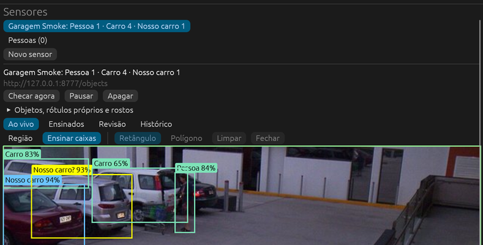

Um arrasto em volta do carro escuro sem caixa, à direita do carrinho, desenhou a caixa branca. O painel mostrou
**Caixa desenhada. Ela é:**. Depois de **Carro**, o contador passou a **2 caixas ensinadas**.

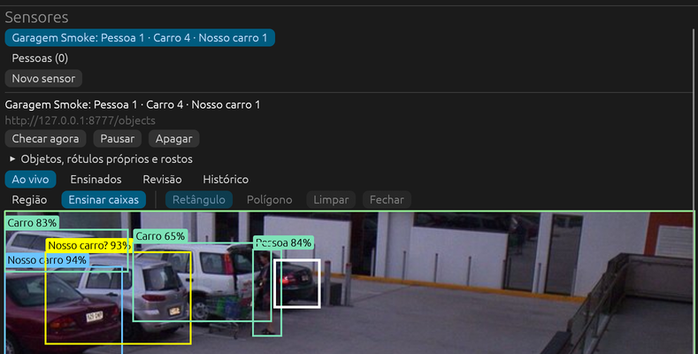

A aba Revisão mostrou **É Nosso carro? (86% parecido)**, com **Sim**, **Não, é outro carro** e **Descartar**.

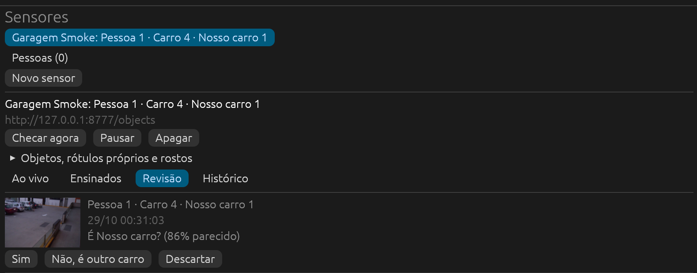

A resposta **Não, é outro carro** esvaziou a revisão. Depois de **Checar agora**, a caixa amarela voltou como
**Carro 93%**.

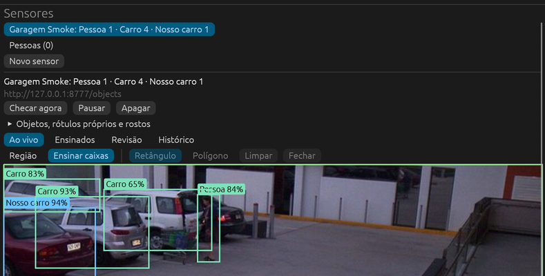

A aba Ensinados listou as três caixas: a desenhada, a resposta da revisão, ambas como Carro, e o Nosso carro. A aba
Histórico registrou **Pessoa chegou, Carro chegou**, **Nosso carro chegou** e a checagem que fez a pergunta.

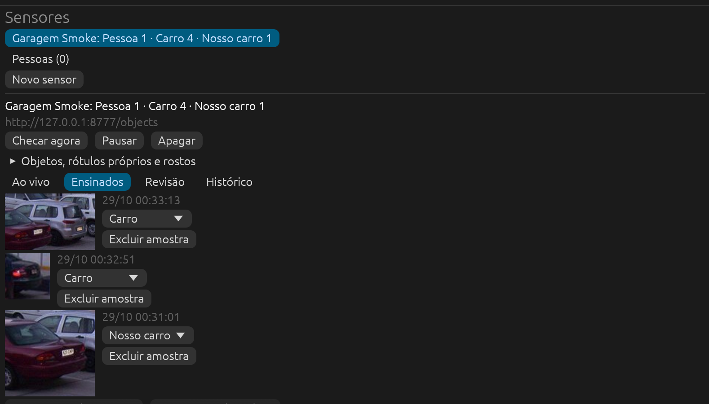

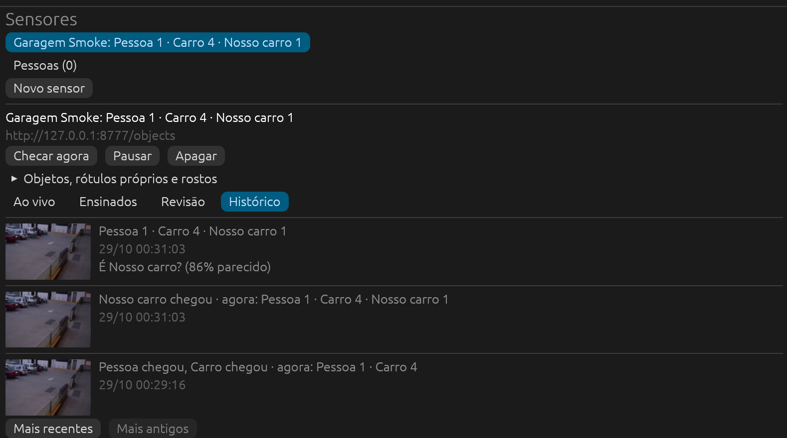

O valor **Carro 4 · Nosso carro 1** conta o carro rotulado também como carro. Esse é o comportamento esperado
pelo teste `tracks_skip_filtered_boxes_count_own_labels_and_forget_deselected_keys` em `logic.rs`.

## Pessoas

O sensor **Rostos Smoke** foi criado em `/people`, apenas com a classe Pessoa. A opção **Reconhecer pessoas pelo
rosto**, em **Objetos, rótulos próprios e rostos**, baixou YuNet e SFace. Ambos passaram a **pronto**. Com
`face_williams_2006.jpg`, o toque na caixa da pessoa mostrou **O rosto desta pessoa é:**. O nome **Williams** e
**Criar pessoa** mudaram o valor para **Pessoa 1 · Williams 1**. A caixa passou a laranja, com o nome.

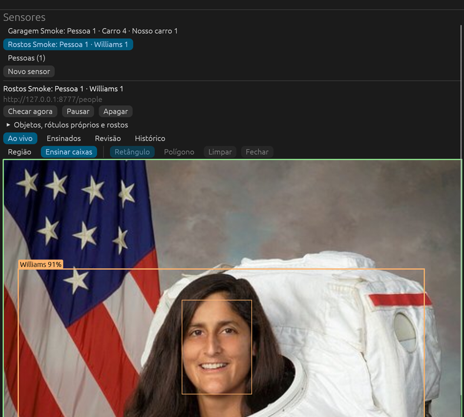

O servidor passou a servir a cena vazia, e o valor mudou para **nenhum objeto**. Depois, com
`face_williams_2018.jpg` ajustado a 480×600, o sensor reconheceu **Williams 95%** sem novo ensino.

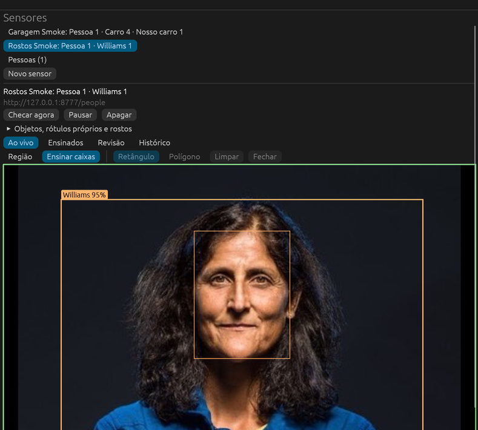

Com a cena vazia entre as fotos, `face_wilmore.jpg` resultou em **Pessoa 1 · Pessoa desconhecida 1**.

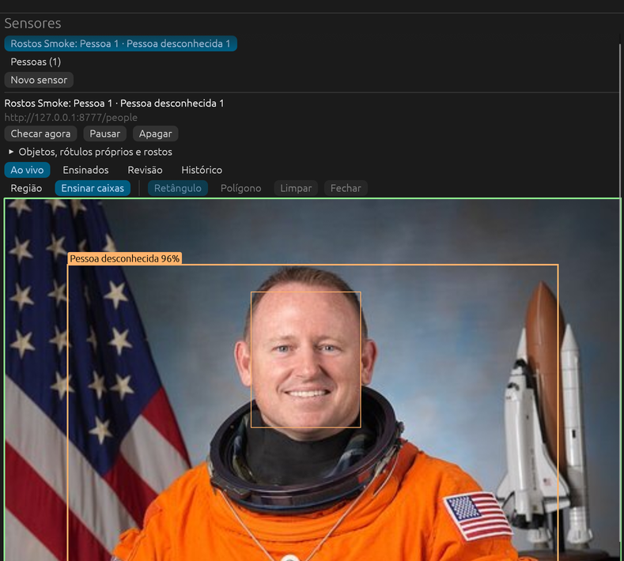

A seção **Pessoas (1)** mostrou o nome editável e **1 rostos ensinados · Vista por último em Rostos Smoke (29/10
00:37:03)**. Ela também mostrou a miniatura do rosto, o sensor de origem, **Mover**, **Excluir** e **Apagar
pessoa**. **Apagar pessoa** pediu **Apagar Williams e os 1 rostos ensinados?**. **Confirmar** deixou **Pessoas
(0)**. A consulta somente leitura retornou zero linhas em `person`, `face` e `face_embedding`, sem arquivos de
rosto em `img/`.

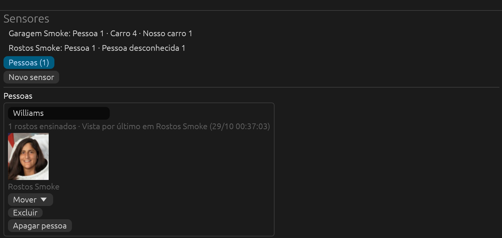

## Leitura

O sensor **Medidor LCD Smoke** foi criado com tipo Leitura em `/reading`, com `lcd.png`. O stream padrão foi Main.
A configuração usou modo Contador, visor **LCD (dígitos escuros no claro)**, **1 casas decimais** e unidade
**kWh**. A região padrão foi a imagem inteira. Depois que o PP-OCRv6 tiny baixou, o sensor publicou
**123456.7 kWh**. O painel mostrou a imagem **O que o leitor viu**, **Última leitura: «0123456.7» · 99% · aceita**
e o limite aprendido. Em **Qualidade**, apareceu **Hoje: 1 leituras · 100% aceitas**.

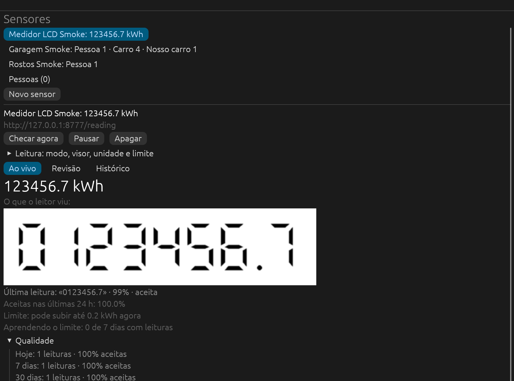

O servidor passou a `seq_down.png`, com 813×200 e `0123450.0`. **Checar agora** produziu **rejeitada: o
contador desceu**, e o valor ficou em 123456.7 kWh. O painel mostrou **1 leituras rejeitadas na revisão**. A
qualidade mudou para **50% aceitas · rejeitadas: o contador desceu 1**.

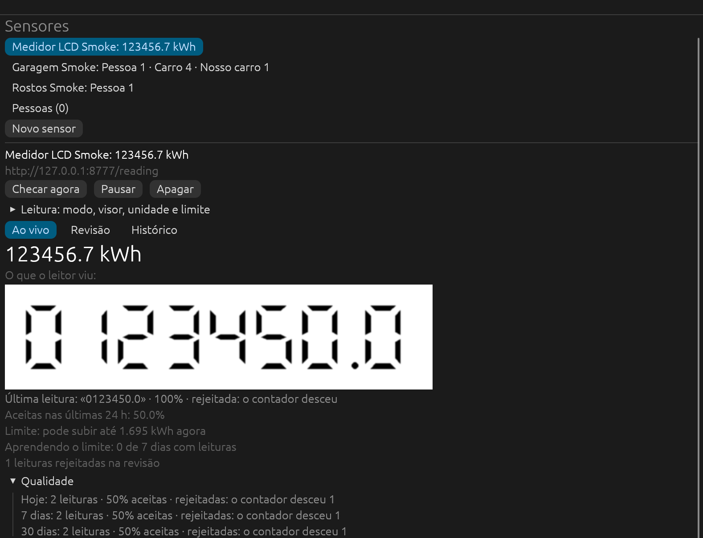

Na Revisão, a linha ofereceu **Leitura certa (123450.0 kWh)**, um campo e **Corrigir**. O texto **123456.8**
digitado e **Corrigir** esvaziaram a revisão e mudaram o valor para **123456.8 kWh**. Em seguida, o servidor
passou a `seq_next.png`, com `0123456.8`. **Checar agora** não criou nova linha no Histórico, e o valor ficou em
123456.8 kWh.

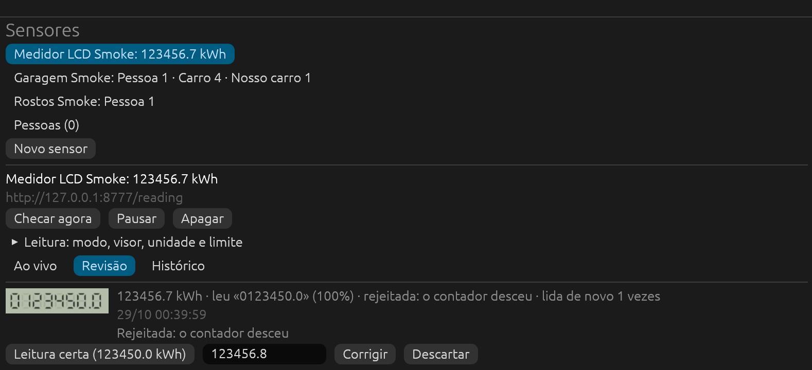

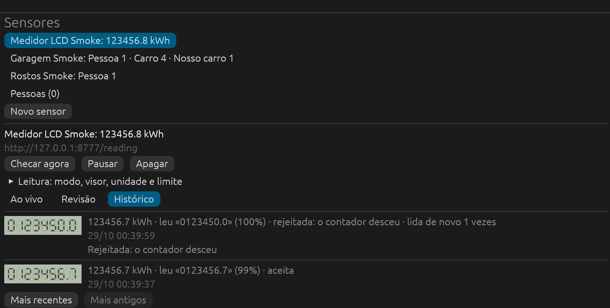

O sensor **Hidrômetro Smoke** foi criado em `/wheels`, com `counter_red.jpg`. A configuração usou **Contador de
rodas**, **7 rodas**, **Leitor de rodas v2**, **3 casas decimais** e unidade **m³**. O sensor baixou o leitor v2
e publicou **632.289 m³**. A tela mostrou **«0632289» · 100% · aceita** e as sete células vistas pelo leitor.

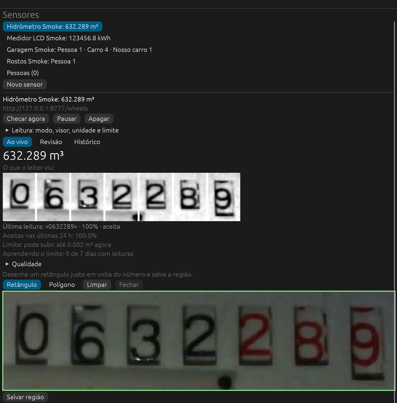

## Selos nos tiles

Um sensor de fonte URL não tem tile. Por isso, o selo foi testado com dois sensores temporários no **Canal1**:

- **Selo Smoke** era um sensor de Objetos com a classe Pessoa.
- **Selo Leitura** era um sensor de Leitura em modo Valor, com stream Main e unidade **ano**. Sua região foi
  desenhada em volta do ano no carimbo de data do DVR.

O primeiro selo mostrou **nenhum objeto**. A primeira checagem do segundo, ainda com a imagem inteira, rejeitou a
leitura como **nada lido**. Depois de **Salvar região**, **Checar agora** leu **«2026» · 100% · aceita**. As
imagens contêm só os rótulos.

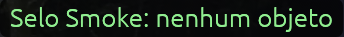

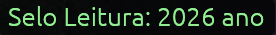

## Limpeza

**Apagar** e **Confirmar exclusão** removeram os seis sensores criados. **Apagar pessoa** já tinha removido
Williams. A consulta final somente leitura em `sensors.db`, com `user_version` 4, retornou zero linhas em todas
as tabelas, exceto `setting`. Essa tabela manteve a retenção padrão de 7 dias e 2048 MB. As pastas de `img/`
ficaram vazias.

O smoke baixou cinco modelos: D-FINE S, YuNet, SFace, PP-OCRv6 tiny e leitor de rodas v2. Eles foram apagados de
`models/`, que voltou a ter apenas o DINOv2, como antes do smoke.

Durante a rodada, a janela mudou de 1400×850 em `{50, 60}` para 1728×1084 em `{0, 33}`. A causa não foi
identificada. O `System Events` restaurou a posição e o tamanho. O divisor do painel voltou a cerca de um terço
da largura. O app foi fechado com `Cmd+Q` e terminou com código 0. O servidor HTTP também foi encerrado.

## Achados

Nenhum defeito do app apareceu nos caminhos exercitados, e o código não mudou. Por isso, `cargo test` e `cargo
clippy` não foram repetidos. Dois comportamentos parecem estranhos, mas seguem o código:

- Depois de respondida, a linha da pergunta continua no Histórico com **É Nosso carro?**. Pelo código de
  `Engine::resolve`, o `mark_resolved` tira a linha só da Revisão; a razão da revisão fica gravada.
- A correção digitada em uma leitura muda o valor, mas não cria uma linha nova no Histórico. A linha rejeitada
  continua com **lida de novo 1 vezes**.

Os itens abaixo não foram exercitados pela interface nesta rodada. Os casos com cobertura pelo protocolo seguem
cobertos por ele.

- As perguntas de rosto **É <pessoa>?** e **Quem é?** não foram exercitadas, porque **Perguntar quem é** ficou
  desligado.
- Na seção Pessoas, não foram exercitados renomear, **Mover** e **Excluir**.
- Em Objetos, não foram exercitados **Não é isso**, a região em polígono e o selo com contagem acima de zero.
  Nenhuma pessoa estava no Canal1.
- Na Leitura, não foram exercitados **Leitura certa**, **Descartar**, o estado de assentando, o salto acima do
  limite, a vazão, os visores LED e Automático, o leitor de rodas v1, **Texto (OCR)**, `counter_turning.jpg` e a
  troca do leitor de números nas configurações.
